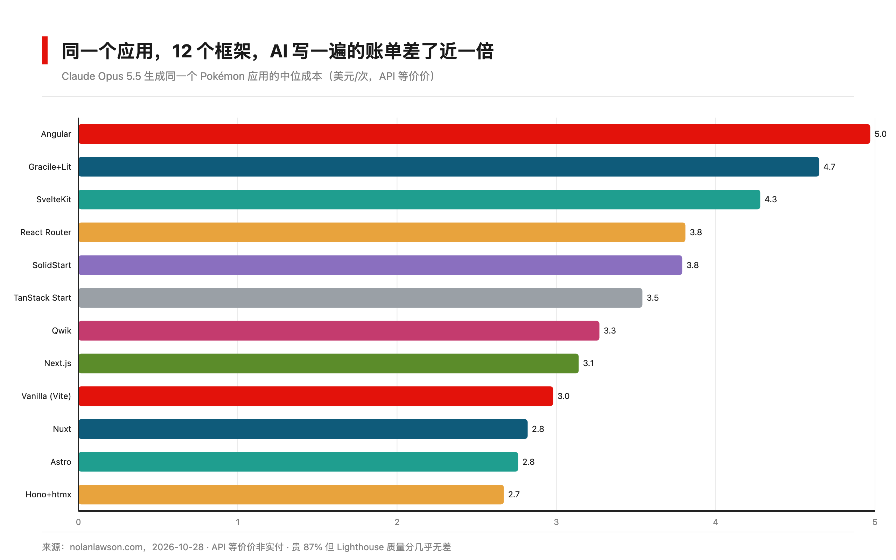
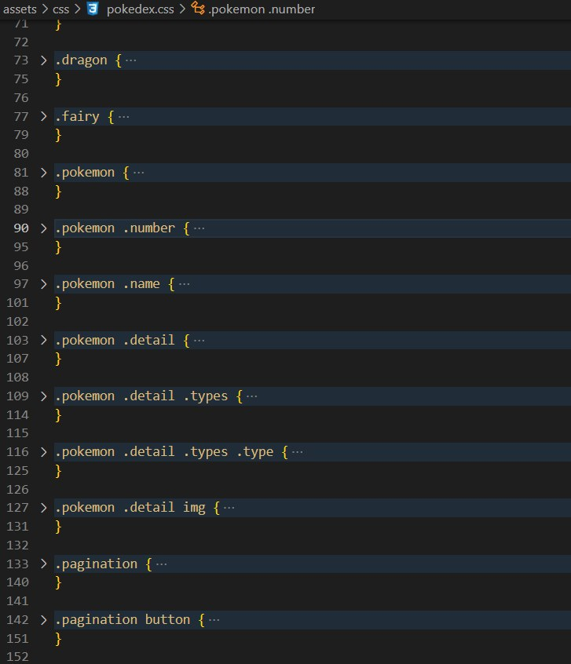

写代码这件事，最贵的不是写不出来，是不知道账单从哪来。

上周（10 月 28 号）微软的 Nolan Lawson 发了一个 benchmark，思路简单粗暴：同一个 Pokémon 图鉴应用，让 Claude Opus 5.5 分别用 12 个 JavaScript 框架写一遍。每个框架跑 5 次取中位数，Angular 只算 3 次，因为另外两次它写出来的应用根本跑不起来。

结果挺有意思。最便宜的 Hono+htmx，一次 2.67 美元。最贵的 Angular，4.97 美元。同一个模型，同一个需求，差了 1.86 倍。

钱花在哪了？拆开看更扎心。

Hono+htmx 写出 1370 行代码就完事，Angular 写了 2009 行。前者烧了 426 万 token、8.6 分钟，后者 976 万 token、17.2 分钟。行数多不是能力强，是每个抽象层都要 AI 多读多写多理解。你多付的钱，买的不是更好的应用，是框架的复杂度。

更冤的是 SvelteKit。5 次运行，5 次都把 v3 迁移指南完整读进了上下文。那份文档是写给从 v2 升级的人类工程师看的，跟这个从零开始的项目八竿子打不着。但它就在那，agent 就读了，一次没落下。

有意思的是质量这个维度。Lighthouse 跑下来，12 个框架的性能和无障碍分数几乎全部饱和，多数是满分。账单差了一倍，质量没差出一分。这可能是整个实验最反直觉的地方。

还有个细节，做 MCP 的朋友可以留意。Lawson 给每个框架都配了官方 MCP 或 skill，结果 Nuxt 的 MCP 服务器 5 次运行一次都没被用上，Next.js 的 skill 只被读过 1 次。他自己在文里猜，现在的 MCP 和 skill 说不定弊大于利。当然他也老实标注了，这个实验没打算验证这件事。

裸写反而不省。不套任何框架的 Vanilla Vite 花了 2.98 美元，比 3 个框架都贵。有些结构确实在帮 agent 少走弯路，只是结构太重的，帮着帮着就开始帮倒忙。

照例说下这个实验的边界，Lawson 自己也交代了：这是个偏内容展示的小应用，他自己说"更像 Wikipedia，不是 Figma"；LLM 输出随机性大，中位数也只能压住一部分波动；Lighthouse 天然偏爱多页应用。换个重交互的应用重跑，榜单可能洗牌。benchmark 开了源，不服可以自己 fork 一份跑。

我自己拿 Claude Code 写东西，每次会话结束看 token 账单的时候，确实在想一件事：以前选框架看的是人写得爽不爽，现在得看模型读着顺不顺。人类工程师三分钟看懂的东西，agent 可能要烧掉几百万 token 去试。

选型的账本，正在从「开发体验」往「生成成本」那边挪。挪多快我不确定，但方向大概率不会回来了。

你们团队的框架，是按什么选的？
