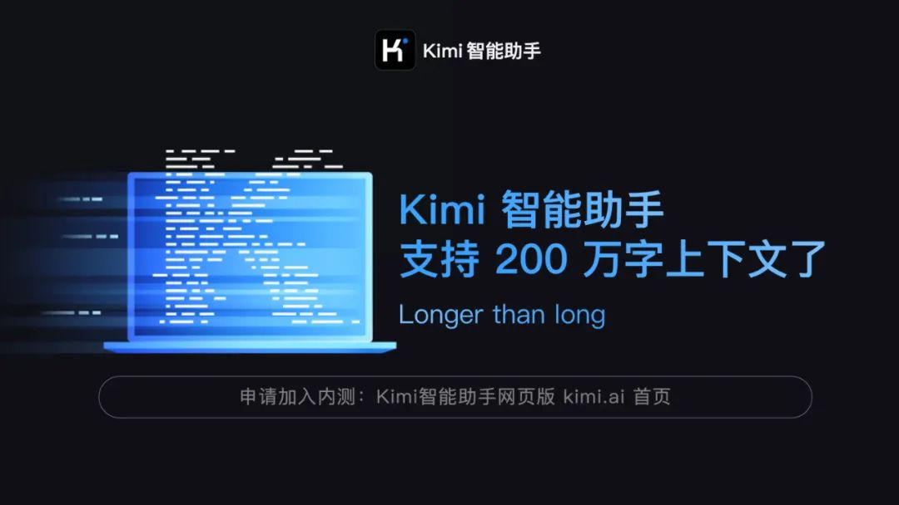
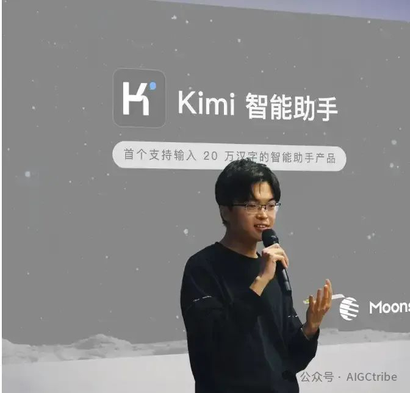
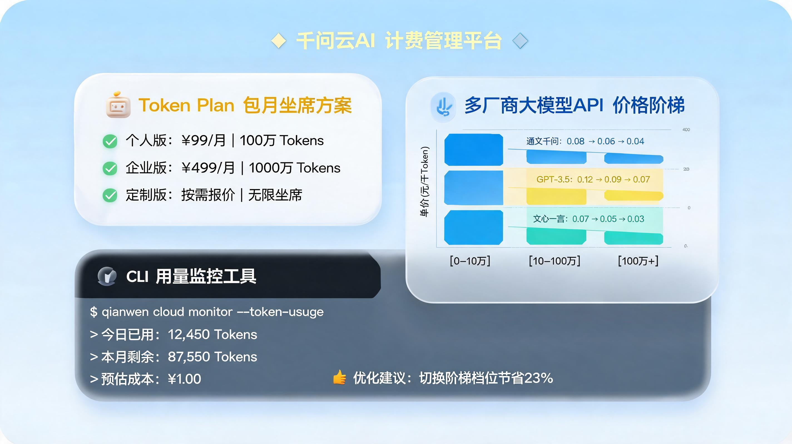

<video data-vsrc="/assets/videos/2026-11-03-kimi-sanqian-bill-v.mp4" data-vposter="/assets/videos/2026-11-03-kimi-sanqian-bill-v-cover.jpg" controls preload="metadata" style="display:block;max-width:100%;width:720px;margin:0 auto;" poster="/assets/videos/2026-11-03-kimi-sanqian-bill-cover.jpg" src="/assets/videos/2026-11-03-kimi-sanqian-bill.mp4"></video>

*视频版：两分钟讲清 Kimi 的强项为什么正是你的账单*

10 月 26 日凌晨 4 点，Kimi 把一封道歉信置顶在评论区。这是它半年内第三次道歉。

道歉信里有句话写得挺诚恳：「问题出在我们，我们也本应更早修复。」补的方案也不含糊：所有订阅会员，月度额度一次性恢复 25%。

但道歉信里还有另一句，被开发者们拎出来反复看：「Kimi 正在减少不必要的子 Agent 调用和输出长度。」

这两句话放在一起看，事情就清楚了。不是说不该道歉——道歉的姿态确实比很多同行体面。是说一家公司道歉的次数跟它发布新模型的次数一样多，三次都发生在发布之后，那该被审视的就不是诚意，是模式：**它把一份算力账单，记到了订阅用户的头上。**

想清楚了「谁替模型的强付钱」，这生意怎么做得成。没想清楚，或者身段太灵活，道歉就会一直道下去。

## 账不是算错，是没打算让你算

经济学里有个老概念，叫信息不对称：买方知道的和卖方知道的，不是同一件事。

K3.1 Pro 这个模型，能力是真的强。Artificial Analysis 的智能指数给了 55 分，全球第四，前面是 Claude Opus 5.5、Claude Sonnet 5.5 和 Meta 一款没开放 API 的模型——它是这份榜单里排名最高的开源权重模型。最考验长程 Agent 执行的 Terminal-Bench 4.0，它拿了 67%，这个评测框架下的历史最高分。第三方评测机构 ModelCompare 甚至因为它的出现改了口风：中美 AI 差距，从数月缩减到只剩 31 天。

定价也确实降了。输入从每百万 Token 20 元降到 13 元，输出从 100 元降到 68 元，差不多打了三分之二折。

单看每一项，都是好消息。放在一起，就不是了。

同样是 Artificial Analysis 发布时的实测：K3.1 Pro 跑完整套评测，累计输出约 1.5 亿 Token，而参与测试的模型中位数是 8700 万——它比中位数多烧了差不多七成。单任务平均输出 5.5 万 Token，比上一代还多了 14%。评测机构官网给它的形容是 somewhat verbose，有点啰嗦。在实测口径里，它比谁都啰嗦。

然后是那张最关键的账单。还是发布时的实测口径：K3.1 Pro 单任务平均成本 1.98 美元，上一代 K3 是 2.00 美元。单价降了三分之一，单任务成本几乎一分没动。降下去的价格和涨上来的用量，在同一张账单上精确对冲了。

这笔账怎么算，取决于你是谁。对 API 客户，这是透明账，烧多少 Token 走多少账。对订阅用户，这不是一笔你能看见的账——你买的是月费，它烧的是你不知道的量。

## 后台干的活，算你的钱

看两个用户的实际遭遇。

一位 199 元档订阅用户，给 Kimi 发了一句「审查项目架构」。就这么一句话，模型自己拉起了 5 个子 Agent，并行开工。十几分钟后，5 小时额度窗口见了底。另一位 699 元档用户更惨，不到 2 小时额度用完，终端里还在不断弹「限流」报错。

这不是用户不会用。K3.1 Pro 本来就是一台为长程任务调校的机器——自己拆解任务、调用工具、拉起子 Agent、反复修正。它的强项就是「替你干很多活」。问题在于，它替你干的每一件活，烧的都是你的额度，而「干多少活」这个决定，是它在后台自己做的。

你只问了一个问题，它在后台干了一堆活，然后这些活都算你的钱。

道歉信里那句「减少不必要的子 Agent 调用」，翻译过来就是：后台确实存在「不必要的」计算。没必要拉那么多子 Agent，没必要输出那么长。这些「不必要」不是 bug，是产品默认的干活方式——直到用户炸了，才改成「减少」。

一家把长程 Agent 能力当头牌宣传的公司，没有把「长程等于烧钱」这件事放进用户买订阅时的决策链里。宣传页上写的是支持多少万字上下文、跑分全球第几；额度说明里没写的是，一句普通的话会派生出多少个你看不见的后台任务。

强项在台前领奖，账单在幕后结账。

## 半年三次，次次都在发布之后

把时间线拉出来看，这个模式更清楚。

4 月 22 日，K2.6 发布，额度统计出错，道歉，全员重置。7 月 19 日，K3 发布，48 小时后算力逼近极限，道歉，暂停 C 端新用户订阅。10 月 24 日，K3.1 Pro 发布，智能指数全球第四；48 小时内额度投诉爆发，10 月 26 日凌晨道歉，补 25% 额度。

每发布一个更强的模型，就道歉一次。模型在变强，事故在复现，连节奏都一样：发布、冲榜、爆雷、道歉、补偿。

这三次事故各有各的技术原因，但底下压着同一件事：算力。K3 系列的用户请求量一度逼近集群承载极限，以至于 7 月那次直接暂停了新用户订阅。信通院报告的口径，国内智能算力需求增速是供给增速的三倍多；月之暗面的推理负载据报还高度依赖外部算力协议。真实的水池就这么大，模型参数却从 2.8 万亿涨到 3 万亿，默认全程深度思考。

一边是必须维持的「全球第四」叙事，一边是扩不起来的算力池。中间那个缺口，靠什么填？订阅额度，就是那个最好捏的阀门。

更值得多看一眼的是另一件事。K3.1 Pro 发布当天，海外博主 Elshayib 在 X 上曝出一份推广指引：Kimi 付费邀请海外 KOL 推广，模板里原话写着「Please DO NOT put on the paid partnership label」——请务必不要打上付费合作的标签。截至发稿，月之暗面没有公开回应。

能力宣传要打光，额度消耗要藏起来，付费推广要摘标签。三件事摆在一起，很难说是巧合。

## 都知道，为什么等炸了才改

道歉信说「我们本应更早修复」。

这句话的前提是：问题早就存在，而且早就被发现。冗余的子 Agent 调用不是发布当天才出现的，它是模型的工作方式，发布前就在那里。内部的测试工程师不可能不知道一个「审查项目架构」会派生多少任务、烧多少额度。

那为什么发布前不改？

因为改了就不强了。减少子 Agent 调用、压短输出长度，意味着任务执行得更保守，跑分可能就没那么好看，55 分可能就变 50 分。发布窗口开着，榜首的 Claude 不等人，「全球第四、开源第一」的宣传语等着写进每一篇通稿。

于是就发布了。把一台马拉松发动机，装进了按 5 小时设计的油箱，然后把油钱算在买车的人头上。

凭什么呢？凭跑分榜上看不见额度消耗，凭宣传物料里不写单任务成本，凭道歉信永远比修复来得快。可如果连「减少不必要的调用」都要等用户炸了锅才肯改，订阅用户凭什么相信下一次发布的 K4，后台没有新的「不必要」？

对了，还有一个时间点可以蹲一下：11 月 4 日，K3.1 Pro 的开放权重版计划上线 Hugging Face。到时候可以看看权重卡的说明里，有没有把「单任务成本」讲清楚。

## 咱该看什么

咱不用 Kimi 的，这事也跟咱有关。

以后每家厂商发新模型，别光盯着跑分第几，先问一句：这个强，是谁付钱。API 计费的，Token 单价乘以用量，账透明；订阅制的，模型越强不等于你越省——可能只是它思考得越多，你付得越快。

跑分榜是厂商的答卷。你的答卷只有一张，就是月底那笔账。下次 Kimi 发 K4，先别急着看它排第几，等第一波订阅用户的额度账单出来再说。

---

*主要信源：Kimi 10 月 26 日致歉公告（经界面新闻、中华网、新浪财经等多方转述）、Artificial Analysis 发布时实测与 11 月 2 日更新数据（数据随版本复测变动，引用已标注时点）、雷峰网 11 月 2 日实测报道、中国信通院 2026 世界智能计算大会报告、X 用户 Elshayib 10 月 24 日曝光帖（英文原话直引）。算力供需与 KOL 争议为公开报道口径，月之暗面未回应。*
