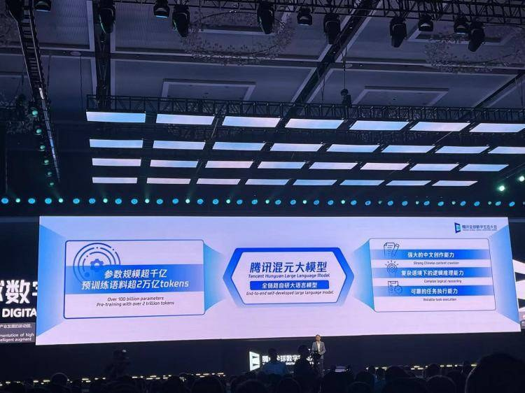

11 月 4 日上午，腾讯混元发布新一代大语言模型 Hy4 正式版。参数从上一代 Hy3 系列的不到 300B，直接跳到 770B 总参数、激活 49B 的 MoE，上下文拉到 100 万 token。官方的说法是，Hy 首次跻身最强开源模型之列。

时间点挑得讲究。前一天乌镇峰会刚开幕，主题就是「开源开放 共建共享」，腾讯展区中央摆着的就是混元。只是展区里那台是 8 月底的 preview，正式版 11 月 4 日当天才官宣。

这代有两个「混元首次」。一是首次带视觉理解，能读细粒度图像、复杂图表，做数学视觉推理。发布稿里我最喜欢的一条演示，是让模型在卫星图里「找屋顶写有 KLOOSTERBOER 的仓库右上方光伏板区里最东侧的白色方形构件」。认字、分东南、从几百个相似白块里锁定目标，太像周二下午随口派给实习生的活儿。

二是首次支持 Computer Use，命令行和图形界面都能操作，针对 Blender、CAD 这类专业软件做了专项训练。演示规则严格到要交鼠标日志、脚本只准读不准写画布，防的就是模型用代码画完假装手点。做 Agent 平台的人对这件事的分量有体感：能看，才点得准；能点，才谈得上替人干活。

官方口径的数字也不少：幻觉率从 preview 的 12.95% 降到 7.2%；213 位专家盲测 579 个真实金融任务，Hy4 拿了 3.04 分，压过 DeepSeek-V4.1-Flash-1017 的 2.97、Kimi K3.1 Pro 和 GLM-5.3 的 2.68；办公场景 WorkBuddy 评测 83.18 分、通过率 96.15%。这些数字都得带上前缀看：自建测试、腾讯 FiT 组织的众测、自家产品里的自家评测，独立第三方评测目前还没有。

落地倒是快的。元宝、WorkBuddy、CodeBuddy、腾讯云 TokenHub 已经接入，定价不变，输入 6 元、输出 18 元每百万 tokens，年底前 TokenHub 五折，WorkBuddy 到 11 月 15 日有免费额度。易观 9 月的数据，WorkBuddy 月访问量 8534 万次，居国内桌面端办公 Agent 平台第一。

最后回到标题那个「等」字。新华社在现场的表述是「发布即全面开源」，官方公众号的原话是「将于近期开源模型权重」。截至发稿，正式版权重没有挂出，现在能用的只有 API 和产品。官方自己也说，与顶尖闭源模型仍有较大差距。从 2023 年 9 月首次亮相到现在，混元两年出了四代，节奏不慢。权重什么时候真放出来、放出来之后社区实测是什么水平，才是「最强开源之列」这句话的验收时刻。
