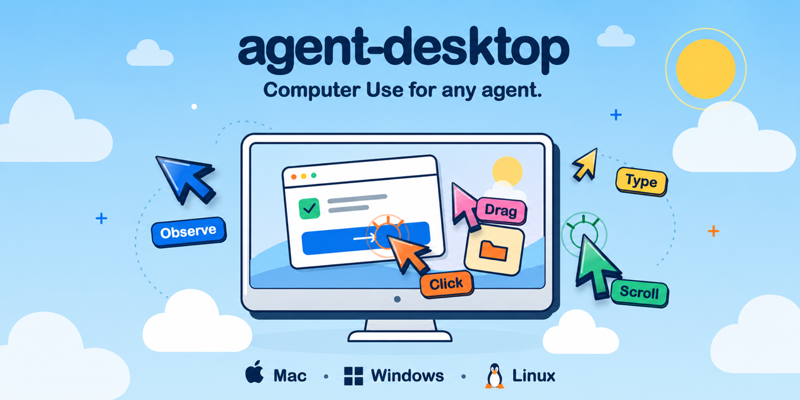
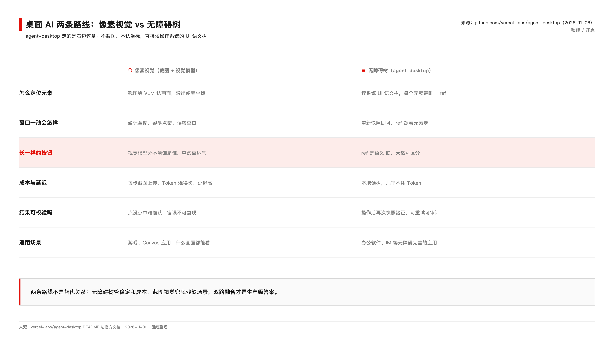
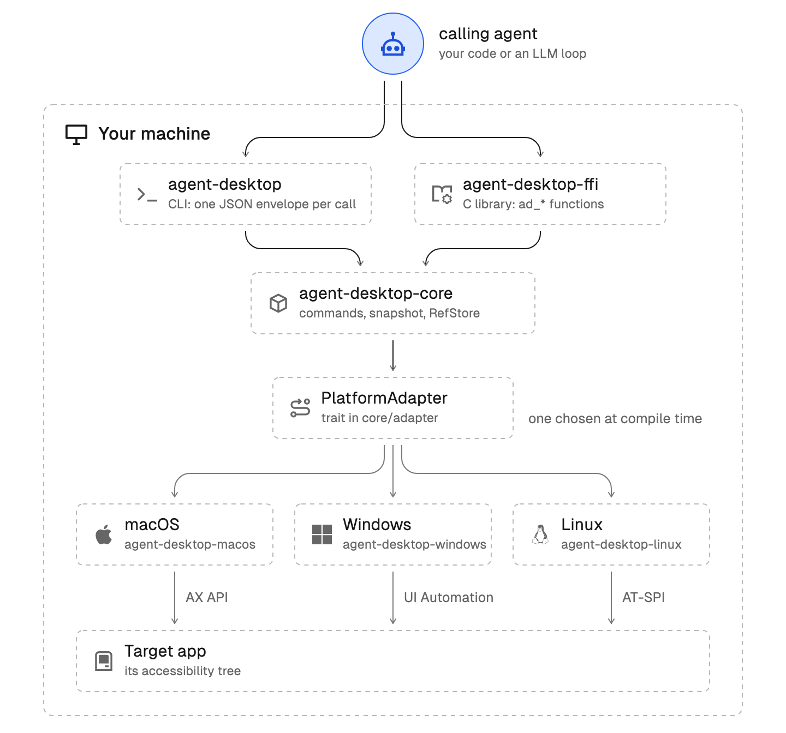
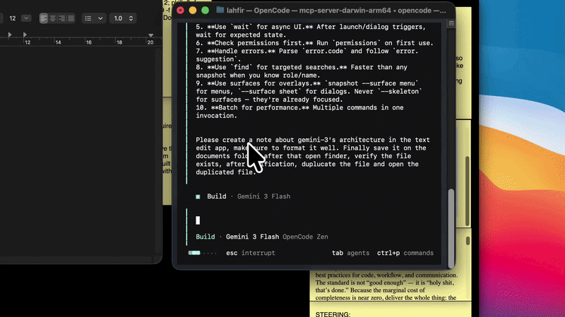

让 AI 帮你点按钮、填表单，这事听起来简单，落地过的人都知道坑在哪。主流做法是截图发给视觉模型，模型算出"按钮在 x=432, y=678"，鼠标移过去，点下去。窗口挪了 20 像素，或者分辨率一变，这一套就作废了。

更烦的是两个长得一模一样的按钮。视觉模型分不出谁是谁，想点右边那个，点了左边。重试，全凭运气。

Vercel Labs 开源的 agent-desktop，绕开了这条路。它不给 AI 看截图，直接读操作系统给读屏软件准备的那棵 UI 语义树，把每个按钮、输入框、菜单标上一个语义 ID，AI 按名字操作，不按坐标。

写这篇之前我拉了下 GitHub API：17,019 星，1,201 fork，Apache-2.0 协议，Rust 写的，仓库今年 2 月建。不少科技号文章还在写"11.4K Star"，这类数据的滞后周期大概两三周，看的时候记得打个折扣。

## 换个赛道：从看图到读树

桌面自动化现在有两条路线，差别比大多数人想的大。

像素视觉路线，代表是 Claude Computer Use：截图、视觉模型识别、输出坐标、驱动键鼠。优点是通用，什么画面都能看，游戏里都能用。代价也实在：每一步都要截图上传，Token 烧得快、延迟高；布局一变就失效；点没点中，模型自己也说不准，错了不好复盘。

无障碍树路线，就是 agent-desktop 这条。操作系统本来就有为视障读屏软件准备的 Accessibility 树，macOS 上叫 AX API，Windows 上是 UI Automation，Linux 上是 AT-SPI。这些接口稳定跑了十几年，agent-desktop 做的事，是把它们封装成一个面向 AI Agent 的跨平台 CLI。



差别最狠的一处在"长一样的按钮"。像素方案里，两个长得一样的按钮就是两块一样的像素；无障碍树里，每个元素自带角色、名称、层级信息，AI 操作的是 ref 这种语义 ID，天然分得清谁是谁。

## ref 的设计是整个项目的聪明处

它的工作循环就四步：快照、决策、操作、再快照。

```bash
agent-desktop snapshot --app Finder -i      # 拿 UI 树，每个可交互元素带 ref
agent-desktop click @s8f3k2p9:e8            # 对 ref 操作
agent-desktop snapshot --app Finder -i      # 再看一眼，验证结果
```

有条关键规则：ref 只在当前快照里有效。UI 一变，旧 ref 立刻作废，再拿去用直接返回 STALE_REF；连快照 ID 都不带裸写 @e8，会被 INVALID_ARGS 拒掉。

这个设计有点反直觉，每步都要重新快照，速度上吃了亏。但它把"AI 缓存了旧引用点错地方"这类事故从根上堵死了。每一步操作对象都有语义记录，日志可审计，失败可重试。对我们做 Agent 平台的人来说，"Agent 到底点了什么"终于有据可查，这比快那么一点重要得多。

工程细节也给得足。所有命令返回统一的 JSON 信封，错误码明确，error.disposition.retry 字段直接告诉 Agent 这条失败能不能安全重试。56 个操作命令覆盖点击、输入、快捷键、滚动、拖拽、窗口管理、剪贴板、通知，默认 headless，不动鼠标不抢焦点。除了 CLI 还发布了一个 C FFI 库，可以进程内嵌进自研 Agent 运行时；MCP server 是内置的，agent-desktop mcp 一条命令起来。



生态接入这块 Vercel 做得挺细：二进制自带版本化的技能指南，agent-desktop skills get desktop 就能取；也能用 npx skills add 直接装进 Agent harness，README 里甚至给了一段建议写进 AGENTS.md 的话。下面这段官方 demo，是在 OpenCode 终端里让 Agent"在 TextEdit 里建一条 Gemini 3 架构笔记，保存到文稿文件夹，验证存在，复制一份再打开"，全程由 agent-desktop 驱动 Finder 和 TextEdit 完成。



## 边界在哪

官方文档没有藏着掖着，三类场景它搞不定，写得清清楚楚。

应用没实现无障碍支持。游戏、Canvas 渲染的封闭应用、不少老旧软件，无障碍树是残缺的，元素都列不全。官方给的建议是这类场景搭配截图 VLM 兜底。

Windows UAC 弹窗。那属于系统安全桌面，用户态进程读不了也点不了。这是操作系统的安全边界，不是工具的 bug。

macOS 权限。辅助功能授权必须给，实测还有个坑：加了权限之后要完全退出终端重开，只重启 shell 没用。权限状态可以用 agent-desktop permissions 一键查。

README 里还有条安全提示值得划出来：快照、剪贴板、截图这些输出可能包含私密桌面内容，别往公开日志和上传里放。

我的判断是，这工具不是来取代截图视觉的，是补了另一条赛道。像素视觉强在什么都能看，无障碍树强在稳定、便宜、可校验。真要做生产级的桌面 Agent，大概率是双路融合：无障碍树优先，检测到树残缺自动降级截图。

坦白讲，这篇是读仓库和官方文档做的调研，我还没在自己机器上跑过实操，macOS 的授权步骤准备好了，还没排上。等跑过一轮，我再来补踩坑记录。

但方向我是认的。客户问得最多的一句话是"Agent 出错了怎么办"，截图路线的错复盘起来经常无迹可寻，ref 路线每一步都有语义记录。就冲这一点，做桌面自动化的团队值得把它拉进候选清单试一轮。

项目地址：github.com/vercel-labs/agent-desktop
