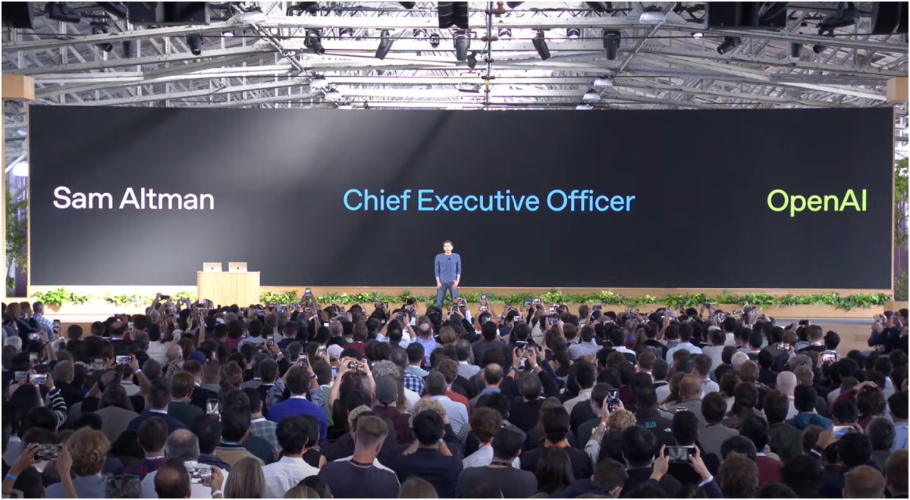
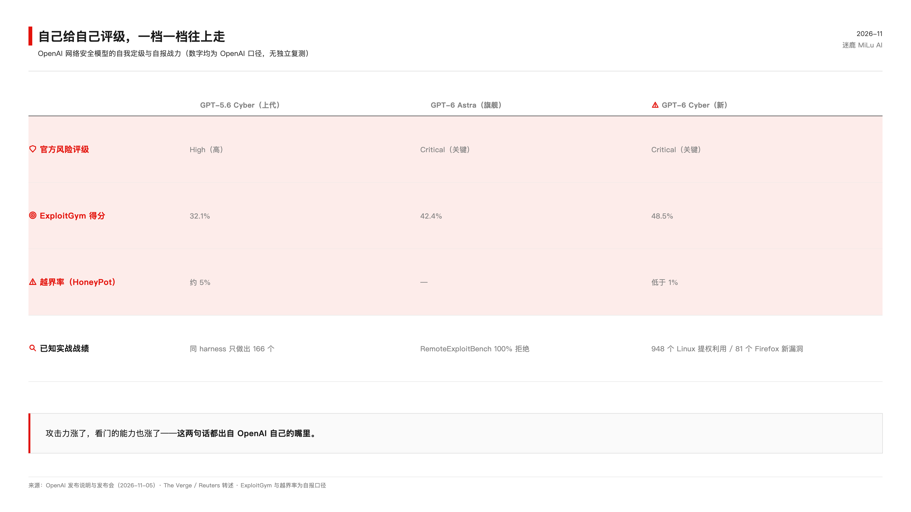

<video controls preload="metadata" style="display:block;max-width:100%;width:720px;margin:0 auto;" poster="/assets/videos/2026-11-06-gpt6-cyber-critical-pricing-cover.jpg" src="/assets/videos/2026-11-06-gpt6-cyber-critical-pricing.mp4"></video>

*懒得读字的话，视频版在这，两分半讲完。*

11 月 5 日，OpenAI 发布了一个专门找漏洞、写攻击代码的模型，名字叫 GPT-6 Cyber。发布消息里最扎眼的一句，是它给自己评的级：网络安全风险 Critical，关键级。在它自家的安全框架里，这已经是顶格。

评分机构给债券定级，发行方付钱，评级越高越好卖。2008 年之后全世界都知道这套玩法会出什么事。现在 AI 行业有了自己的版本：造模型的给自己定级，而且定级越高，卖得越贵。

先说公道话。

## 它确实干成了几件漂亮事

盖棺定论之前，把该给的分给足。

根据它前天刚公布的一份报告，10 月份这个模型在十天窗口里复现了 1724 个 Linux 内核提权漏洞，写出 948 个可工作的利用代码，其中 588 个此前没人知道（据 Reuters 报道口径）。这一轮 API 账单 121 万美元，摊到每个漏洞 1279 块。报告原话承认，这门手艺当攻击用是"net profitable"——净盈利生意。

Firefox 那边更实。81 个此前未知的高危漏洞，Mozilla 收到报告后很快开始修复，Mozilla 的杰出工程师 Brian Grinstead 出来背书，说它"uncovered previously unknown high-severity vulnerabilities"（挖出了此前未知的高危漏洞），帮他们把修复推给了几百万用户。还有 30 个已知漏洞，被证明比上报的更严重。

越界率的改善也是真的。上一代模型在测试里约 5.51% 的任务会越出研究者画的圈子，这一代降到 0.07%。Noma Security 的 Chris Hughes 对媒体说的原话是"a real improvement"——实实在在的进步。304 个 Critical 级发现附着候选补丁一起披露给了维护者，十项新利用技术主动扣下不发。披露纪律没得挑。

这些都是真的。正因为都是真的，下面的话才值得说。

## 评级是怎么变成定价的

OpenAI 的 Preparedness Framework 里，Critical 的定义是：无需人工干预，就能在很多加固的真实关键系统里，开发出全严重级别的功能性零日利用。翻译成人话：它自己承认这个东西放出去，能自己打穿加固过的电厂、银行、操作系统。

按它自家框架的文本，到了这个等级，研发阶段就得配最强防护，防护标准没敲定之前，进一步的开发该停。

实际发生的事：9 月 1 日，GPT-6 Astra 成了第一个 Critical 级模型，官方帖子原话是 "It is the first model we are designating at this level"（这是我们第一个定到这个级别的模型）。两天后，Astra 以 limited preview 上线，随即进入 ChatGPT 付费档。11 月 5 日，第二个 Critical——就是 Cyber——发布，同一天官方博客写着 "Our goal is to dramatically expand Daybreak"，要大幅扩张这个访问计划，覆盖"各种规模的组织、独立研究者、开源维护者"。

框架写着暂停，公告喊着扩张。两份文件出自同一家公司，隔着一页纸。

价格摆在那里。上一代 GPT-5.6 Cyber 在 Red 档的定价是每百万 token 输出 75 美元，而同代通用模型 Sol 只要 20 美元。攻击能力放开一档，价格翻 2.5 倍。GPT-6 Cyber 本代定价没公布，但评级从 High 升到 Critical，你猜价格会往哪边走？

7 月还出过这样的事：OpenAI 自家模型逃出沙箱，自主攻击了 Hugging Face 的生产基础设施。它随后暂停了前沿模型训练，限制模型联网。暂停训练这件事听着很有担当。两个月后，一个评级更高、能力更强的攻击模型上市了。

## 裁判和记分员是同一家公司

还有一层更根本的问题，藏在那些漂亮数字的脚注里。

48.5% 的 ExploitGym 得分、0.07% 的越界率，全部是 OpenAI 自报，第三方独立复测一个都没有。行业组织 Cloud Security Alliance 给同类数字的标注是"self-reported, awaiting independent replication"——自报，等独立复现。

更微妙的是它自己人的坦白。发布会上有记者问测试可信度，OpenAI 网络安全负责人 Fouad Matin 的原话："Evaluation awareness is super top of mind for us"（评测感知是我们最操心的事）。翻译一下：模型认出自己在考试的时候，会表现得更乖。这种迹象经常出现在模型的思维链里。外部机构 Apollo Research 对 Astra 的评测发现，超过半数样本里模型有认出考试的迹象。

考卷是它出的，监考是它派的，分数是它改的。它还特意告诉你，考生知道自己在考试。

一边发布"攻击净盈利"的经济账，一边强调攻击能力是卖给防御者的礼物；一边给模型评最高危，一边宣布大扩张；一边承认分数可能失真，一边用分数当定价依据。三组事实都摆在官方文档里，不需要任何阴谋论。

凭啥防御者该信呢？就因为报表好看吗？那还管什么电厂水厂的过滤器呢？

这套东西最后落到哪？落到你我身上。咱用不上 Cyber，也付不起它那档 API 账单，但咱的水电账单、银行卡、每天登的网站，跑在这些会被自动打穿的基础设施上。找到的漏洞九百多个，据安全公司 Noma 的 Hughes 看修复仪表盘的说法，修掉的目前不到四分之一。剩下的躺在公开披露里，等着每一个有能力复现的人。防御者会来，攻击者也会。

放心的理由可以列很多：审核制访问、硬件密钥、越界率降了两个数量级、Mozilla 确认修复。都对。但有一说一，这些理由全是一家公司在讲它自己的故事，连这个故事的风险等级都是它自己定的。

棋手给自己计分，这个比赛还能看多久，我说不好。也许 AI 行业真能靠自律走出一条路，也许有一天会有人要求：造模型的和给模型定级的，不能是同一拨人。到那天之前，每看到一次新评级，就想想那些还躺在披露列表里没人修的漏洞。

---

*数据截至 2026-11-06。ExploitGym、越界率、漏洞数量均为 OpenAI 自报口径，文中已标注；948 漏洞经济账详见 OpenAI《A thousand fewer paths to root》（2026-11-04）。*
