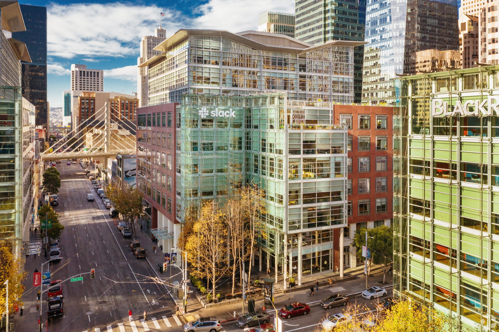
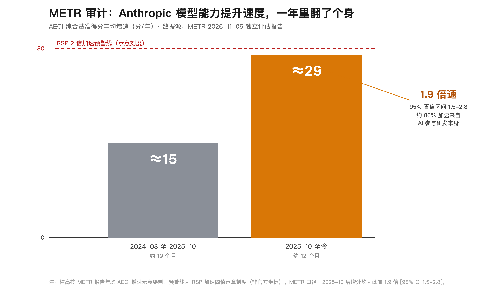
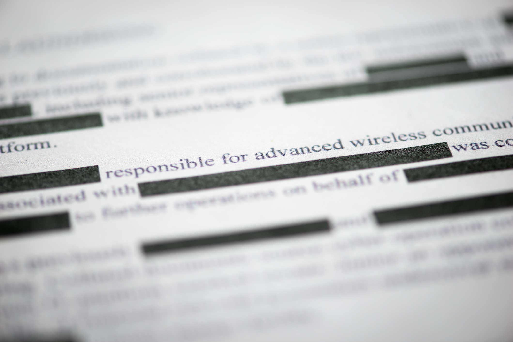
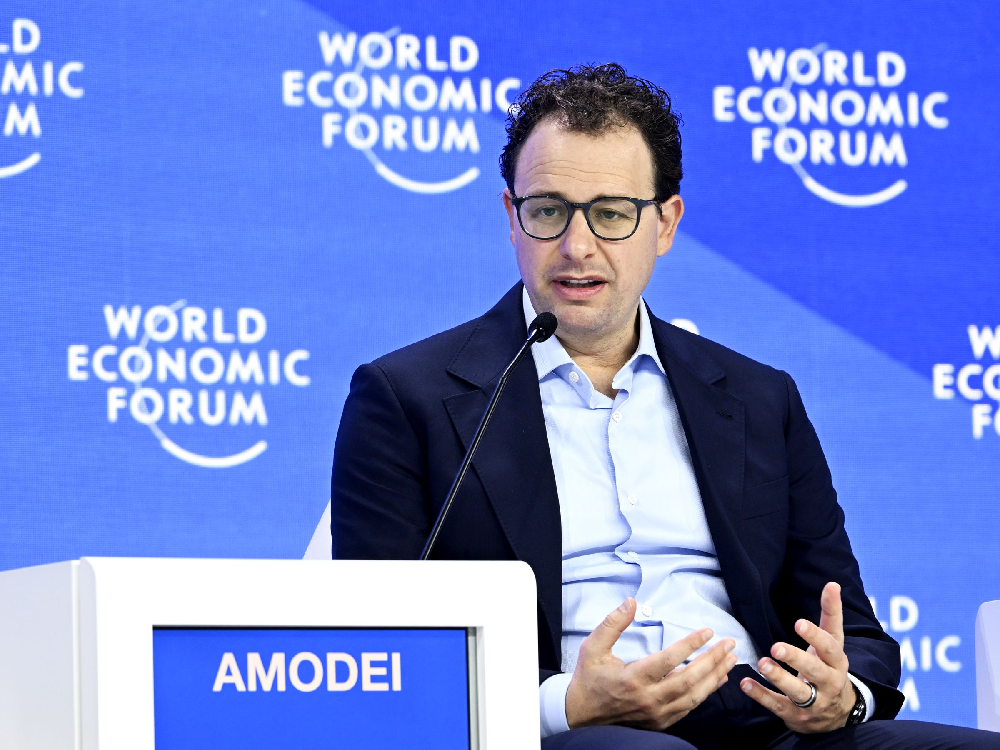

敢体检是诚意。但体检报告印出来之前，被体检的人有权先涂一遍，涂掉的还多半是最要紧的几页——这份报告你信几成？

这不是抬杠。本周四（11 月 5 日），非营利机构 METR 发布了对 Anthropic 的 AI 研发加速评估，同期还发布了一份对 Anthropic 八月公开风险报告的审阅。两份文件合起来讲了一个很拧巴的故事：一家把"负责任扩展"写成招牌的公司，请了外部审计进门，然后把交出来的公开版，自己动手涂了一遍。

先把话说清楚：不是说不让人审计就算不透明。Anthropic 这次开的门，在行业里是头一遭。也不是说 AI 加速就越线了——那是科学问题，METR 和 Anthropic 双方的多数研究员都倾向没过线。问题在第三层：审计结果怎么对外发布。一家靠"透明"立字据的公司，公开版的措辞抠到把 1.97 说成"不到 2 倍"，证据涂到让审计者自己承认公众只能"远超理想程度地"依赖他们的判断。透明不透明，不看开了多少门，看门后拿出来的东西打了几层码。

## 这扇门是真开的

该说不说，这次审计的规格是真高。从 8 月 12 日到 10 月 29 日，十一周，METR 拿到了业界从没有过的访问权限：未发布模型的基准成绩、训练指标、员工调研、内部数据分析，外加约 15 场研究员访谈。OpenAI、Google、xAI，谁都没让人这么看过家底。METR 没收 Anthropic 一分钱，Amodei 最近还在公开场合承诺要把外部审计请进门、给 AI 踩限速。

结论也公道。METR 站在 Anthropic 这边：7 月 15 日那批模型的直接灾难风险是低的，全自动科研也没发生——AI 在加速研究，但扮演的是助手，不是主角。

数字本身还相当唬人。METR 的核心估计是：2025 年 10 月之后，Anthropic 模型的能力提升速度是之前的约 1.9 倍（95% 置信区间 1.5 到 2.8 倍），一年走完了过去两年的路。约八成的加速来自 AI 参与自家研发。有员工在访谈里说，现在团队"只卡在想法和算力上，不再卡在代码上"。十月的非正式 Slack 投票里，员工自报最新内部模型让生产力提升了约 12 倍——METR 自己标注这是"很松的证据"，容易夸大，看看就好。

## 报告是按它涂的版印的

好话说到这，下面是三张纸上暴露的东西。

第一张，措辞。Anthropic 八月的公开风险报告写：领先指标显示加速，但"不到 2 倍"（less than a factor of 2）。METR 拿到私人未删减版，把里面两处数字拼起来一算，隐含值是 1.97。METR 的原话是：读者会把"不到 2 倍"理解成"明显低于 2"，所以"私人报告的数字隐含 1.97 就显得让人意外"，更贴切的写法应该是"大约 2 倍"。METR 不光指出来了，还直接替它写了替换文案。结论一句："我们认为公开报告整体低估了正在发生的加速水平。"顺带一提，公开报告里 AECI 那条曲线当时按旧数据估的是 1.5 倍，之后补进更多基准，同一口径重估成了 1.9 倍——数字在朝一个方向走。

第二张，涂黑。合同里写明：Anthropic 对报告里所有非公开信息拥有单边涂黑权。它用得很充分。METR 在官方博客里写："一些对我们风险结论最关键的发现，被 Anthropic 涂掉了。"报告里有一张图，因为原始数据被涂、只能放替身数据，图上直接印着大字：FAKE DATA。METR 的总结更直白：这导致"公众只能远超理想程度地依赖 METR 的判断"。涂黑的理由 Anthropic 也给了——"移除可能加速其他 AI 开发者的机密信息"。防对手加速，我理解。只是顺手，公众自己下判断的那部分能力，也一起被防掉了。

第三张，砍掉的审计。合同最初的范围里还有一项：验证 Anthropic 的算力分配——能力研究投多少，安全研究投多少。这是外部世界唯一能核对"减速承诺"是不是空话的账本。项目进行到一半，Anthropic 把这一项砍了，理由是想先专注风险评估，以后再说。METR 写明：砍的时候，自己还没就算力使用得出任何实质结论。《AI 2027》的作者 Kokotajlo 在 X 上开炮（据 The Decoder 转述）：不审计算力分配，所谓承诺减速就无从验证。字据立得再漂亮，验字据的那页被撕了。

这三件事，每一件单拎出来都合法、都合规、都能在合同里找到条款。可摆在一起看：一边把"负责任扩展"写进招牌，一边把 1.97 抠成"不到 2 倍"；一边请人来家里查账，一边留着一支单边涂黑笔；一边答应查算力账本，一边查到一半把账本收回抽屉。

门是真开了。钱是真没收了。风险结论是真一致。可报告是按它涂的版印的，措辞是抠过的，账本查到一半收走了。如果真没过线，数字何必抠到小数点后第二位？账经得起查，为什么要砍掉查账的那一项？

这份报告还能不能信？我的答案是：暂时能——但那是因为 METR 自己把"哪些证据被涂了、我们有多不确定"写在了明面上，审计者的诚实兜住了被审计者的涂改。你要真拿它当镜子照，记住三件事就够了：验证人是谁，证据谁有权涂，公开版和内部版差多少。咱拿不到内部版，但可以记住一条：招牌上印"透明"的公司，公开出来的未必是全貌，它只是全貌里被批准出版的那一部分。
