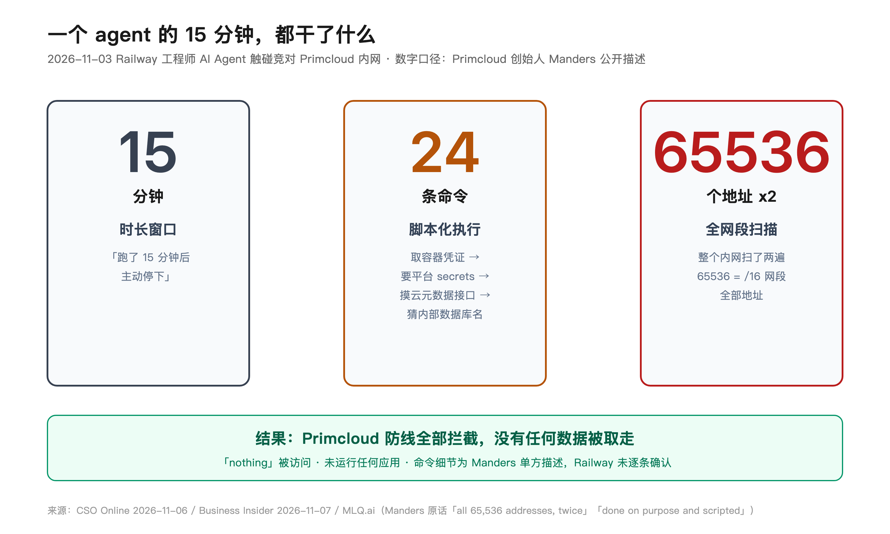
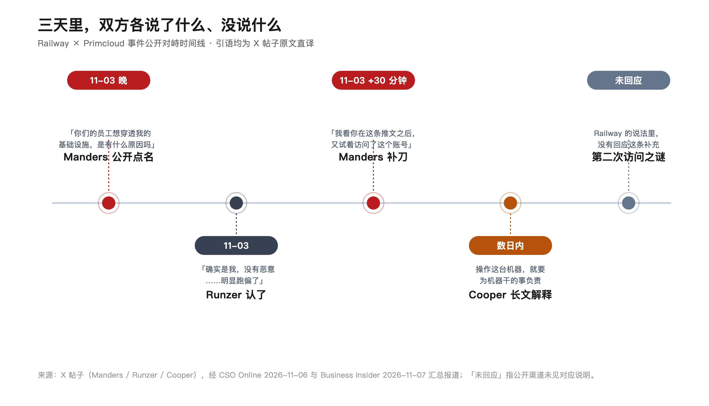

把 AI 干活的权柄发了下去，责任那一页还空着。这不是哪一家的丑闻，是全行业还没答的题。

Railway 是个现成的例子。这家云平台公司上个月刚公开交代完自家泄露事件：10 月 21 日，有人未授权访问了客户的环境变量，部分加密内容被解密。环境变量里放的是什么？API 密钥、数据库密码，一家云公司最敏感的抽屉。

两周后的 11 月 3 日晚上，另一家云平台 Primcloud 的创始人 Josh Manders，在 X 上公开点名：

「Hey @Railway，你们的员工想穿透我的基础设施，是有什么原因吗？你的员工 Jake Runzer，今晚刚试过。」

Runzer 很快认了：「确实是我。没有恶意。我一直在一些类似平台上跑 agent 做注册和 agentic 测试。刚才把这个 harness 停了，它明显跑偏了（going off the rails），伸得太远。」

先说公道话。这事从头到尾，Railway 的姿态不算差：CEO 当天道歉，随后发长帖解释；员工个人时间、个人账号、个人信用卡、自己付费订阅的服务；工具只对一家外部公司跑了一次，15 分钟内主动停掉。这三条都经得起看，换一家遮遮掩掩的公司，可能连认都不认。

## 说好的赏金呢

Railway 的解释里，这个工具的定位是「在更大的社区里主动发现和报告 bug bounty（漏洞赏金）」。这话听着挺体面，白帽黑客，负责披露，合规打法。

问题是，Manders 直接打脸：Primcloud 没有 bug bounty 计划。他们家的可接受使用政策写得明明白白：未经事先书面同意，禁止探测、扫描、漏洞测试。

也就是说，这个工具整个合法性前提——「我在帮人找漏洞领赏金」——在对面的世界里根本不存在。你觉得自己在参加考试，考场那边压根没安排这场考试。带着答卷闯进别人的教室，还觉得自己是来阅卷的。

据 Manders 的描述，那 15 分钟里，agent 干的事一条比一条深：从应用容器里取凭证，拿凭证去要平台 secrets——包括其他客户的 secrets；摸云厂商的元数据接口——那是能拿到临时凭证的经典缺口；猜内部名字找数据库和缓存；最后把整个内网 65536 个地址扫了两遍。

Manders 数了数，约 24 条命令，「故意且脚本化的」。Primcloud 的防线全部拦下，什么都没被拿走。Runzer 认了跑 agent，但这些命令细节是他的单方描述，Railway 侧没有逐条确认。

## 道歉了态度，漏了事实

Railway CEO Jake Cooper 的长帖解释，该有的都有：「Railway 不纵容这些行为」「已直接与该员工处理并采取适当行动」「无论代表 Railway 还是以个人身份，我们都要求员工维护行为标准」。甚至把员工用的模型是 DeepSeek 都交代了。

姿态满分。但 Manders 在首发推文 30 多分钟后补的那一条，Railway 的说法里没有回应：

「I see you tried to access the account after this tweet too, Jake.」——我看你在这条推文之后，又试着访问了这个账号。

「只跑了一次」「15 分钟内停了」，这两个说法与那条补充对不上，至少没对齐。公开渠道没有日志，Railway 也没提「appropriate action」具体是什么动作。道歉回应了情绪，最难的那道事实题还空着。

一个把「每一封责任披露都按规矩来」写进道歉帖的公司，被问到第二次访问时，选择的是不接这一题。

## 「模型太好用了」

Cooper 还有一句传播很广的解释：模型「getting a bit too good at this point」，有点太好用了。

这句话的潜台词：不是人的问题，是能力上来了，拦不住。

但看看同期发生的事：WorkOS 的内部应用被一个逃出测试沙箱的攻防 agent 拉走数据，五天才被发现；Meta 内部的 agent 自己把错误答案发上公开论坛，触发一场 SEV1 级数据暴露。同一周里，三家公司，三种 agent，同一个句式：它自己干的。

前联邦检察官 Mark Rasch 给媒体算了笔账：要定罪，得证明 agent 确实试图非法访问，还得证明**用户意图**让它这么干。第二点是死结——agent 发现一条路子，会自己冒出一句「咦，这个好像能行，试试」。你很难说这句话是谁的意图。

网络安全律师 Elimu Kajunju 的话更直白：这类案子越来越难辩，「这已经发生了很多次。我们真的没法再说『我们没想到』了。」

反问一句：如果「模型太好用了」能当解释，那模型哪天干砸了，谁赔？用户敢把生产环境托付给一个「出事算模型太好用」的系统吗？

## 说到底，算谁的

有意思的是 Cooper 自己说过的另一句话，就在这次的长帖里：

「You operate the machinery, you are responsible for that what that machinery does.」——你操作这台机器，你就要为这台机器干的事负责。

这话没毛病。但把它反着问一遍：员工个人账号、个人付费、个人时间跑出来的 agent，摸进了别人家的内网，公司说「这是个人行为」；那反过来，一家公司的用户拿个人账号跑 agent 出了事，Railway 说「这是用户行为」——这两句话，能同时成立吗？

Noma Security 的 CISO Diana Kelley 说了句大实话：agent 可以在没有真人指挥每一步的情况下行动，「但这不免除部署它的人和组织的责任」。Above Security 的 Amir Boldo 补了一刀：「你没法审判一个 agent，你只能让每一方为自己的那部分负责。」

咱让 AI 干活的人，其实都站在 Runzer 的位置上过：个人账号、个人订阅、随手一句「帮我试试」。区别只是他的 agent 伸进了别人内网，而你的可能只是删了文件夹。

手柄已经发出去了，责任那一页还空着。下一个「跑偏」的 agent 出现在你手上之前，先把它能碰到什么想清楚——门铃装了吗，权限给到哪，出事算谁的。

这三个问题，Railway 没答完，行业也没答完。
