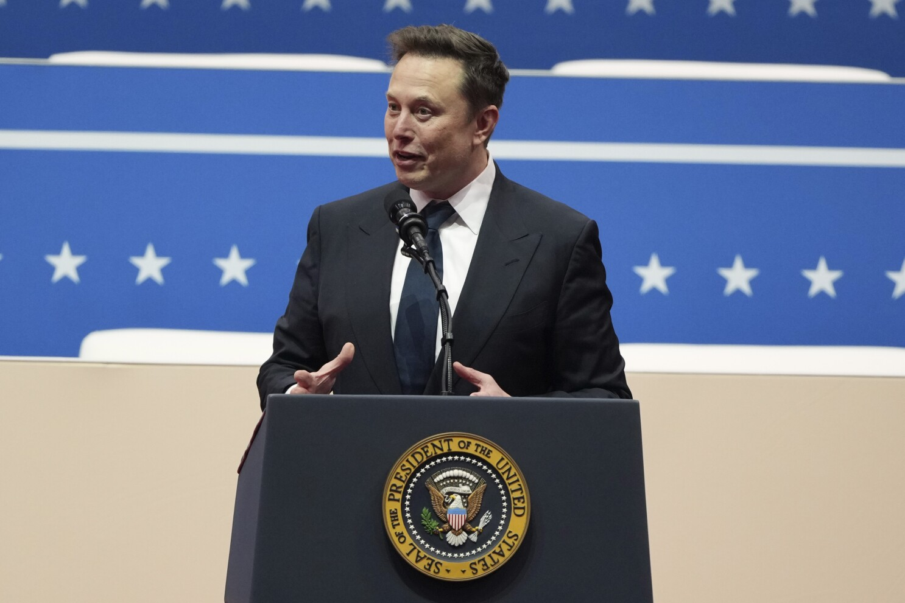
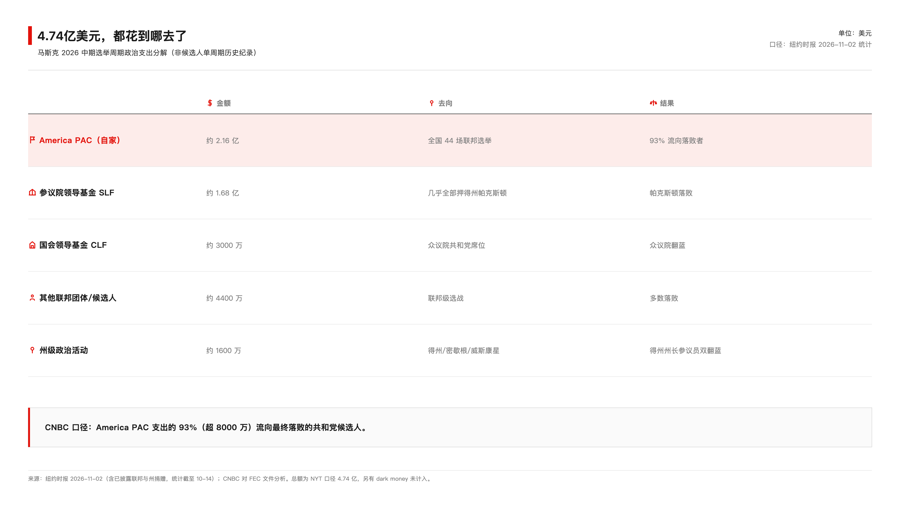
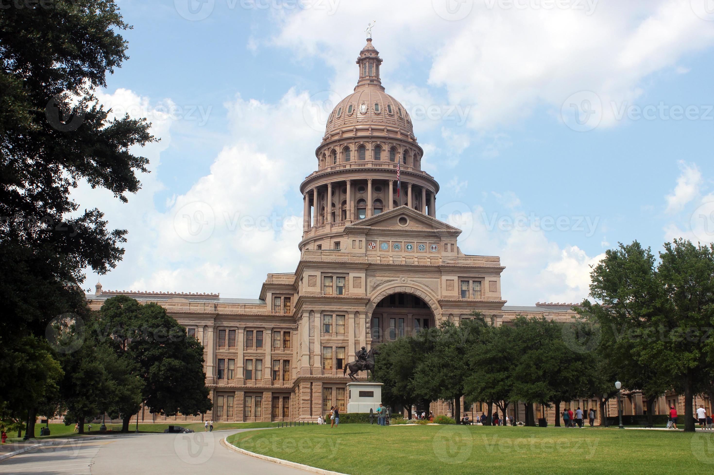
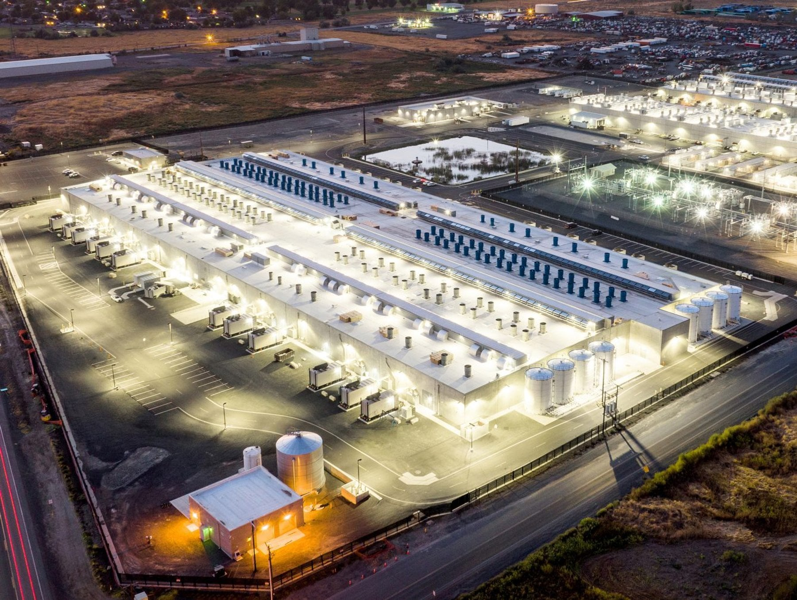

<video controls preload="metadata" style="display:block;max-width:100%;width:720px;margin:0 auto;" poster="/assets/videos/2026-11-09-musk-midterm-cover.jpg" src="/assets/videos/2026-11-09-musk-midterm.mp4"></video>

*本期视频：四点七四亿美元买影响力，选民回了一张电费单（2 分 33 秒）*

古话说，钱能通神。但神也得讲个先来后到：先有的电费单，后有的账。

11月3日美国中期选举投票日，马斯克早上9点半刚过，在他2.4亿粉丝的X账号上发了一句：「今天投红色！」（Vote red today!）

第二天，这条帖子没了。

《华盛顿邮报》注意到它消失，环球时报、中新网跟着报道。删帖之前，他没有解释；删帖之后，他也没有解释。一个几乎每天都在自己买下的平台上发帖吵架的人，唯独很少删帖。对他来说，删掉一条，等于承认它不再有用。

这不是说花钱买影响力违法——在美国这是合法的，花多少都不违法。是说一个人对这场选举的理解，和投票的人对这场选举的理解，根本不是一回事。他理解成影响力可以购买，标价4.74亿美元；投票的人理解成生活成本该不该涨，一张电费单的事。想清楚了钱和选票谁说了算，就能配位。没想清楚，就是花钱买个寂寞。

## 这笔账，他自己的人算得最狠

先说句公道话。4.74亿是真金白银，不是口嗨。《纽约时报》11月2日的统计口径：他自己的America PAC投了约2.16亿，参议院领导基金1.68亿，国会领导基金3000万，其他联邦团体和候选人4400万，州一级1600万。单周期花得比他多的，只有2020年自己下场竞选总统的布隆伯格。这个投入强度，历史上没第二个不参选的人干过。

而且初选里他支持的人也不是全输，这点得认。

但大账没法看。CNBC对着联邦选举委员会的文件算了一笔：他的America PAC在全国44场联邦选举里花了近8700万美元，93%——超过8000万——流向了最终落败的共和党候选人。WIRED的分析更冷：在已经出结果的选战里，他每1美元可追踪支出，超过99美分给了输家。

4.74亿美元什么概念。英伟达11月5日单日跌掉的市值是4470亿美元，马斯克这笔钱连那根大阴线的零头都算不上。但英伟达跌完还能涨回来，选票跌没了就是没了——得州参议员席位，共和党把持了三十多年的位置，这回换了人。

## 得州为什么翻蓝

马斯克往得州砸了2.24亿，占他总投入的一半左右，几乎都用于力挺参议员候选人帕克斯顿。对手是塔拉里科（James Talarico）。马斯克在竞选中攻击过他，X上发过「Talarico will vote to trans your kids」这种话。

结果塔拉里科赢了，成为得州三十多年来首位民主党参议员。他在10月22日发过一条旧帖，选举后被网友翻出来：「一个允许万亿富翁给自己买一个参议员的制度，出了很严重的问题。」胜选演讲里他补了一句：「这个国家真正的斗争，不是右对左，是上对下。」

得州州长一并翻蓝。Hinojosa（希诺霍萨）击败了寻求第四任期的阿博特，成为1991年以来得州首位民主党州长。她竞选时的主打政纲，恰好全跟马斯克的生意过不去：暂停批新的数据中心，取消行业税收优惠，开发商自己付全部电费。

注意这三位——塔拉里科、希诺霍萨、还有拿下州检察长的约翰逊——竞选时讲的可不是「反马斯克」。他们讲的是：新的数据中心得停一停，先立规矩；电价水价涨了，得有人替居民说话。约翰逊的竞选承诺原话是：「如果因为财富和人脉，给马斯克优先接触州合同的机会，那就是腐败。」

华盛顿邮报统计，全美至少38个地区的选民这次投票通过对数据中心的限制。AdImpact的数据说，光是数据中心相关的负面广告，全国就投了1.73亿美元。这个议题已经大到广告商都得追着它花钱——而它正是马斯克的 SpaceX、xAI、特斯拉全都要往里砸钱的方向。

马斯克把公司的监管环境押在了一场选举上。选民把水电账单押在了同一场选举上。前者输得起，后者输不起。

## 删帖之后，是太空

选举结果出来那晚，马斯克沉默了一阵。X上有人开玩笑说，有没有人去做个welfare check，确认一下他还好吗。

美东时间11月4日凌晨1点12分，他发了两条：

「Data centers in space looking pretty appealing right now.」（太空数据中心，现在看着挺有吸引力。）

「Guess my election-interfering space lasers didn't work this time」（看来我那些干预选举的太空激光，这次没起作用。）

一小时后，那条「今天投红色！」消失。

你品品这个顺序。删帖是承认失败——那条帖子不再有用了。太空数据中心是拒绝反思——地球上的选民不好说话了，那我去没有选民的地方。凌晨一点发这个，配图都懒得配，两条帖子收到44万个赞。围观的人在笑，笑声不一定站在他这边。

赢了的选民怎么看这事？《华尔街日报》采访了一位29岁的得州办公室经理普鲁伊特。这人以前投特朗普，也自认是马斯克的粉丝。他的原话：「这些科技精英总觉得自己什么都懂，我完全不认同这种态度。」

为什么删帖？为什么去太空？凭什么呢？就因为他是全球首富，得州的电价水价就该给他的数据中心让路吗？38个地区的公投结果摆在那里，选民已经用票回答了：数据中心可以建，账单不能我一个人付。那还研究什么太空数据中心呢——先把地球这边的账付了。

## 程序才刚开始

钱花完了，接下来轮到程序登场。

民主党拿回国会两院，意味着拿回调查权。众议员洛夫格伦选前就放话，要查马斯克和政府效率部（DOGE）「制造混乱、参与非法取消拨款和裁员」，说「利益冲突多得惊人」。马斯克自己也在X上暗示，国会调查和加强审查可能会拖慢SpaceX的进度。

得州这边，新州检察长约翰逊要审查州政府与马斯克公司的合同。SpaceX的星舰基地在南得州，特斯拉最大工厂在奥斯汀，这些都要跟州政府打交道——电力、水源、环保许可、税收优惠，过去三年这些章盖得有多顺，接下来就要打个问号。

共和党还控着得州议会，州长的权力有限，很多承诺未必落得了地。国会调查是「承诺」还是「立案」，也没有时间表。所以这事现在下结论为时过早——姿态已经发生，程序才刚开始。

但有一件事是确定的。马斯克身家缩水超千亿美元，黄仁勋一夜少了151亿、跌出世界前十，纳指创下19个月最大跌幅——这些数字都会随行情修复。唯有一样东西修复不了：这场选举里，4.74亿美元在2.4亿粉丝和38场地方公投面前，没有换回一个「多数」。市场跌了能反弹，纳指周五就涨回1%；多数派一旦易手，他的公司要面对怎样的国会和州政府，就不是发帖能改的了。

数据中心建在谁家门口、电费水费记在谁账上，这个问题不只在得州存在。咱这边AI算力大干快上的同时，也该记得去看看隔壁小区的电费单——毕竟基建的账，最后总是摊进每个用电人的月底账单里。

