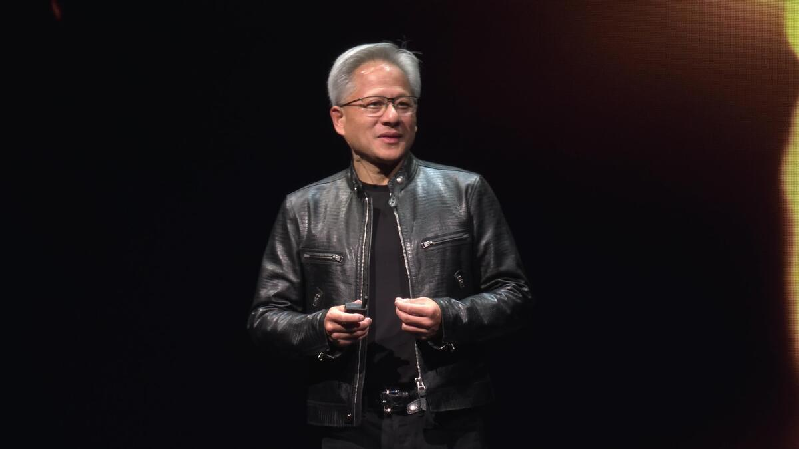
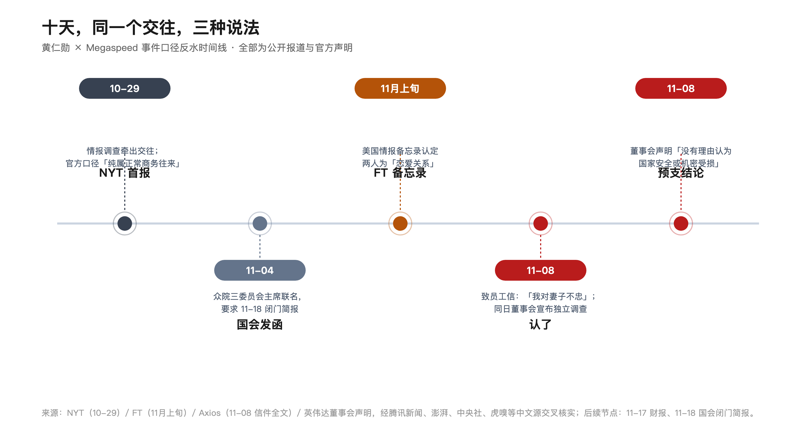
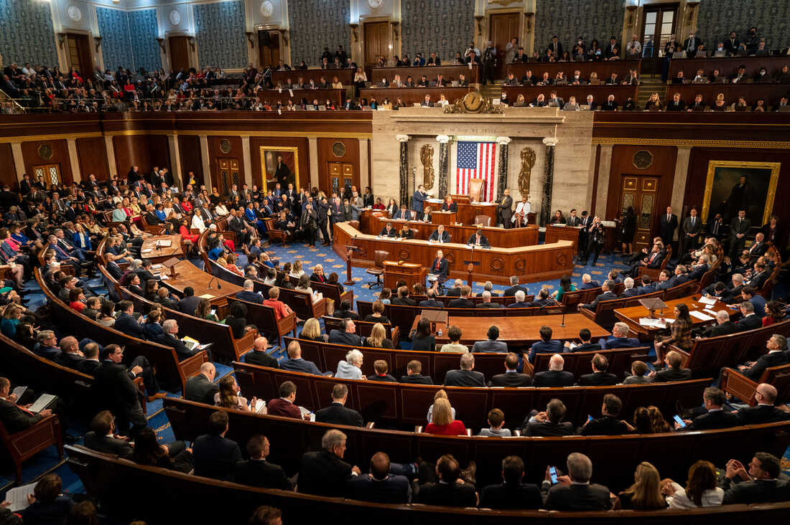

<video controls preload="metadata" style="display:block;max-width:100%;width:720px;margin:0 auto;" poster="/assets/videos/2026-11-10-huang-megaspeed-cover.jpg" src="/assets/videos/2026-11-10-huang-megaspeed.mp4"></video>
*十天改口、四十八亿采购、一千五百亿共同持股，两分半讲清这封道歉信背后没答的题*

老话说，纸包不住火。但比纸包不住火更耐人寻味的，是纸破了之后，大家怎么补。

11 月 8 日，英伟达官网刊登了黄仁勋致全体员工的信。他承认对妻子不忠：「我的行为伤害了她和我们的孩子。我所做的一切没有任何借口。」63 岁，执掌英伟达三十多年，第一次用这种体裁公开认错。信写得体面，认错认得干脆，还专门请求外界给家人留点隐私。

单看这封信，你会觉得这是个体面人。

但把日历往回翻十天，同一件事有两个说法。

10 月 29 日，《纽约时报》报道美国情报部门在调查新加坡算力公司 Megaspeed 涉嫌转运受管制芯片时，发现其前高管黄乐（Alice Huang）与黄仁勋交往密切，美方情报评估认定她是「中国官方发展的线人」。当天的回应是：黄仁勋每年会见数千名客户高管，两人互动「纯属正常商务往来」。英伟达发言人的补刀更妙：「如果公司真是某个威胁的目标，相信美国政府早就通知他们了。」

一周多后，FT 报道美国情报备忘录认定两人是恋爱关系。再过两天，那封信来了：「我对妻子不忠。」

从「纯属正常商务往来」到「对妻子不忠」，十天。

商务往来不会需要道歉信。

信登出来的同一周，众议院外交事务、中国问题特设、情报三个委员会的主席联名致函，要求他 11 月 18 日出席闭门简报会——三位主席，全是共和党人。同一天，英伟达董事会宣布启动独立调查，声明里写着：「目前没有理由认为美国国家安全或英伟达的机密信息受到损害。」发言人紧跟着补了一句：「今天的消息不会让英伟达放慢脚步，黄仁勋继续担任 CEO。」

调查还没开始，结论先发了。

独立调查的意义，在于结论不可预知。如果结论在调查开始前就写好了，那不叫调查，叫背书。董事会请了外部法律顾问、组了独立董事委员会，阵仗是「我们要查清楚」；声明却先把最坏的可能提前排除掉——查出来的东西无论是什么，都动摇不了「没有理由认为受损」这八个字。

这封信的写法也很讲究。给妻子孩子那几段是家书，给股东董事会那几段是治理文件。最关键的一段长这样：「我支持调查，并将全力配合。我热爱我们的国家，也热爱我们的公司，我将致力于保护 NVIDIA、支持美国的国家安全。我以身为美国人为荣，也心存感激。」

一封认错的信里，个人道歉和国家忠诚出现在同一段。这不是忏悔，是律师参与过的声明。

该说不说，这事对黄仁勋本人有点不公平。没有起诉书，没有实锤。所有间谍指控来自匿名官员转述的情报评估，虎嗅说得直白：「目前没有任何一个国家检方对黄乐提出正式起诉。」中国外交部发言人郭嘉昆的回应是「纯属捕风捉影，污蔑抹黑」。黄仁勋本人也从未承认任何间谍相关指控——他认的只是私德。美国官员自己的评估也是他可能并不知情。特朗普出来打圆场：「只知道他是个好人。」马斯克转发：「我同意。」

但董事会的调查不是查私德的。声明原文是调查「黄仁勋成为国外情报行动目标」一事。也就是说，董事会真正关心的，是那 48 亿美元。

NYT 报道，Megaspeed 在马来西亚的关联公司，2024 年 6 月到 2026 年 2 月，采购了至少 48 亿美元含英伟达芯片的设备。美国商务部怀疑这些芯片合法出境后，算力被远程租给了受出口管制的中国企业。据报道，商务部已把 Megaspeed 的事移交司法部。而黄仁勋持有英伟达约 3.58% 股份，其中约 1500 亿美元的部分，与妻子构成共同受益所有权。伯恩斯坦的评估说得更直白：他手下有 60 名直接下属，几乎一人掌控公司所有运转，若他无法继续领导，「目前并不清楚由谁接手」。

一家 4.5 万亿美元市值的公司，治理风险等于一个人。

这些事，道歉信一个都没回答。

48 亿的采购链条上，CEO 与大买家高管的私人关系是「商务往来」还是「恋爱关系」，决定出口管制问题查到哪一层。1500 亿的共同持股，在独立调查期间怎么处理，没人提。60 个直接汇报者里，谁在监督 CEO，没人提。信里说「我将全力配合调查」——配合，和接受监督，是两回事。

市场用脚投票了一次。11 月 9 日，英伟达盘初跌近 7%，盘中一度跌近 9%，跌到 3 月以来最低，年内涨幅全部回吐。预测市场 Polymarket 给「年底前辞职或被免职」开出的盘口，截至北京时间 11 月 9 日早间，隐含概率约 14%。真正的大考还在后头：11 月 17 日财报，11 月 18 日众议院三委员会主席的闭门简报，前后脚，48 小时。简报上他要回答的不是「为什么穿皮夹克」，是「为什么改口」。

曾经那个「从 17 岁认识妻子之后，我完全没有购物了」的男人，如今在最需要人设的时候没了人设。可平心而论，私德的诚实他已经给了——十天里改了口，认了，道歉了。真正悬着的，是公司的诚实。

为什么调查还没开始，结论就能先发？

凭什么一个人的私德被盘问得事无巨细，公司的利益结构却可以先领「没有理由认为受损」的免检标签？

11 月 18 日那场闭门简报，他还会再认一次什么？

咱盯着英伟达股价的，或者就拿着它当 AI 时代的水电煤在用，都不用慌——这公司照常运转，芯片照常出货。但下次看到「董事会全力支持」这种话，多想一层：支持调查，和支持调查结果，是两码事。11 月 17 日和 18 日，双考连着来，答案在纸的另一面。

（资料来源：Axios/纽约时报/金融时报报道经腾讯新闻、澎湃、中央社、新浪财经、网易、虎嗅等中文源交叉核实；信件全文经 Axios 原文比对。本文为基于公开报道的评论，所有间谍指控均为美方情报评估转述、未经司法认定。）
