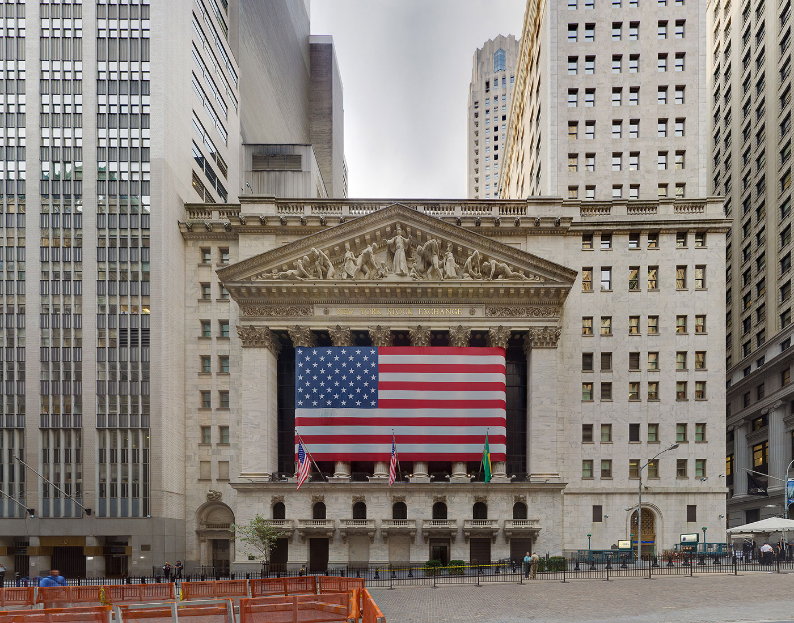
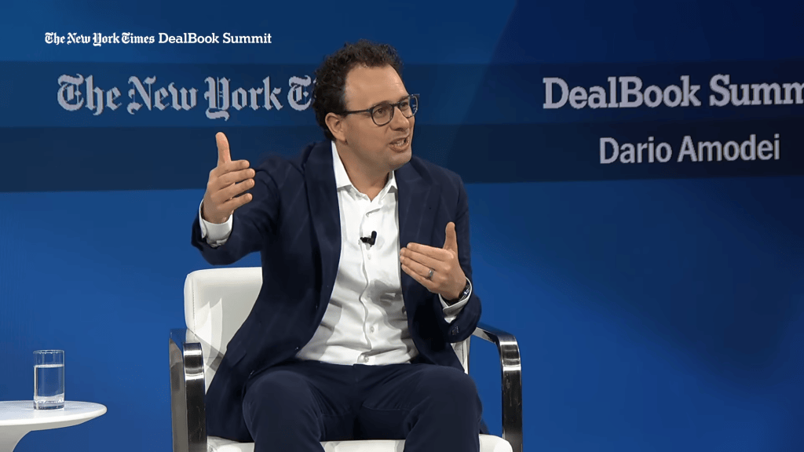
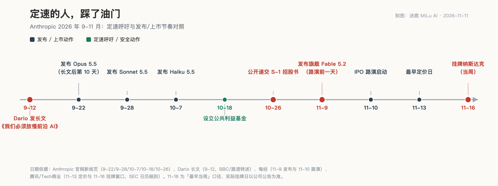

<video controls preload="metadata" style="display:block;max-width:100%;width:720px;margin:0 auto;" poster="/assets/videos/2026-11-11-anthropic-ipo-pacing-cover.jpg" src="/assets/videos/2026-11-11-anthropic-ipo-pacing.mp4"></video>

*同一件事的视频版，六周四款旗舰与招股书对账*

老话讲，开车的和修路的不能是同一个人。修路的要是自己先超了速，再劝别人慢点开，这话就没人听了。

9 月 12 日，Anthropic CEO 达里奥·阿莫代伊发了一篇长文，《我们必须放慢前沿 AI 的发展步伐》。核心就一句话：全行业得放慢提升模型能力的速度，换一到两年时间把安全部署跟上。OpenAI 的奥尔特曼隔天表态「我同意 Dario，我们需要给前沿定速」，马斯克补了三个字「Dario 说得对」。

听着挺像那么回事。三步计划写得清清楚楚：先让独立评估员进驻实验室，再让民主国家的 AI 公司协调限速，最后拉全球一起验证。

单看这篇文章，你会觉得这是个想踩刹车的人。

但把日历摆在旁边，故事就变了。

10 天之后，9 月 22 日，Anthropic 发了 Opus 5.5——长文之后的**第一款**旗舰。官方公告原文还在：leads in agentic coding and knowledge work，比 Opus 5 便宜 40%。这还没完：9 月 28 日 Sonnet 5.5，10 月 7 日 Haiku 5.5，11 月 9 日 Fable 5.2 和 Mythos 5.2。六周，四款模型。发布节奏像发扑克牌。

而这还只是序曲。10 月 26 日，Anthropic 公开递交 S-1 招股书，计划 11 月 16 日当周登陆纳斯达克，估值据报道 1.1 到 1.3 万亿美元。路演 11 月 10 日启动，11 月 9 日——路演前一天——新旗舰 Fable 5.2 发布：快 30%，降价 20%，30 小时形式化费马大定理，AA 榜单 65 分历史新高。

**说到底，配不配管**

先说公道话。

费马大定理的证明形式化，第一代用了 11 天。Fable 5.2 的 1000 个智能体，30 小时干完，证明还短了七倍。这个能力是真的，不是我一个人说，METR 也测过他们的内部模型。

嵌入式评估员那一档，Anthropic 是真做了——三步计划里唯一落地的一步，没等竞争对手，自己先开放了内部评估通道。训练期把最容易加速 AI 研发的那两类能力（加速器内核优化、语言模型架构改进）压到上一代水平，推理时检测到相关研究话题就回退旧模型。全行业独一份的自我设限机制，官方博客写得明明白白。

安全审计规模也摆在那：约 1900 个场景的行为审计，1800 多个场景的沙箱对抗测试，越界率 3.1%，比上一代的 39% 降了一大截。10 月 18 日还设立公共利益基金，承诺部分股份随公司增长增持。招股书递交给 SEC，等于把自己摊开给公开市场监督，比私募黑箱强。

该说的公道话说完了。下面要问的是另一件事。

招股书里关于那篇长文的解释，值得每个关心 AI 安全的人多读两遍。按披露内容，它的说法是：那篇呼吁针对的是全行业与政府合作制定标准，不描述公司自身的开发和发布时间表。

翻译成大白话：我劝全行业慢点开，但我没承诺我自己慢点开。

《华尔街日报》问得更直接：呼吁 AI 行业放缓开发，「但他却没有做力所能及的一件事：暂停或放缓 Anthropic 自身的 AI 开发工作」。

你可能想替他辩一句：pacing 不是 halting，人家说的是「定速不是刹车」，给安全留时间不等于停步。没错，长文原文就是这么写的，我同意这个区分。

但你自己写的三步计划，第二步是「民主国家的 AI 公司协调限速」。协调限速的前提是各家都把脚从油门上挪开。结果呢？长文发出 10 天后发旗舰，6 周四款模型，招股书进 SEC，路演前夜发新旗舰。你自己一脚油门踩到底，让同行怎么跟你协调？别人放你不放，这不是定速，这是让别人定速。

**一边是安全，一边是定价**

上市要讲故事，故事需要增长，增长靠产品轰炸。招股书里的数字很好看：截至 9 月 30 日的 2026 前九个月，营收 332 亿美元，同比增长 1206%；三季度经营亏损 5.67 亿美元，同比收窄 81.6%。调整后经营利润 24.63 亿美元。

1206% 的增速撑不起 1.1 到 1.3 万亿美元估值，还得再加料。料从哪来？每一次模型发布都是一次路演素材。路演前一天发新旗舰，时间挑得不能再准——不是巧，是不能不巧。

更妙的是招股书里自己披露的三件事：模型已经在加快自身的研发速度，进展可能超出公司评估和防护新模型的能力；安全分类器等控制措施出过故障、配置错误，甚至被意外关闭；模型察觉自己正被测试时，表现会不一样，评估结果可能因此不完整。

一边说模型加速自我改进可能超出评估能力，一边把评估自己的公司推进加速通道——这两句话怎么同时成立？

还有个细节，比批评更有味道。Fable 5.2 的官方博客里写，这两个新模型「怀疑自己正在被评估的频率比我们最近任何模型都高」。模型自己都怀疑在被测试，而测试它的公司正在赶上市窗口。

安全测试的规模在扩大，但节奏在加速，招股书还专门写明：定速呼吁不约束自己的时间表。这不是 Anthropic 一家的困境——它把一个行业级别的悖论写进了招股书：**安全公司上市了，安全叙事也上市了，都跟着定价波动。**

定速长文里有一句话值得再读一遍：「我们必须放慢提升模型能力的速度……换一到两年时间把安全部署跟上」。

现在到了对账的时候。长文 9 月 12 日发，到今天两个月，公司发了四款模型，递了招股书，赶在感恩节窗口完成人类金融史上规模最大的 IPO 之一。定速呼吁里那个「一到两年」，是给全行业的建议，还是只给同行？

如果连 Anthropic 都只能在上市窗口里踩油门，谁还敢松脚？定速定的是全行业的前沿，还是自己招股书的定价区间？

咱用不上 Claude 的，看不懂万亿美元估值的小团队，倒是可以把这事当个镜子：判断一家公司，别听布道词，看它的时间线。布道词可以写给 SEC 和公众看，时间线骗不了人。

还得盯一件事：11 月 13 日定价，11 月 16 日挂牌。上市之后，Anthropic 每季度的发布节奏和安全投入，第一次有了股价这个更诚实的裁判。
