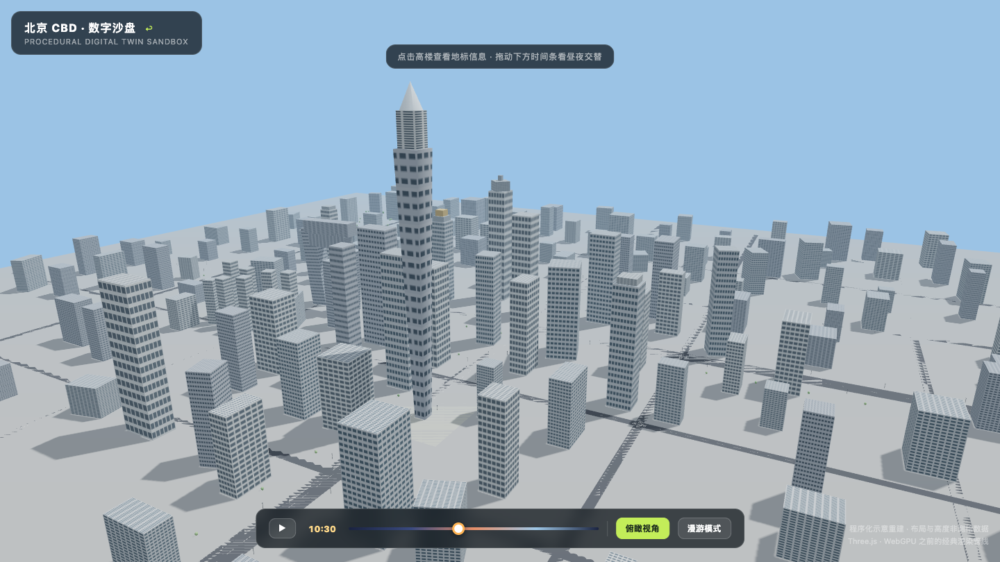
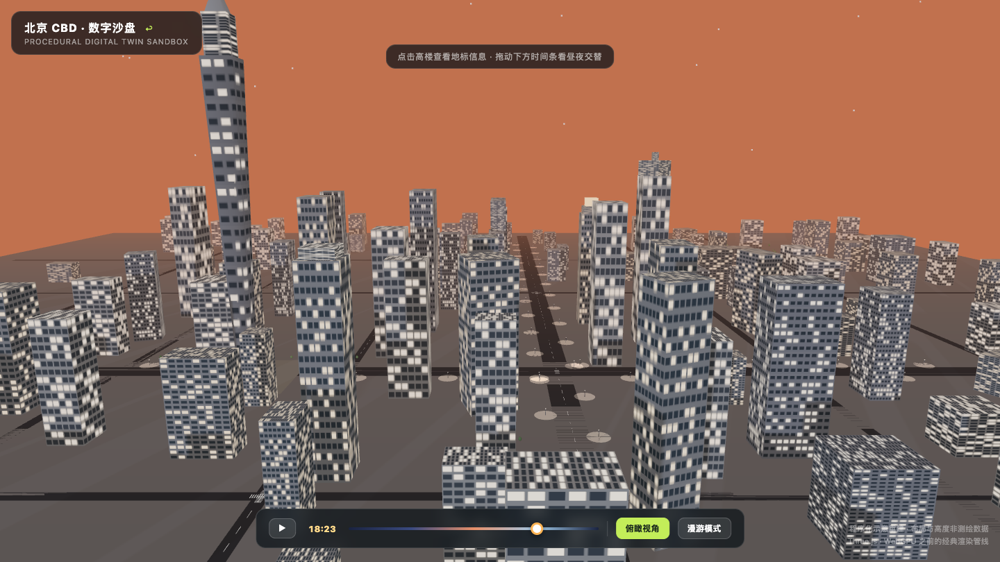
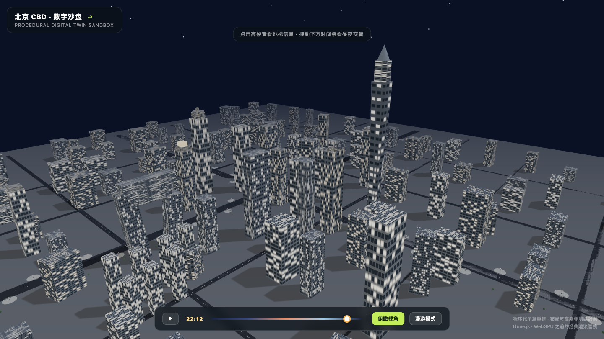
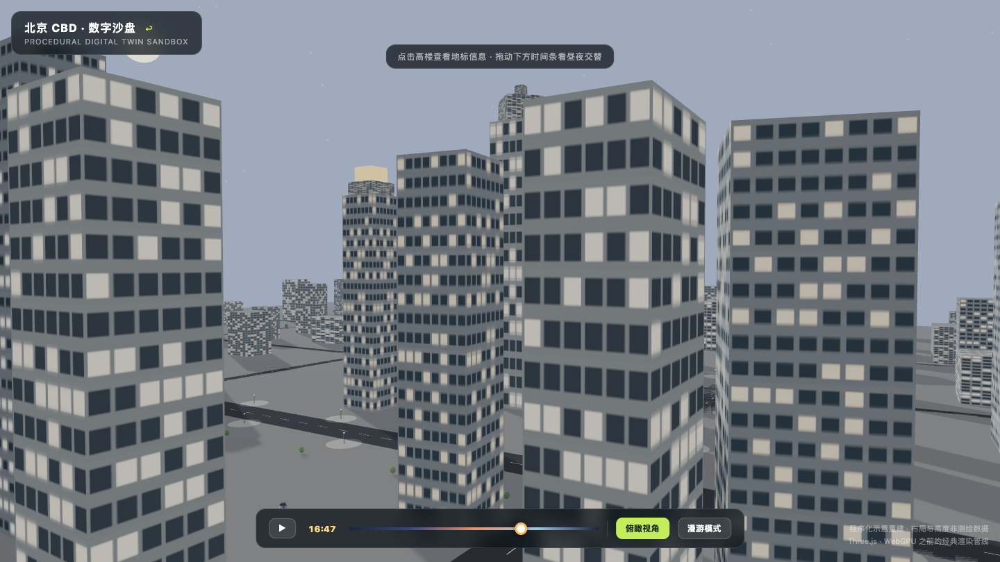

*程序化重建的北京 CBD：中间那根收分的塔是中国尊*

先看效果。下面这段视频里：城市天际线绕着镜头转，天色从上午九点一路跑到深夜——楼宇窗灯渐次亮起、路灯在地面上晕开光斑、星空升起来。后半段镜头切到第一人称，你站在长安街的路面上，车流贴着斑马线开过去，抬头就是两侧的塔楼。

<video controls preload="metadata" style="display:block;max-width:100%;width:720px;margin:0 auto;" src="/assets/videos/2026-11-12-beijing-cbd-sandbox.mp4"></video>
*二十八秒昼夜全循环 + 第一人称街景漫游（720p）*

这一切不是建模软件里做出来的，是一个网页。起因是我给 AI 下了一条提示词：

> 生成一个网页城市数字可交互沙盘，城市是北京 CBD，根据网络地图数据和图片识别地形和城市建筑道路交通等，建模写实精细可以旋转缩放平移。可以拖动 24 小时的时间条呈现白天黑夜，点击地标能呈现信息，可以第一人称视角城市漫游。

这条提示词现在收录在[迷鹿提示词库](/prompts/beijing-cbd-sandbox/)里，可以照抄。但更值得聊的是：它哪些部分成立，哪些部分不成立——这才是用 AI 做东西的真实经验。

## 提示词里"对"的部分：需求陈述得越具体，产出越接近想要的

这条提示词其实是一份浓缩的需求清单，五句话各管一件事：

1. **"网页城市数字可交互沙盘"**——定了载体（浏览器）和形态（三维、可交互）。说"网页"而不是"做一个三维模型"，AI 就不会去输出 OBJ 文件，而是直接给你能跑的代码。
2. **"城市是北京 CBD"**——定了主题。附带的价值是地标清单自动明确：中国尊、国贸三期、央视大楼、银泰中心……这些名字不用你逐个列，AI 的知识里自带。
3. **"旋转缩放平移 + 24 小时时间条 + 点击地标 + 第一人称"**——四个交互全部点名。提示词里写"可以XX"的句式，AI 会把它理解为验收标准而非装饰语。
4. **"白天黑夜"**——决定了一套完整的天光系统：天空颜色随时刻插值、太阳月亮位置、楼宇窗灯和路灯只在夜里亮。这是个隐藏的大需求，幸好它只需要一句话。
5. **"第一人称城市漫游"**——最容易被漏掉的需求，漏了它沙盘就只是"能转着看的模型"，有了它才有了"在这个城市里散步"的体验。

一句话总结：**交互需求一条都不能省，每一条"可以"都会变成一行代码。**

## 提示词里"不成立"的部分：别指望 AI 真的去"根据网络地图数据建模"

提示词里有一句"根据网络地图数据和图片识别地形和城市建筑道路交通等"——这句要泼冷水。

AI 没法在对话里真的去爬地图数据、做图像识别、再转成三维模型。它的实际做法是**程序化重建**：调用自己的知识，把中国尊做成一个 528 米高的收分塔身、把央视大楼做成两座斜塔加悬臂、把长安街和东三环摆到正确的相对位置上。道路网格是程序生成的，背景楼群的密度和高度靠随机分布加距离衰减来模拟。

效果如何？看图：

*黄昏时分的 CBD，窗灯和天光同步过渡*

几个诚实的结论：

- **轮廓对，尺度对，天际线认得出来**。中国尊的收分轮廓、央视的悬臂环、银泰的"灯笼"冠都在。给不知道这是哪的人看，大多数人能猜到"北京某个 CBD"。
- **布局是示意的，不是测绘的**。建筑间距、街区尺寸、道路走向都是近似。拿它做数据可视化背景、做教学演示、做创意视频素材完全够；拿它做导航、做规划论证，不行。
- **"写实精细"有上限**。提示词里要"写实"，AI 会用立面纹理、窗灯贴图、雾效、色调映射这些手段往"照片感"凑，但距离照片级渲染还有明显距离。想要真写实，路径是接真实 GIS 数据 + 摄影测量模型，那是另一条工程路线，不是一条提示词能跨过的。

所以这条提示词的合理预期是：**程序化示意沙盘，视觉氛围拉满，数据精度有限**。写提示词时把"根据网络地图数据建模"改成"根据你对北京 CBD 的知识程序化重建"，反而是更诚实的写法，产出质量不会有差别——因为 AI 实际就是这么干的。

## 人机分工：AI 干七成，人干三成

这条提示词一次生成的结果，大约七成可用。剩下三成，是人的活：

**AI 一次做对的**：城市骨架（地标几何 + 路网 + 背景楼群）、四个交互的系统框架、昼夜天光系统的整体设计。这些要是自己写，是几百行 Three.js 代码的活，AI 一轮给出能跑的版本，这是它真正省时间的部分。

**人要接手调的**：

- **光照参数**。AI 默认的白天曝光偏亮，整张图发灰白。太阳强度、半球光、色调映射曝光这几个参数要人看着图往回收。
- **机位**。默认相机太低太近，天际线压在画面上半截。俯瞰角要多高、离多远、看哪个点，得人定。
- **城市密度**。首版背景楼群太稀疏，CBD 的"楼海"感出不来。网格间距、高度分布、离核心区的衰减梯度，都要按目视效果调。
- **细节bug**。比如我遇到的第一人称截图模式失效——一处代码顺序问题，AI 自己看不出来，人来定位。

**经验公式：AI 负责"从 0 到 70 分"，人负责"从 70 分到能发布"。** 省掉的是搭框架的苦活，留下的是审美和调试的判断活。这跟用 AI 写文章一个道理：初稿飞快，定稿靠人。

## 一条提示词之外：让它变成"作品"的三件小事

同样是让 AI 生成沙盘，做完这三件事，成品的完成度会完全不同：

*夜晚是沙盘的加分项：窗灯、路灯光晕、星空同时出现*

1. **给它加"截图模式"**。在提示词里补一句：加一个通过 URL 参数驱动的确定性截图模式，支持指定时间、机位、视角。有了它，才能用无头浏览器批量出图、逐帧录屏——你在本文看到的所有图片和视频都是这么来的。没有它，你只能开着浏览器手动截。
2. **本地化依赖**。Three.js 别走 CDN，下载到站点目录里引用。一来加载快、二来离线能跑、三来截图录制时不被网络抖动坑。
3. **录一段"会动"的证据**。静态截图说服力有限，昼夜交替的时间条一拖、第一人称一开，效果是十倍级的。无头浏览器 + CDP 抓帧 + ffmpeg 合成，半小时内搞定一段 720p 演示。

这三件事都不难，但都不在最初那条提示词的覆盖范围内。**AI 生成的是"功能"，作品感来自这些功能之外的包装**——这也是目前人机协作里最稳定的一条规律。

## 提示词原文与收尾

完整提示词（连同我最终调好的参数版本）已收录进提示词库，点开就能抄：

→ [北京 CBD 数字可交互沙盘 · 提示词条目](/prompts/beijing-cbd-sandbox/)

沙盘本体也可以直接玩（旋转缩放、拖时间条、点地标、WASD 漫游）：

→ [打开北京 CBD 数字沙盘](/prompts/beijing-cbd-sandbox/sandbox/)

*第一人称视角仰望中国尊，黄昏*

最后说下这个提示词库：以后我会把这类"跑通过、有成品、能照抄"的提示词陆续收进去，每条附原文、拆解和实拍效果。与其收藏一堆看不懂的咒语，不如攒一批验证过的工具。
