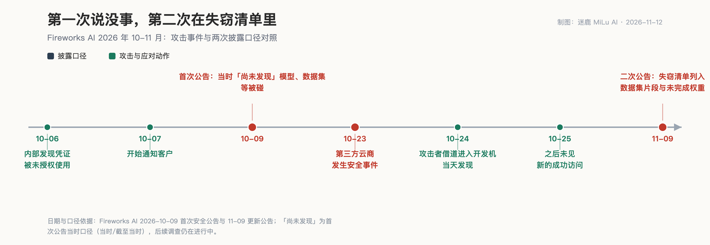
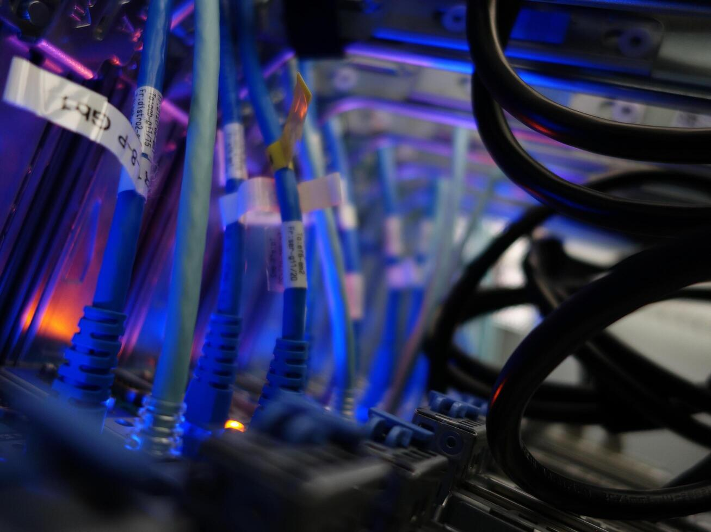
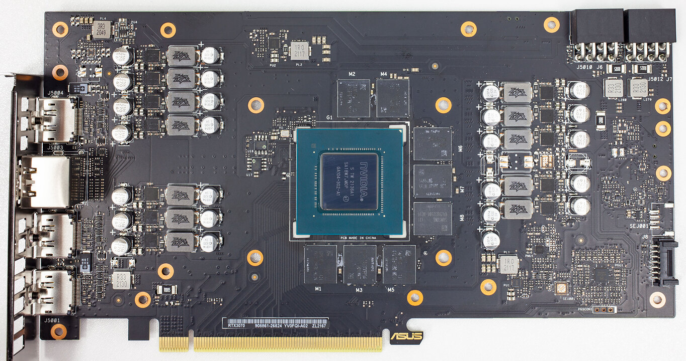

<video controls preload="metadata" style="display:block;max-width:100%;width:720px;margin:0 auto;" poster="/assets/videos/2026-11-12-fireworks-breach-all-clear-cover.jpg" src="/assets/videos/2026-11-12-fireworks-breach-all-clear.mp4"></video>

*同一件事的视频版，两份公告逐句对账*

老话说，话别说太满。你今天写下「未发现证据」，下个月就得解释当时为什么没发现。

11 月 9 日，Fireworks AI 第二次通报 10 月的安全事件。这家公司靠一句话吃饭：你把钥匙、数据、微调好的权重，放我这儿。Notion、Cursor、Harvey 都是冲这句话来的，据 Forbes 报道，它手里攥着大约一万家企业客户。

第一次通报是 10 月 9 日。公告写得很有分寸，当时「尚未发现有人在其安全边界内未经授权访问客户模型、数据集、训练数据、个人信息或推理流量」。

一个月后，11 月 9 日的更新公告交出了失窃清单：资源元数据，账单地址、发票与付款历史，账户余额、额度使用，还有——部分客户的秘密、数据集片段，和未完成的模型权重。

说「没发现证据」的那几样，一个月后躺在失窃清单里。

这家公司不是无名之辈。2022 年成立，做开源大模型的推理和训练服务，2026 年 7 月年化营收做到 10 亿美元（WSJ 口径），同月估值 175 亿美元，这条赛道上估值最高的初创。出事之后的应对也够快：聘 Palo Alto Networks 的 Unit 42 做取证，通报执法部门，主动停掉自助数据集上传下载，零数据保留的推理服务经它自查未见影响；10 月 24 日入侵发生，当天发现，10 月 25 日之后没再见到新的成功访问。该说不说，这个反应速度是真金白银砸出来的水平。

可惜，下面三件事也是真的。

## 时间线摆在一起，话就成了一份进度报告

最锋利的证据，是它自己写下的字。

10 月 9 日那份公告，处理的是 10 月 6 日发现的问题：有人未经授权使用了「少数客户账户中用于评估任务的环境变量里的存储秘密」。10 月 7 日起通知客户，随后轮换员工 API key、撤销用户密钥。然后是那句要紧的话——当时「尚未发现」模型、数据集、训练数据、个人信息、推理流量被碰。截至当时，这话挑不出毛病。

10 月 23 日，为它研发机器提供托管的第三方云商发生安全事件。10 月 24 日，攻击者借道进入 Fireworks 的开发机，跑上了未授权工作负载——当天发现，10 月 25 日之后未见新的成功访问。Bloomberg Law 给这件事的定性是：数周内第二次已知入侵。

得说一句公道话：这是两起独立的事件，公告也没有把两件事搅在一起。

但客户分不了这么细。你 10 月 9 号告诉他们，安全边界内没发现模型和数据集被碰；两周后，边界本身被人从隔壁院子打穿了；11 月 9 号交出的失窃清单里，「数据集片段」「未完成的模型权重」白纸黑字在列。第一次公告里点名「没发现被碰」的那几个名词，第二次公告里逐个出现在被偷的东西中间。客户拿哪一份，来决定明年把钥匙放在哪儿？

第一次那个「没发现」，不是安全结论。是调查进度。

这门生意的底细，也被这回的事捅了出来：门不在 Fireworks 家里，在隔壁。研发机器托管的那家第三方云商先被入侵，攻击者从它那儿借道，进了开发机。

我不知道那家云商是谁。公告里没写，也许永远不会有下文。

这才是推理这门生意的底细。客户以为钥匙交给 Fireworks 就完事了，实际上钥匙坐在一条链上：云商的机器、开发机、环境变量里的秘密、数据集、微调到一半的权重。任何一环漏了，全链买单。公司自己把这次攻击定性为 LLMjacking——偷算力访问权，经非法网关转卖牟利——并援引 Mandiant 和谷歌威胁情报组 11 月 2 日的研究：干这行的，初始入侵和算力转卖早就分了工，各干各的，都很熟。

分工成熟的意思是，这不是哪个天才黑客的手笔，是一条产业链。而一万家企业的评测集和权重，就挂在这条产业链路过的地方。

爆炸半径也已经量出来了。Notion 确认，不到 1% 的工作区，部分 AI 聊天会话可能已经暴露。Harvey 的发言人说客户数据未受影响——注意，这是它自己说的，不是独立核验。Cursor 还在评估。

## 这门生意，开始漏气

生意这头，动静更实。据 The Information，Fireworks 已把这事告知 Harvey 等大客户，有年烧数百万美元的客户在考虑迁走。Forbes 报道得更直接：两家客户称已经实质迁走了业务，其中一家批评这是「very bad hacks」，还抱怨沟通糟糕；还有两家压根不知情。

不知情这三个字，比失窃清单还难看。一家靠「放我这儿」吃饭的公司，出了事，一部分客户是从媒体那儿知道自己可能受了灾的。

同一时间，据 WSJ 报道，Fireworks 原计划本周启动一轮 300 亿美元及以上估值的新融资谈判——7 月那轮是 175 亿，三个月想涨七成多；刚聘的前 Meta 首席战略官戴夫·韦纳出任 CFO，上市的意思已经写在人事任命里。

融资谈判和客户流失，撞在同一个星期。打算按 300 亿估值进场的人会怎么读这一个月：10 月 9 日「没发现」，10 月 23 日云商被打穿，11 月 9 日权重和数据集在列，客户在迁走，有的从新闻里才知道自己可能是失主。这些不用谁去指控，全是公告和报道里摆着的字。

凭什么呢？

凭什么一家卖「放我这儿安全」的公司，连自家开发机坐着的院子都看不住，却要一万家企业替它的供应链作保？凭什么第一次公告的「没发现」可以当安民告示发，第二次公告就得让客户自己对答案？CEO 林乔说，攻击者「似乎不是冲着权重来的，因为下载多为残缺且中途停止」——公司单方口径——可残缺的权重就不是权重吗？丢了一半的评测集，就不是客户的数据吗？

咱用推理平台的不用慌，云照常上，模型照常调。但下次续约前，把合同翻出来查三样。第一，你的身份写清楚没有：你是数据控制者，它只是处理器，出了事谁通知你、几天内通知。第二，它的上游子供应商出了事，通知义务延不延伸到你——这回 Fireworks 自己就是被上游坑的，你的供应商头上还摞着几层。第三，微调出来的权重算谁的资产、丢了怎么赔、能不能在别处再训一份。

话别说太满。第一次公告留了「截至当时」四个字的余地。一个月后，那点余地，正好用来装失窃清单。

（资料来源：Fireworks AI 两次安全公告原文；Forbes、Bloomberg、The Information、WSJ 报道经中文源交叉核实；Notion 与 Harvey 表态均为各自公司口径。本文为基于公开信息的评论，事件仍在调查中。）
