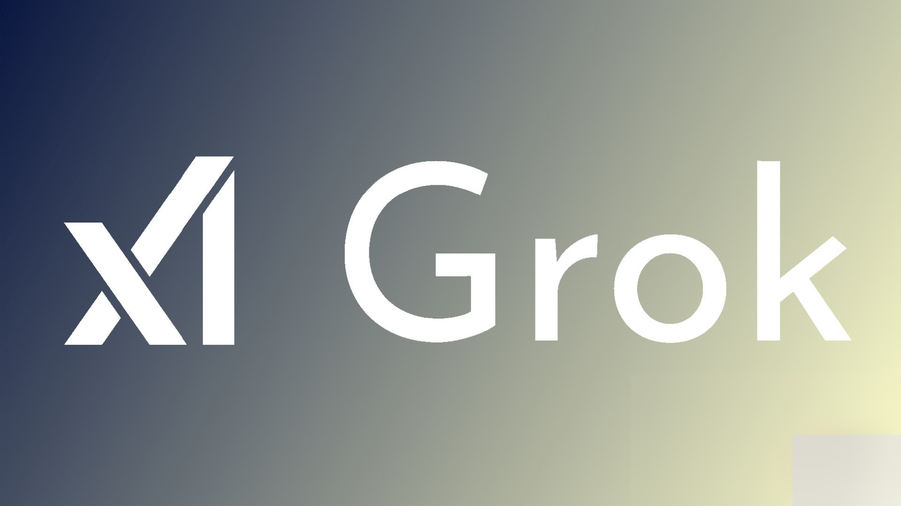
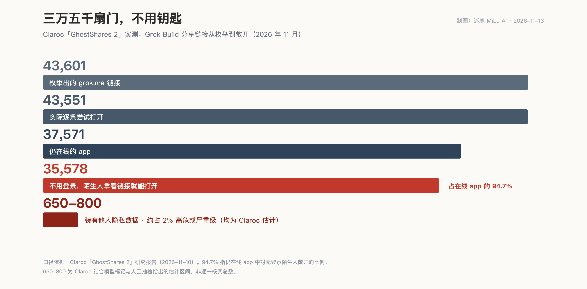

<video controls preload="metadata" style="display:block;max-width:100%;width:720px;margin:0 auto;" poster="/assets/videos/2026-11-13-grok-build-ghostshares-cover.jpg" src="/assets/videos/2026-11-13-grok-build-ghostshares.mp4"></video>

*同一件事的视频版，四万三千条幽灵链接对账*

做锁的人，自己家不会不装锁。开保险柜行的，也不会开着柜门过夜。这不用学，是本分。

11 月 10 日，安全公司 Claroc 发布报告：Grok Build 这个"几分钟造一个 app"的平台上，三万五千多个 app 不用登录、拿着链接就能打开。其中 24 个，是 SpaceXSI（SpaceX 与 xAI 合并后的主体）自己员工建的。里面有标着 confidential 的企业销售新人入职计划，有盖着 594 个客户账户的销售区域地图，还有一份发给美国联邦机构的广告提案——文件上同样印着 confidential。研究员开进那份入职计划时的原话是："We were shocked."（我们惊了。）

我的判词很简单：这不是失误。失误是意外，是设计没兜住的角落；而"默认公开"是 Claroc 实测出来的出厂设置。一家替人保管秘密的公司，把门出厂默认开着——这不该叫失误，该叫选择。

行为经济学管这个叫默认效应。塞勒和桑斯坦在《助推》里讲：绝大多数人不会去改默认设置，不是因为认同默认选项，是因为改它要花力气。器官捐献同意率，默认捐献的国家和默认不捐的国家能差出几十个百分点，不是两国人对生死的态度差那么远，是表格上预先打好的那个勾不一样。默认选项看起来最不像决定，其实是分量最重的那个决定。

所以那个 94.7%——据 Claroc 测试，37,571 个还在线的 app 里，35,578 个对陌生人敞开——不是几万个用户都想过"我要公开"，是几乎没有一个人被问过。他们只是没去动那个本来就选好的勾。

先讲几句公道话。

Grok Build 这产品本身确实顺手，一句话进去，一个能用的 app 出来，销售要用个跟进面板，不用提预算、不用走采购，聊两句就有了。分享链接它也确实做了随机化：三个不相干的随机词拼成子域名，正常人猜不出来，方向是对的。Cursor（SpaceXSI 近期收购的编程公司）的代表也对记者说了，员工账号出厂默认是 "Only you"。自家那 24 个 app 被问到之后，几个小时内就撤了，现在打开返回 app not found。这三件事都是真的，都记着。

但另一个默认，跟这几句话打架。

据 Claroc 的付费测试账号，点下 Publish 之后，权限面板给三个选项："Anyone with the link"、"invited users"、"only you"。光标停在哪儿？停在 "Anyone with the link" 上。想要私密，得自己动手改。

Cursor 的口径是 "apps are private by default and nothing goes public unless the creator chooses to share it"——默认私密，除非创作者主动选择公开。Claroc 不反对前半句，不点发布确实不上线；它拆的是后半句：所谓 "creator chooses"，那个选择早在创作者知情之前就替他做完了。你选了个默认，这不叫你选择。

门是怎么被找到的。

随机词放在子域名里而不是路径里，这个设计有个物理后果：每个链接第一次被人打开，都要触发一次 DNS 查询——互联网得先问路，才知道那三个词住在哪。被动 DNS 服务专门记录这些问路，付费就能按模式检索。Claroc 就是这样枚举出 43,601 条 grok.me 链接、试了其中 43,551 条的。换句话说，链接没被人猜出来，是它每次被打开，都自己朝全网喊了一嗓子"我在这儿"。用的人越多，喊得越响。

对照一下就知道这不是"行业都这样"：Claude 的 published artifacts、ChatGPT 和 Gemini 的分享聊天，秘密都放在路径里，不过 DNS，没这毛病。

开出来的都是什么？据 Claroc 人工核实的部分：医院集团 3,500 多名员工的可检索名册；一个 ICU 病人的病情简报，化验、影像、呼吸机状态俱全——躺在病床上的人不会想到，自己的一次抢救在某个陌生人的浏览器标签页里开着；邮轮厨房的卫生检查清单，船员全名加工号；消防队的实时排班板，姓名和警号都在；一家货运公司招募一千多个司机，法定姓名和私人邮箱整整齐齐；最绝的是一家承包商的工时表 app，代码里躺着 18 个账号的明文密码，管理员也在——每个打开这 app 的人，浏览器都会把那份代码下载一遍。Claroc 估计，约 650 到 800 个 app 装着这类私人数据，约 2% 够得上高危或严重级；认得出主人的组织有 30 个，6 家在财富 500 之列。

随机词确实随机。它们只是排队把自己报告给了全网的路由器。

只关自家的门。

时间线摆出来看。11 月 8 日，Claroc 通过 SpaceXSI 官网 security.txt 里的地址私下通报，附上全部计数、两个测试 app、四条修复建议，还主动提出私下共享完整链接名单，好让它去通知每一个主人。没回音。据 Ars Technica 报道，Claroc 高管随后在 X 上 @ 了 Musk 和 Grok 负责人，也没等来回应。11 月 10 日报告公开当天，SpaceXSI 在记者问询后数小时内撤下了自家员工的 24 个 app——然后呢？剩下的三万五千个公开 app，截至报道发布，原地不动。Claroc 的通报，SpaceXSI 没有直接回过，回的只有记者。

Claroc 那句话值得原样翻过来："the default is a design choice SpaceXSI defended rather than a bug it said it would fix"——默认设置是 SpaceXSI 辩护的设计选择，不是它承诺要修的 bug。

自家那 24 扇门，问一声就关了。剩下三万五千扇别人家的门，就交给一家安全公司挨个发邮件。

这产品的卖点是"几分钟造出一个 app"。那咱想想，那几分钟里，有没有一分钟是想"谁能看见它"？没人想，因为面板早替所有人答完了，答案统一是"谁都行"。一个默认选项替几万个用户做了决定，这决定还算谁的呢？自家的门 24 扇，问一声就关；别人家的门三万五千扇，凭啥就等得起呢？

所以判词收回来：默认公开，不是失误。失误会认、会修、会通知受害者；选择只会辩护。上个月是 Meta Muse 的聊天记录，这个月是 Grok Build，同一个把秘密放进 DNS 的姿势。Claroc 也说了，Lovable、Replit、Bolt、ChatGPT 的 app builder 同样给每个 app 独立域名——这不是 Grok 一家的病，只是这回它病得最重、嘴还最硬。

至于咱：用 vibe coding 造过带数据库的小工具的——哪怕就一个客户名单、一张排班表——今天开个无痕窗口，登出状态点自己的链接。陌生人进得去，那就不是"理论上随机"，是门开着。有人默认上锁——GitHub 同期上线的 Agentic Workflows，出厂就是只读加预算上限；有人默认开门。查完你自己的门，就知道该信哪边的"默认"了。
