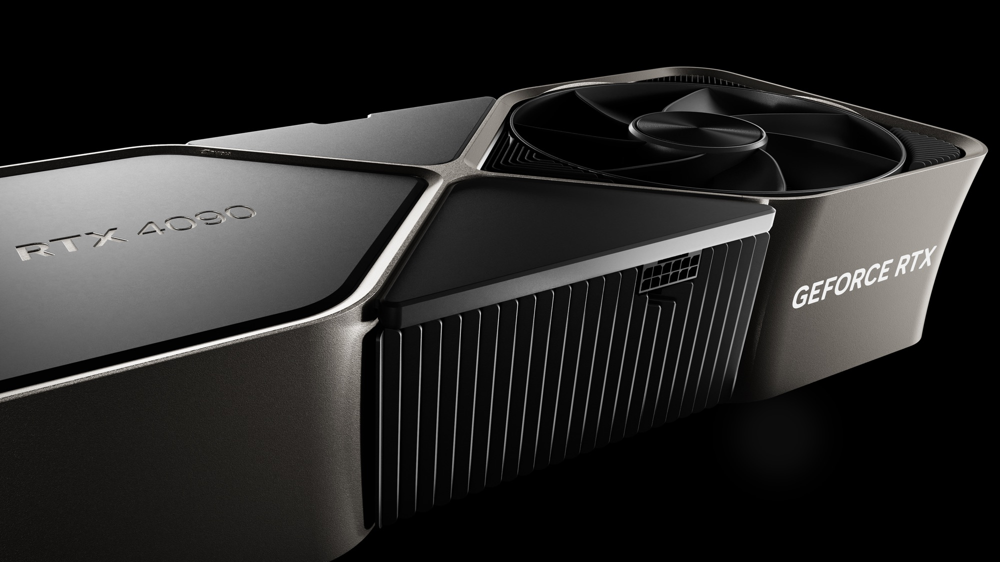
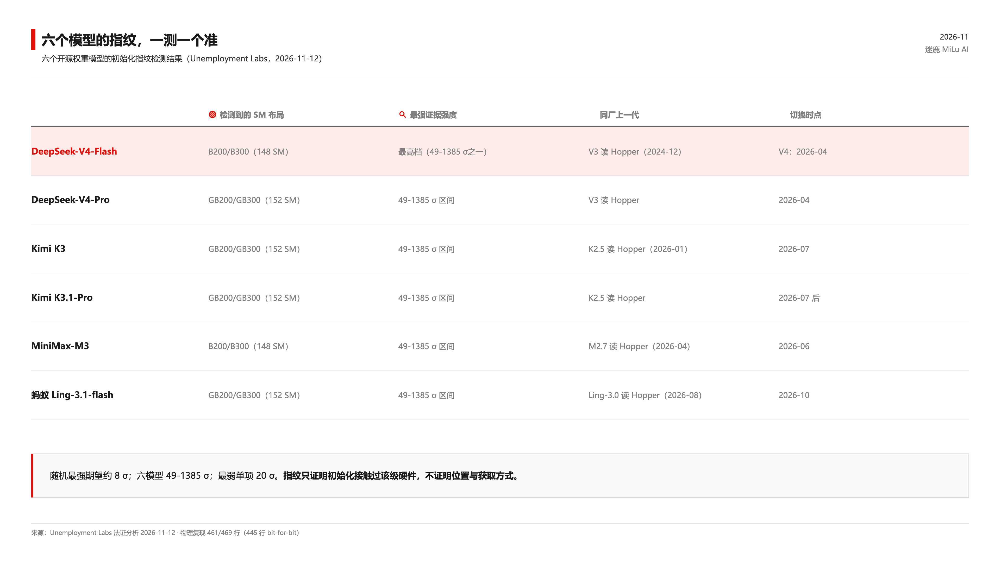

去年起，华盛顿流传一个说法：DeepSeek 打算「清除技术指纹」。「据称」，匿名官员说的，媒体转述，国会调查跟着立项。一年过去，指纹清除没有等来，等来的是另一种东西——11 月 12 日，一个叫 Will DePue 的研究员（在 OpenAI 做过 Sora 与 GPT-5 后期训练）把六个开源权重模型逐个拆开，从初始化参数里读出了 Blackwell GPU 的数学痕迹。要擦的指纹没擦，倒被人用放大镜一个个拓了下来。六个模型：DeepSeek 两代、Kimi 两代、MiniMax、蚂蚁 Ling，报告的标题起得毫不客气——「顶级中国前沿模型带有被出口管制的 Nvidia Blackwell GPU 指纹」。

我的判词很简单：这件事最大的看点不是指纹，是证据。吵了一整年的指控，全是「据称」；第一份硬证据，是一个人用数学算出来的。证据生态脆弱到这个地步，才是真正该记下来的事。

有一个概念可以借来当刀：证据分层。法庭上，间接证据能立项，不能定罪。放风说某人「计划清除指纹」，是动机层面的传闻；指纹留在权重里，是物理层面的痕迹。前者可以被否认一百次也不会少一块钱，后者摆在那里，谁下载谁就能验。这一年华盛顿手里握着的一直是前者，直到 DePue 把后者放到桌上。

先把这份报告该得的敬意给足。

方法不复杂，漂亮在执行。模型初始化时，PyTorch 用 cuRAND 的 Philox 算法按 GPU 的 SM 数量播撒随机数：Hopper 132 个 SM 对应 270,336 个线程位置，B200/B300 148 个 SM 对应 303,104，GB200/GB300 152 个 SM 对应 311,296。权重文件里没被训练碰过的那部分，保留的就是初始化原值。换句话说，每一份开源权重，出厂时都带着它出生那张卡的字形。DePue 做的事，是把约 6 万亿个「种子×布局」组合挨个试过去。纯随机最强期望约 8 sigma，六模型最强证据在 49 到 1385 sigma 之间，最弱单项也有 20 sigma。

这不是纸上推演，是真机复现过的。拿 DeepSeek 自己公布的种子，在 H100 上复现出 V3 的保留值、复现不出 V4-Flash；在 B300 上反过来，V4-Flash 469 行相关系数大于 0.99 的有 461 行，其中 445 行 bit-for-bit 完全一致。租来的 GB200 上，Kimi K3 的 13 行全部复现。种子改一位，全部归零。这套方法在 24 个公开披露硬件的模型上全部命中（作者自注：11 个走 step-zero checkpoint，算一致性检查）。顺手还算了一笔账：用同一套初始化卡数推训练规模，算 DeepSeek-V3 得 2000 到 2500 卡，官方披露过 2048。方法能对上账，才可怕。

单看数据，你会以为铁案要收尾了。往下读，画风变了。

第一件事：放风了一年，全是「据称」。去年匿名官员对媒体说 DeepSeek 用上了 Blackwell，还说「计划清除技术指纹」；据 Reuters 等转述，Moonshot 曾在泰国接洽 8000 卡 Blackwell 集群；国会那边，Neal 和 Wyden 已就 H200 对华 25% 关税立项调查。一整年，没有一条是能拿出来的技术证据——全是匿名官员的嘴，和媒体的耳朵。指控跑了一年，证据上周才出生。

第二件事：说好要擦的指纹，原样在。「计划清除技术指纹」这话说出去的时候，大概没想过验它成色的工具早就免费躺在 HuggingFace 上。六个模型，指纹一格没动，S 就是 S，sigma 就是 sigma，任何人下载权重都能自己量。说要擦干净的手，把证据原件留在了公开货架上。更妙的是时间线：DeepSeek-V3（2024 年 12 月）读 Hopper，V4（2026 年 4 月）读 Blackwell；Kimi K2.5（1 月）读 Hopper，K3（7 月）读 Blackwell；MiniMax、蚂蚁同厂上一代照旧读 Hopper，新款齐齐切换。指纹不撒谎，它把每次换卡的日期都记下来了。

第三件事最有意思：证据到了，结论反而收着。报告自己写得很清楚：指纹只证明初始化那一刻接触过 Blackwell 级硬件，不证明位置，不证明获取方式，不证明违规。作者亲口承认，海外数据中心合法租用是说得通的替代解释——据 Reuters 报道，中国实验室正成规模地涌向海外租算力。AMD MI300X 的特殊配置作为技术替代，对 V4-Flash 已排除，对其余五个「非常不可能」。这份报告通篇没有说出「违法」两个字，还坦白没过同行评审、无独立复现。五家公司没回应，Nvidia 也没有。嗓门最大的一方喊了一年「据称」，唯一握着硬证据的人反而只敢说「接触过」。

两边一对照，一句话就出来了：叫得最响的没有证据，有证据的最克制。

顺手记一笔时间线。11 月 12 日 DePue 发报告；11 月 13 日，OpenAI 向美国政府递了 15 页信函，要求分级出口管制，说 DeepSeek 构成「重大风险」，信里有句原话：领先优势「并不大，而且正在缩小」。信函和报告隔了一天，没有证据表明有关联，只是碰巧挤在同一个星期里。这个星期里还挤着谁呢？去年就开始放风的官员，立项一年的调查，和六份人人可下载、谁都能验算的权重文件。

那咱把这个问题想到底：一年时间，一个政府级议题，全世界最有资源的机构们拿出来的证据是「据称」；一个研究员，一台租来的 GPU，六万亿次数出来的证据是 1385 sigma。如果指控可以只靠嗓门走一年，那还要证据干什么呢？如果连真正拿到证据的人都要把结论往回收着说，那些没有证据就喊满一年的，又该拿什么还呢？

所以判词收回来：这事的看点从来不是「六家中国公司用了 Blackwell」——这个结论没人有资格下，报告作者自己都没下。看点是，一整年的指控生态，喂给国会的全是转述和匿名，而第一个把证据做实的人选择了最轻的措辞。指控的嗓门和证据的嗓门，头一回站在了同一张桌上，音量差着一个数量级。

对做 AI 的咱，还有句更实在的。模型文件是会被读的。初始化种子、训练的痕迹、数据的线索，都留在权重里——你以为发出去的是一个 checkpoint，其实是一份可被法证的材料。DePue 用六万亿次搜索读别人的文件；下一次，被读的可能就是咱发出去的那一份。发之前想一想：这里面写了什么，你未必知道，但数学知道。
