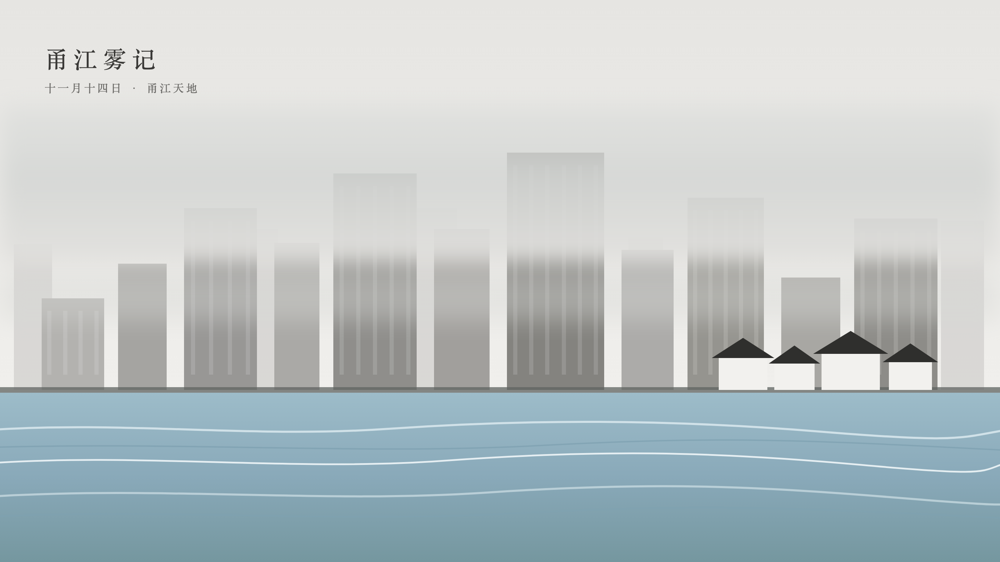

*题图：甬江雾色（手绘意境图，非实拍）。出门时高楼的上半截，就是这样没进云雾里的*

十一月十四日，下午。去了宁波的单向空间·水手书店，在甬江天地。回来路上脑子里一直过着几个画面，索性记下来。

先说外表。独栋的仿古建筑，黑白两色，单调，克制，应该是照着浙江老民居的样子做的，白墙黛瓦那一路，连颜色都是收着的。第一眼不会想到它是一家书店，倒像一座安安静静的老宅，只是恰巧开在了江边。

进了门，里头是另一回事。书太少。少到什么程度呢？少到你不会把它当成书店，更像一家为了装饰才摆了几架书的咖啡店。我在架子间大致转了一圈，抽出一本翻了翻，放下；再抽一本，还是放下。架上大半是各类诗集，各种型制的都有；另有一本作品，翻几页就觉出拖沓，实在看不下去。书名的字都认得，就是没有一本想带回家。别的书也有，不多，库存大概都让位给了咖啡。书少，转一圈用不了几分钟。最后还是掏出了iPad。在书店里掏iPad，多少有点讽刺。讽刺归讽刺，书看不进去就是看不进去。

店里嵌着家水手咖啡，点了一杯，找了个靠窗的位子。窗外就是甬江。

甬江的水是奔涌的。不是那种安静得能当镜子使的水面，是一股接一股往前赶的水，看一眼就知道它没打算停；也不是海那种大开大合，就是一条河自己在赶路。说不好这水为什么抓人：下午四下都安静，街区空着，只有它一直在动，随便哪个角度看过去，水面都是活的。就这么隔着一层玻璃，我看了挺久，还挺有意思。iPad 摊在桌上，心思先跟着江水走了。今天让我在店里真正坐住的，不是架上的书，是这条江。

书店所在的甬江天地，几乎没有什么人来。人少，坐得住。

从咖啡店出来，外面的样子变了。所有的高楼都给云雾罩了一层，上半截直接没进雾里，看不见顶。雾不高，就贴在楼的上半截，像给每栋楼都盖了半床被子。这个罩法有点像山里起雾，山谷里那种白，能把整座山整个吞掉的白，今天出现在一排城市的楼上。

街上几乎没有行人。旁边施工工地的轰鸣一阵接一阵，中间几乎没断过，听不出是什么机械。楼罩在雾里，江在雾后面接着奔涌，工地自己响自己的，谁也不管谁。走出来的一段路，雾一直悬在楼顶上，不动。

雾不散，轰鸣不停，江照旧赶它的路。

今天书没看进去几页，甬江倒是看了个够。
