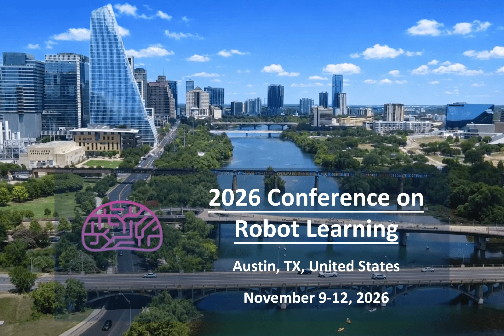
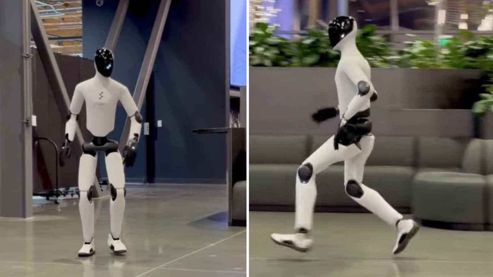
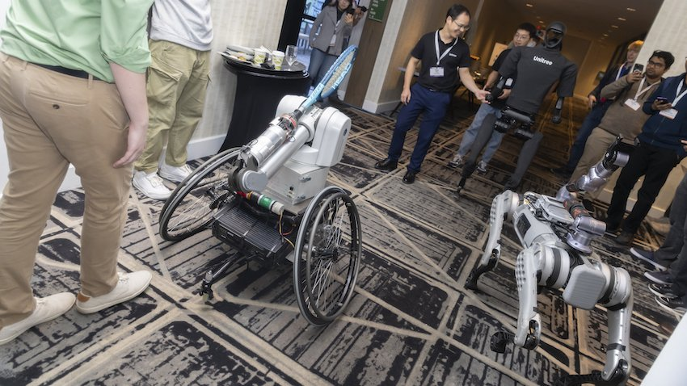
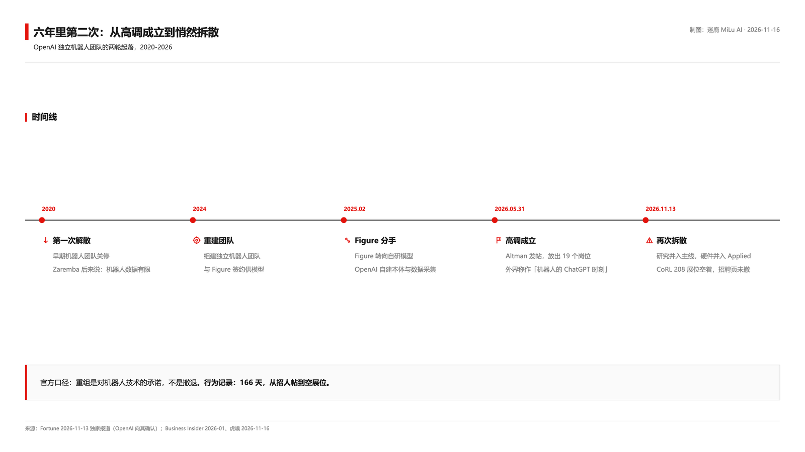

看一家公司还信不信自己说的话，别去读愿景文档，去看两样东西：组织架构图，和招聘页。

这不是我的偏方。管理学者奥卡西奥（Simone Ocasio）1997 年提出过"注意力基础观"，说白了就一句话：高管注意力放在哪，钱和人就流向哪；没进注意力清单的事，口号写得再响也只是墙上的字。博弈论补了另一半，有个词叫廉价磋商（cheap talk）——说话不要成本的时候，话不构成承诺；要动编制、动预算的，才算信号。

OpenAI 在 11 月 13 日给了所有人一个把这两条摆在一起看的机会。

把丑话说在前头：我说的是错位，不是放弃。OpenAI 发言人 11 月 13 日对 Fortune 说，机器人仍是"长期愿景的核心"，重组是"对机器人技术的承诺，而不是撤退"（"robotics remains a core part of OpenAI's long-term vision"，"a commitment to robotics rather than a retreat"）。可就是这家公司，166 天前刚把独立机器人团队高调立起来，166 天后亲手拆散。愿景没变，团队没了。话和行为对不上，这才是今天要过堂的事。

## 先说句公道话：这步棋有它的技术道理

OpenAI 给的理由，在技术上不是狡辩。10 月 14 日英伟达的研究，让 GPT-6 Astra 在零机器人专项训练的条件下直接控制机械臂，在 RoboLab-120 仿真基准上拿到 74.8%，榜单上最好的专用机器人模型 Lakeside 只有 51.0%，差着 23.8 个百分点。这个数确实漂亮。限定也得说全：那是仿真不是真机；74.8% 靠带上下文的 agent 配置，模型直接生成动作只有 66.3%；每完成一次尝试要烧约 36.4 美元的 token，每次模型调用约 18.56 秒——真机器人等不了 19 秒再抬手（The Decoder 2026 年 11 月转述英伟达研究数据）。

真机那边也有旁证。公开的 StationeryBench 测试（openai.robocurve.org）用真实双臂机械臂跑了五个桌面任务，GPT-6 Astra 完成 7/100，Ai2 的 MolmoAct2 完成 0/100。7% 很低，但"通用模型能动真机"这件事，确实从 0 变成了 1。

所以"通用模型直接开机器人"这条路线有实验撑着。卡内基梅隆大学机器人研究所助理教授 Guanya Shi 对 Fortune 的解读是，OpenAI 大概认为机器人"已经不再是一个特殊问题"（"no longer a special problem"），就像今天的编程工具、法律工具一样，只是通用智能的下游应用。

再看投入，2024 年以来的路线实验也是认真的：2024 年重建团队、和 Figure 签约供模型；2025 年 2 月 Figure 分手转自研；旧金山的机器人数据实验室 2025 年 2 月开建，到今年 1 月已有约 100 名数据采集员三班倒（Business Insider 调查报道）——自动化出橡皮鸭进杯子，再一路加码到叠衣服、把面包放进烤面包机，三班倒地攒真机数据，这个笨功夫不像玩票。今年 5 月 31 日 Altman 亲自发帖宣布成立 OpenAI Robotics，一口气放出 19 个岗位，被外界称作"人形机器人的 ChatGPT 时刻"。你可以说路线会调，但没法说这半年是敷衍。

## 可行为全在反面

第一笔账，算给团队里的人看。

19 个岗位放出来的时候，是 Altman 亲自站台、全网围观的阵仗。166 天后团队没了。Fortune 记者本周去奥斯汀的 CoRL——机器人学习领域的顶会——现场看到的场景是这样的：OpenAI 注册的 208 号展位，会议 app 和展馆平面图上都印着名字，到场一看，空的，没有 logo，没有展品，倒是几位前团队成员聚在那里，身边围了不少人。更潦草的是，OpenAI 招聘页上那个年薪最高 48.5 万美元的机器人岗位，拆队消息传出去之后还没撤下（虎嗅 11 月 16 日）。队都拆了，门还开着，连收拾都懒得收拾干净。想象一下这半年里刚为这个方向搬到旧金山、推掉其他 offer 的人，166 天，从"人形机器人的 ChatGPT 时刻"到展位清空，连一句像样的告别都没有，这账找谁对。

第二笔账，算给时间看。

这是六年内第二次解散机器人团队。2020 年第一次，联合创始人 Zaremba 后来解释说机器人数据有限，不如把资源押给语言模型——那次押注后来确实换来了 ChatGPT，这是明账。去年，Altman 给全公司下过指令：砍掉一切支线任务（"abandon side quests"，Fortune 转述），Sora 团队是前一个被收编的，当时也说过"资源要集中"。这次拆队的时点更值得看：据媒体报道，OpenAI 上一季度运营亏损约 109 亿美元；《华尔街日报》报道公司在为 2027 年 IPO 做准备——要上市的公司得给投资人看一个亏得少、够专注的故事，收编支线省下的人头和算力，恰好在这本账最紧的时候派上用场。官方口径只谈能力不谈钱。时点不说话，时点只是站在那儿。

第三笔账，算给"说好的呢"。

这事 OpenAI 没有发过一篇自己的官方公告，全部口径来自发言人答 Fortune 问。承诺清单倒是一样没少：机器人仍是长期愿景的核心、2027 年仍要首次公开演示自研人形机器人（Fortune 11 月 13 日）。Altman 5 月 31 日那条帖子还在，里面写着要让机器人"对社会有用"。承诺还在嘴上，执行承诺的组织先没了。而且"通用模型赢了"这个前提本身，学界并没有共识：MIT 教授、Walden Robotics CEO Russ Tedrake 对 Fortune 说，机器人公司握有真实部署数据的优势；Generalist 联合创始人 Pete Florence 说得更是直接——"不清楚现有哪个模型会长期主导机器人"。对照组也摆在那儿：Google DeepMind 11 月 10 日刚公布了 Apollo 2 机器人在奔驰工厂做零部件分拣的测试，走的是 Gemini Robotics 专用模型路线，它给的成功率是 96%；宇树也在自家机器人上测 GPT-6，王兴兴说规划导航确实好使，但精密操作"仍然容易出错"。你看，本体厂商一边接入通用模型，一边压根没打算把"大脑"整个让出去。前提有争议，结论先落地了。

行，就算技术账真如它所说，通用模型可以顺带把机器人做了。那咱想问的就三句：一边说机器人是"长期愿景的核心"，一边把亲手成立的团队半年拆散，这叫承诺，还是叫口径。如果重组真不是撤退，为什么不敢把 19 个人的去向、2027 演示的预算、还有那页没撤的招聘启事一并说清楚。等下一次，它再指着某个方向说"这是愿景的核心"的时候，凭哪一条让人信这次不一样。

## 咱该怎么读这个信号

判词收回：这次拆队不是机器人的失败，也不是通用路线的胜利宣言，它是一份组织行为学证据——口号管嘴，架构管手，手比嘴诚实。

做 AI 应用、做创业的，这个信号跟咱有直接关系。做 MaudelClaw 这几年，客户问过我几乎一样的问题：你们依赖的模型、接的平台，哪天收缩了怎么办。我的答案一直是那三条：别听发布会，看招聘页、看编制、看预算，这三样比愿景文档诚实。平台收缩支线的时候，你建在它支线上的依赖，就是你的风险敞口。

2020 年它离开机器人，后来被证明是对的。但要留意，证明它对的是 ChatGPT 真做出来之后的事，不是 2020 年决定的那一天——身在其中的人，当年只能看着团队解散。下回再看到哪家平台把什么方向称作"愿景的核心"，先别急着信，也别急着跟着兴奋，翻翻它的招聘页和季度账本，答案多半已经躺在那儿了。
