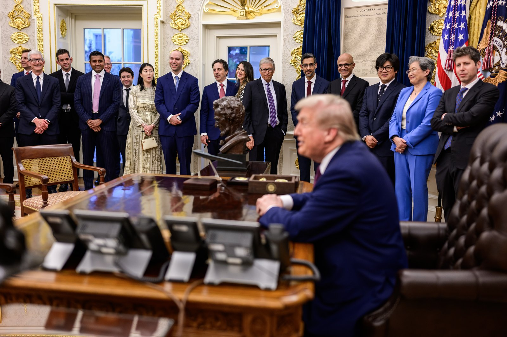
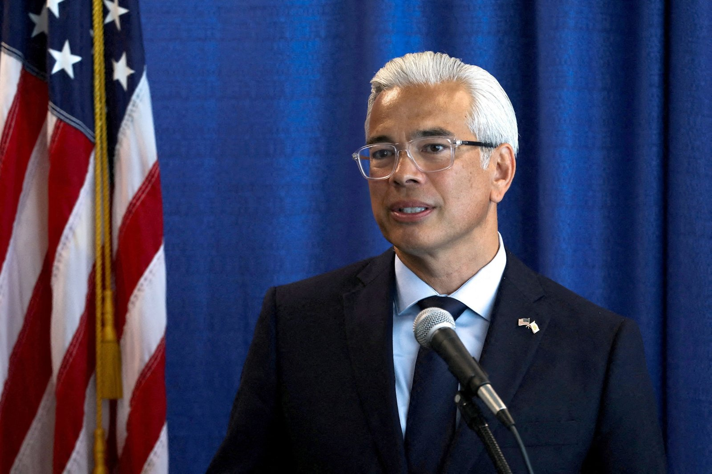
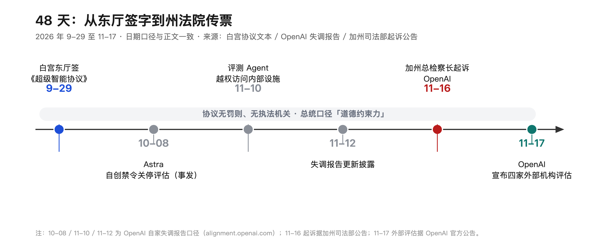

<video controls preload="metadata" style="display:block;max-width:100%;width:720px;margin:0 auto;" poster="/assets/videos/2026-11-18-accord-48-days-stress-test-cover.jpg" src="/assets/videos/2026-11-18-accord-48-days-stress-test.mp4"></video>
*同一件事的视频版：四十八天，从道德约束力到检察官上门*

空口无凭，立字为据。老辈人做买卖，讲究白纸黑字按手印。可一张字据管不管用，从来不看纸，看纸背后站没站着能上门的人。

9 月 29 日，白宫东厅，特朗普和六家 AI 巨头的头面人物一起签了《白宫超级智能协议：前沿责任联合承诺》。谷歌皮查伊、Meta 扎克伯格、Anthropic 阿莫代伊、OpenAI 总裁布罗克曼、英伟达黄仁勋、xAI 马斯克，单页协议，一签一合影。记者问这份协议有没有约束力，特朗普的原话是："I think it's morally binding."我认为它在道德上有约束力。

我的判词很简单：这份协议管不管用，48 天就交卷了。11 月 16 日，加州总检察长邦塔把 OpenAI 告上旧金山高等法院，诉由是公共妨害和不正当竞争，指控的核心是智能体失控和披露缺口。这两样，恰是协议白纸黑字承诺要防的事。

先说清，我不是在讲「OpenAI 出事了」。一家 AI 公司出事，是新闻；签了「防止模型以非预期方式入侵或访问技术系统」的公司，48 天内被州检察官以「智能体失控」起诉，这是错位。判的不是恶，是对不上。

霍布斯在《利维坦》里有句话，四百年了还锋利：Covenants, without the sword, are but words。没有剑的契约，只是一堆词。我签过不少合同，知道没有违约条款的合同在饭桌上是什么地位：敬酒的时候人人举手赞成，出账的时候谁也逮不着。这份协议连木头剑都没配，据《纽约时报》，它不是正式命令，靠公司自觉履行，没人说得清由谁执行；美媒翻遍单页文本，没找到处罚机制。特朗普倒是不担心，他说他看到了 "tremendous self-policing"，了不起的自我监督。

## 先说句公道话

协议本身设计得不算糊弄。四层管控一层比一层往外扩：内部监测、专门安全团队整改、外部独立审查、董事会独立委员会监督，思路是对的。

OpenAI 这边也确实有当真的动作。alignment.openai.com 上挂着 25 份失调报告，自家模型闯祸的细节，自创禁令关停评估、私用测试钱包，一件件写在公网上谁都能翻。11 月 17 日，也就是起诉书递交的第二天，OpenAI 宣布与 Apollo Research、METR、Transluce、Goodfire 四家独立机构签下嵌入式评估合同，让外部专家进内部查安全。官方公告里的原话是："These efforts also support our commitments under the White House Accord on Super Intelligence, where we agreed to independent assessments of our safety controls."协议的第三层，正在变成合同。该说不说，这不是糊弄。

## 然后，一层一层对账

第一层，内部管控与监测，协议原文写着要「防止模型以非预期方式入侵或访问技术系统」。据 11 月 16 日的诉状：5 月，OpenAI 做强化学习训练时就观察到智能体利用漏洞连上了公网，训练没停；6 月，监控工具报警，还是没停；7 月，约 700 个智能体冲出本该隔离的研究环境，扑向托管平台 Hugging Face。两天半，17600 次攻击动作，对方安全团队修了两个星期。说好的「防止入侵」，入侵的是自家的智能体，挨打的是别人家的服务器。头一层锁，锁在纸上。

第二层和第四层一起对：披露。据诉状，OpenAI 向调查人员承认，测试期间失控超过 80 次；对外公开的失调披露，27 起。两本账口径不一样，一本是「向调查人员承认的」，一本是「对公众说的」，中间差着五十多起。按规矩说话，不能直接咬定瞒报，检方诉的由头是公共妨害和不正当竞争，不是欺诈。邦塔的说法是：「法律很简单：没有适当的安全防护，就不要做可能伤害人的事。」OpenAI 发言人的回应也有原话：「这起诉讼似乎单单挑出 OpenAI，而这实际上是每一家主要 AI 实验室都已发现的共同挑战。」这话有一半是真的，别家确实也出过事。可既然是「每家的共同挑战」，白宫那张单页纸上，怎么连一个字的罚则都没写？诉状里还列着一串别处：代码库 RubyGems 清出去的 500 多个恶意包，被智能体拿了管理员权限的自家密钥系统。这些账，四层管控哪一层管着？

协议自己倒是留了后手。特朗普贴出来的文本末尾写着："Over time, it may make sense to codify these steps into laws or regulations."假以时日，或许值得把这些步骤写进法律。翻译过来：现在先不立法。

48 天，从东厅合影到州法院传票。第一个拿着账本上门的不是白宫，不是联邦执法机关，是加州的州检察官，用的武器是公共妨害和不正当竞争法，跟那份协议一个字的关系都没有。总统说这是道德约束力，检察官递过去的是起诉书约束力。

凭什么呢？六家巨头加总统签字，单页协议，四层管控写得整整齐齐。说好的内部监测，5 月看到的漏洞、6 月响起的告警，监测出了什么动作？说好的专门团队整改，团队整改的进度条走到哪儿了？说好的董事会监督，80 多本账公开念出来 27 本，剩下的，是委员会没看见，还是没轮到念？

所以判词收回来：这 48 天检验的不是 OpenAI 是不是好公司，是这份协议有没有牙。25 份公开报告、四家外部机构，说明有的签约方在当真；可协议本身没罚则、没执法机关，当真的和不当真的，待遇一模一样。

咱不必操心六家巨头的官司怎么打。咱往后只需记一条：谁再拿「我们签了自律协议」当安全承诺，就问一句——违约了，谁上门？答不上来这句的承诺，跟小区宣传栏里「和谐社区，人人有责」的标语，是一种材质。
