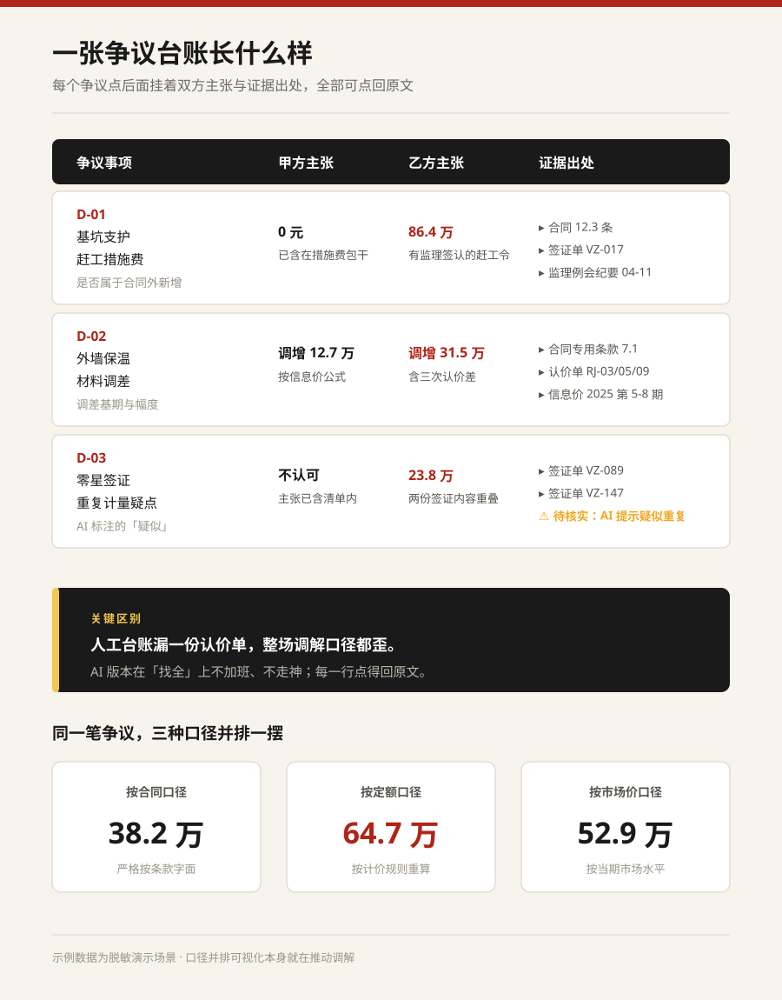
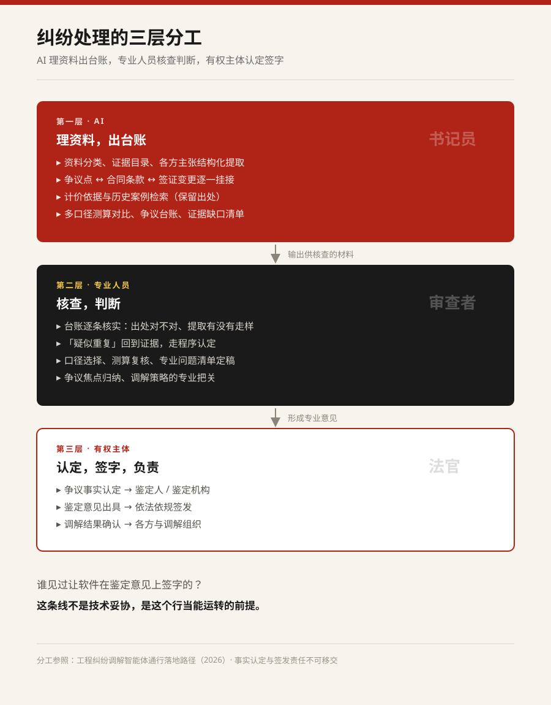

一个工程造价纠纷案，调解现场。双方各执一份结算文件，差异八百多万。

主持调解的人要做的第一件事不是评理，是对齐事实：哪几条争议，每条双方各主张多少，依据分别在合同的哪一条、哪份签证的哪个签认。这个活，业内叫理争议台账。

传统做法，助理抱着材料翻三天。然后调解开始，第一轮先对台账，双方发现台账里漏了两份签证，再来一轮。

我看完这套流程之后的感受是：台账这个活，天生就该 AI 干。

## 书记员的活，AI 全接得住

把纠纷鉴定和调解这件事拆开，一类活是整理和检索，一类活是认定和判断。前一类，AI 接得住，而且接得比人稳。

具体是这些：建案件资料目录和证据清单，把几十份文件按性质分类。提取各方主张、争议事项、争议金额、时间节点，形成结构化台账。把每个争议事项和合同条款、招投标文件、签证变更、过程资料一一对上号。检索可能适用的计价依据、技术标准和历史案例，保留出处。对争议金额按不同计价口径做测算，把几种口径的差摆出来。

这份台账和人工做的有什么区别？三个字：可点回。

台账里每一行，争议点后面挂着证据来源，点进去能跳到合同第几条、签证第几份的原文。人工台账漏掉一份认价单，可能整场调解的口径都是歪的；AI 的版本至少在"找全"这件事上，不会因为加班到凌晨而走神。

测算部分也有价值。同一笔争议，按合同口径算是多少，按定额口径是多少，按市场价又是多少，三种口径并排一摆，双方的分歧点立刻可视化。调解很多时候卡在"各自心里都有一本账但谁也不摆出来"，把账摆到桌面上，本身就在推动调解。

## 法官的活，干干净净让出来

但有一类活，AI 不能碰。

争议事实怎么认定。合同条款该怎么解释。签证签认有没有效。鉴定意见怎么下。调解方案哪方能接受。这些活的核心不是检索，是裁量，裁量背后是责任。

所以一条清晰的分工线：AI 产出的是争议台账、证据缺口清单、多口径测算对比、调解方案的造价影响分析，全部是"供核查的材料"。事实认定归鉴定人，意见归鉴定机构，调解结果归各方和调解组织。

这条线不是技术妥协，是这个行当能运转的前提。谁见过让软件在鉴定意见上签字的？

## 一个行业级的好消息

这条路不是空想。重庆住建公布的住建领域 AI 应用典型案例里，"编-审-管一体化"造价智能体已经把风控前置跑通了，标书审查效率提升 80%（官方发布口径）。纠纷调解方向的智能体，路径和它同构：都是先把资料理顺，把线索标出来，把判断留给有权主体。

工程纠纷这个领域，AI 的天花板看起来不高：不出认定，不下结论。但换个角度，纠纷处理最贵的资源是专业人士的时间和各方的信任，AI 把翻资料的七天变成两小时，把"你漏了一份签证"这种低级争执消灭在调解开始前，专业人士的时间就能花在真正需要专业的地方。

书记员干得越好，法官越有威信。这话放在造价纠纷里，一样成立。
