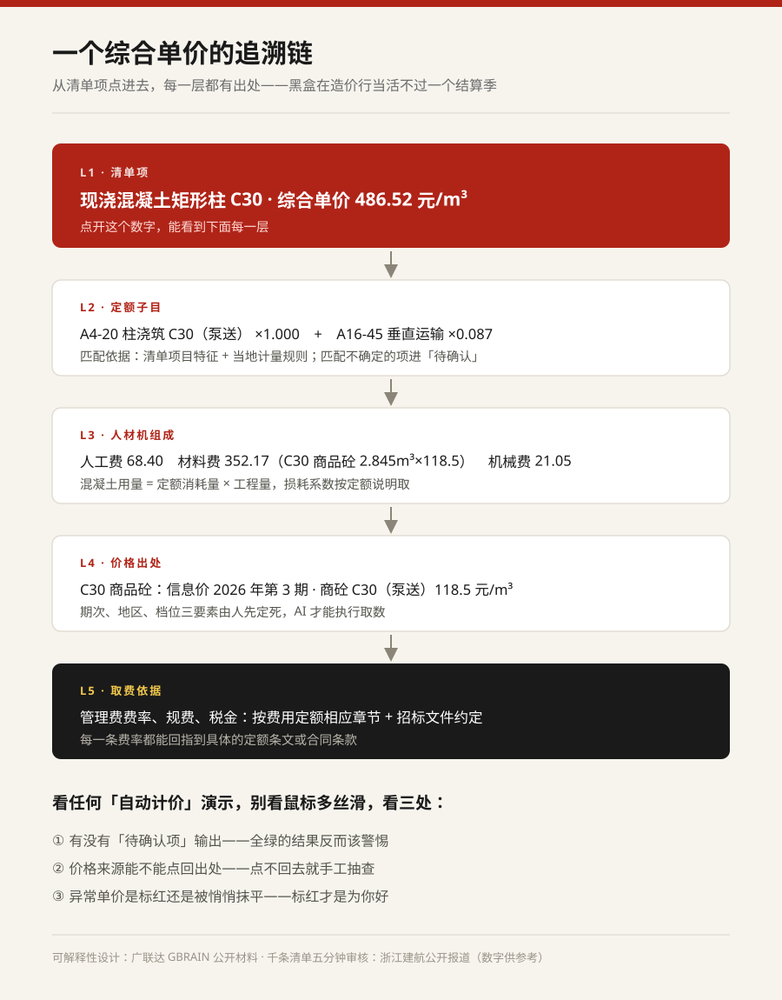
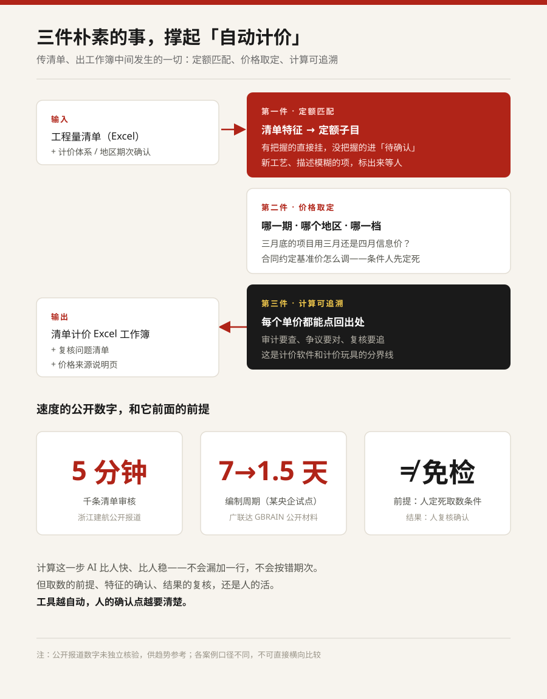

自动清单计价这件事，演示的时候特别像魔法。

鼠标拖进去一份工程量清单，几分钟后出来一个 Excel 工作簿：每条清单挂好了定额子目，综合单价、材料价、措施费、取费全齐，底部还有一页"价格来源说明"。

看过演示的人第一反应都差不多：它是怎么算的？

第二反应才是关键的：我怎么信它？

## 拆开是三件朴素的事

把"魔法"拆开，就是三件事：定额匹配、价格取定、计算可追溯。一件一件说。

**第一件，定额匹配。**

清单项"现浇混凝土矩形柱 C30"，AI 干的事是把这条描述对应到适用的定额子目。它依据的是清单的项目特征、计量规则和当地的定额库。匹配有把握的直接挂，没把握的标出来等人确认。浙江建航的清单 AI 审核系统公开说法是千条清单五分钟审完（公开报道数字，供参考），靠的就是先匹配再复核这个次序。

匹配会错吗？会。特征描述写模糊了的、新工艺定额库里没有的、一专多能的项，AI 会挂错或者不知道挂哪个。所以组价结果里必须有一页"待确认项"，这是设计出来的，不是 bug。

**第二件，价格取定。**

材料价格从哪来，信息价哪一期，暂估价怎么处理，这是计价的命根子。AI 做的是按确认的计价体系去取数：哪个地区、哪一期、哪一档。取数本身不难，难的是口径。三月底的项目用的是三月信息价还是四月？合同约定了基准价怎么调？这些条件得先由人定死，AI 才能执行。

**第三件，计算可追溯。**

这是三件里我最看重的。工作簿里每一个综合单价，都应该能点开看到：组成了哪些定额子目，每个子目的人材机是多少，材料价取的哪一期哪一档，取费费率是哪条依据。

广联达的 GBRAIN 造价大模型公开材料里反复强调一个词：可解释性设计，每条数据可追溯来源，避免 AI 黑盒的合规风险（公开报道）。这个词不是营销话术，是计价这门生意的前提。审计要查，争议要对，复核要追。黑盒在造价行当里活不过一个结算季。

## 所以信不信，看三处

下次看任何一家"自动计价"的演示，别看鼠标多丝滑，看三处：

第一，有没有"待确认项"输出。全绿的结果反而该警惕，说明它替你做了所有判断。

第二，价格来源能不能点回出处。点不回去的，跑一遍手工抽查，对不上就是玩具。

第三，异常项是标出来还是抹平了。好的工具会把明显高于市场价的单价标红给你，而不是悄悄取个"合理"值。

计算这一步，AI 比人快，也比人稳，因为它不会漏加一行、不会按错期次。但取数的前提、特征的确认、结果的复核，还是人的活。工具越自动，人的确认点越要清楚，这条在哪个行当都一样。

下一篇换个软的：合同、签证、结算文件搅在一起的经济纠纷，AI 能帮上什么忙，帮不上什么忙。
