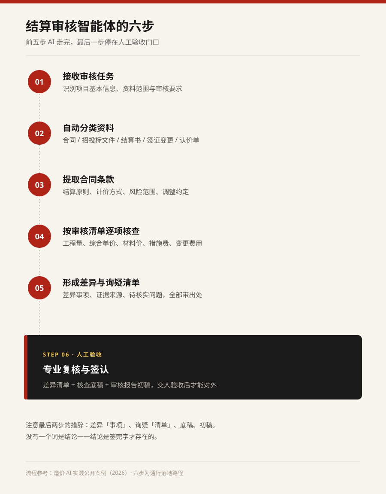
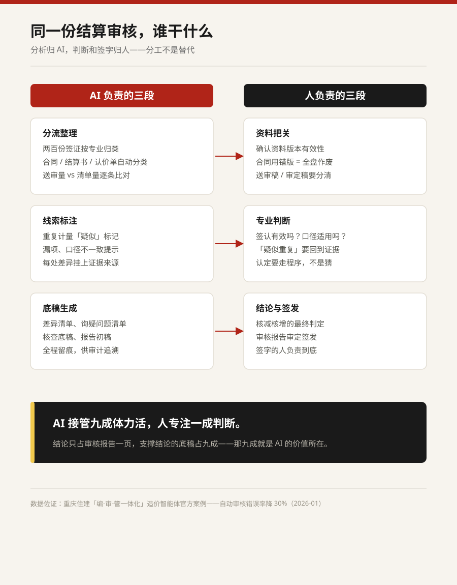

上周有个做造价的朋友问我：你们那个结算审核的 AI，审完是不是直接给结论？核减多少，定多少，盖章那种。

我说你想多了。它交的是底稿。

他不满意。这个反应我熟。这两年把 AI 往工程造价这个行当里塞，听到的最多的期待就一句话：能不能让它替我把事办了。结算审核这件事，在很多人想象里，AI 的终点就应该是那句"核减 87 万"。

先说我的看法：到不了，也不该到。

## 先看一个已经跑起来的样子

先摆一个行业公开案例。三十万平米的住宅项目，施工周期里攒了两百多份变更签证，甲方要求七天内出审核意见。按老办法，一个团队全职对量，平均五天。上了一套分专业的审核智能体之后，公开的说法是平均一点五天（出自 2026 年公开的造价 AI 实践培训案例，数字我没法独立核验，但路径本身是通的）。

路径拆开是六步：

接收审核任务，识别资料范围。自动分类合同、招投标文件、结算书、签证变更、认价单。提取合同价款条款、结算原则、计价方式、风险范围。按审核清单逐项核查工程量、综合单价、材料价、措施费、变更费用。形成差异事项、证据来源、待核实问题和询疑清单。最后输出结算差异清单、核查底稿和审核报告初稿，交人验收。

注意最后两步的措辞。差异"事项"，询疑"清单"，底稿，初稿。没有一个词是结论。

为什么？因为结算审核里真正值钱的判断，全在人这边。

AI 负责把两百份签证按专业分流，把送审量和清单量一条条对出差异，把每处差异的证据来源标清楚。人负责判断：这条变更的签认有效吗？这个计价口径适用吗？这一笔核减，敢不敢写进报告？

## 真正的坑在结论之前

大量交付事故不发生在 AI 算错，发生在结论之前。资料版本。

合同用错版，整本底稿作废。结算书是送审稿还是审定稿没分清，差异表全错。AI 分类很勤快，但它不知道你桌上哪份是最后生效的那份。资料清单核验这一步，人省不得。

另一个坑：把 AI 的提示当认定。AI 说"第 147 号签证疑似与第 89 号重复计量"，这是核查线索，不是重复计价的认定。认定要回到证据，要走程序。AI 的产出停在"疑似"和"待核实"，是对的。

这条路的收益也有公开数据佐证。重庆住建发布过的"编-审-管一体化"造价智能体典型案例，官方口径是自动审核减少错误率 30%，标书审查效率提升 80%（中国建设新闻网 2026 年 1 月报道）。错误率降，靠的不是模型更聪明，是把"查"和"判"分开了。

## 底稿才是资产

回头看那位朋友的问题。他想要那句"核减 87 万"，但一个结算审核员一周的产出里，结论只占一页，剩下全是支撑结论的东西：差异归类、证据索引、询疑记录。

AI 把这九成体力活接管了，人的时间腾出来干那一成判断。

这才是它交底稿的原因。底稿是给人签字用的，结论是签完字才存在的。

下一篇讲清单计价：上传一份清单，吐出一份 Excel 工作簿，中间每一分钱怎么追溯。那个更魔法，拆开反而更朴素。
