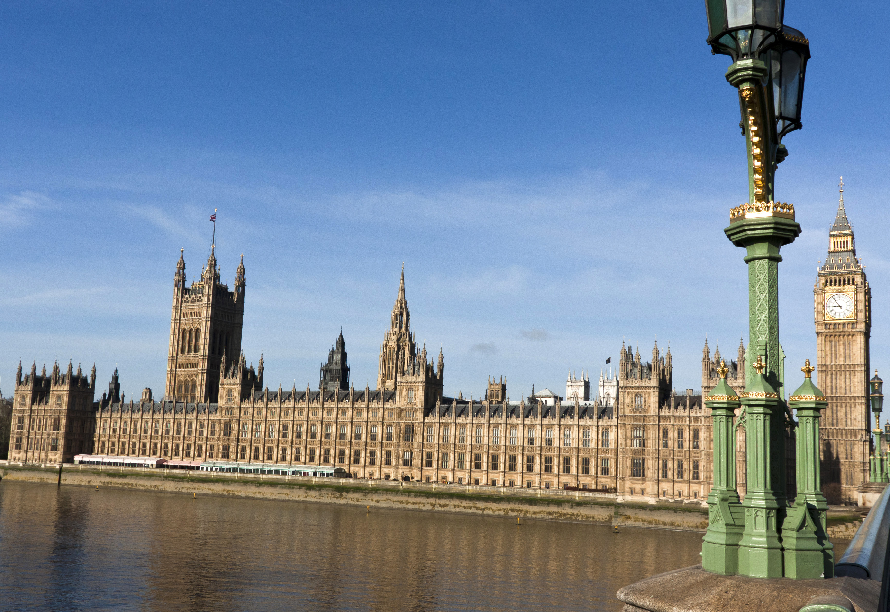
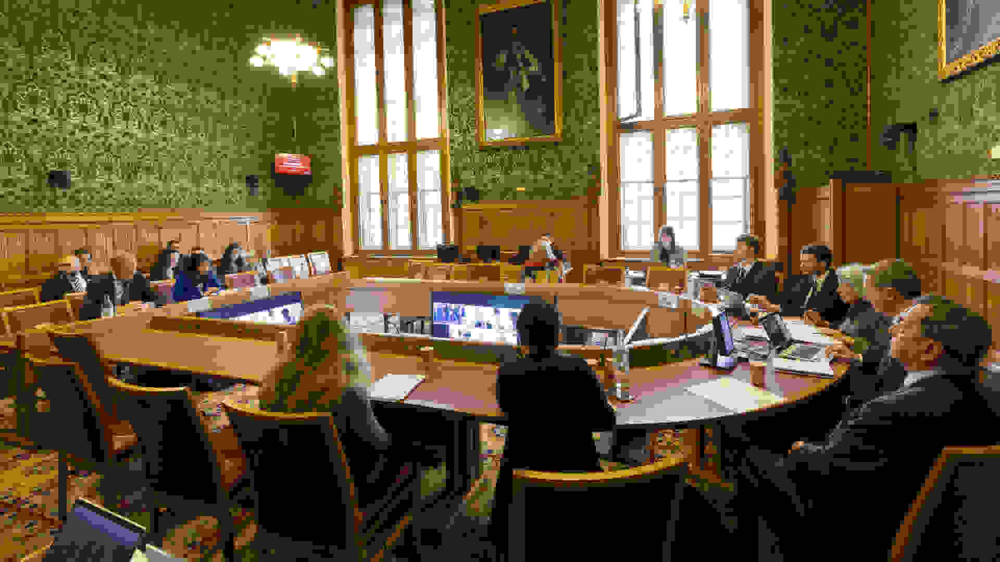
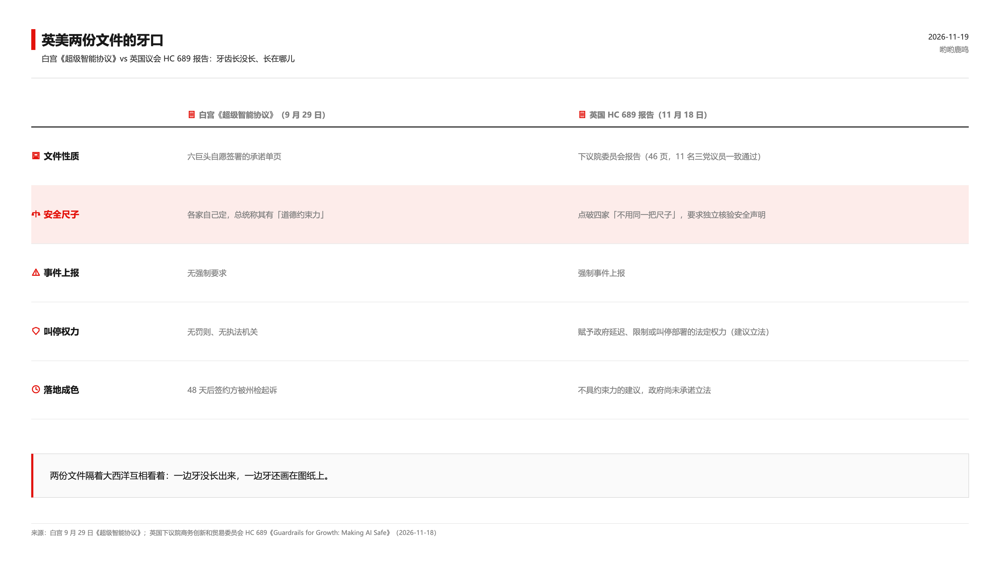
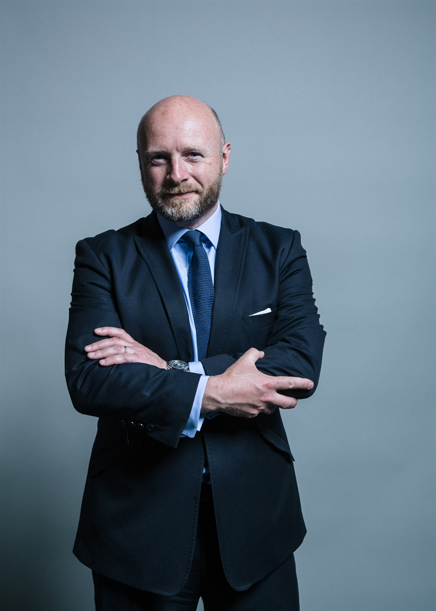

王婆卖瓜，自卖自夸。这句老话损了一千年，损的其实不是卖瓜的，是没人能掀她的秤。

11 月 18 日凌晨 00:01，英国议会下议院商务创新和贸易委员会把一份 46 页的报告挂上官网：《Guardrails for Growth: Making AI Safe》，编号 HC 689，11 名三党议员一致通过。问的对象是 OpenAI、Google DeepMind、Anthropic 和 Meta，四家都把"安全"当核心卖点的公司。

我的判词就一句：卖安全的公司，最怕统一考卷。不是说这四家撒了谎，也不是说哪个模型已经闯了祸。是说"安全不安全"的定义权，到今天为止全在卖方自己手里。自己出题，自己批卷，自己公布分数，家长连旁听的座位都没有。

委员会主席 Liam Byrne 议员说得直白："We cannot give today's AI leaders unfettered freedom to behave like modern-day Dr Frankensteins."（我们不能给今天的 AI 领袖们毫无约束的自由，让他们像现代版弗兰肯斯坦一样。）他还补了个类比：航空、制药、核电，没有哪个行业的安全是靠厂商自己拍胸脯的。这话不新鲜，正因为它不新鲜才扎人。自查、自证、自发布，逻辑上自己转圈，圈的意思就是外人不许进。

## 先数一遍人家做到的

公道话得说足。四家全部到场作证，没人缺席，都公开承诺不发布自己认为不安全的模型。Anthropic 招股书里，风险因素披露写了 90 多页，白纸黑字警告先进 AI "could pose catastrophic or existential risks to society"（可能对社会构成灾难性甚至生存层面的风险；据 Korea Times 报道）。各家自愿把模型送英国 AI 安全研究所（AISI）测，Byrne 也认可这套测试能力世界级。报告标题起的是 Guardrails for Growth，护栏为增长服务：按 OECD 口径，AI 十年能给英国经济多带来 4000 亿英镑。这份报告没打算勒死行业，它想的是让行业跑得让人放心。

## 尺子、刹车和账期

先看尺子。报告原话："they don't use the same yardstick for safety, and UK law doesn't generally require them to get an independent opinion before releasing anything."（他们用的不是同一把安全尺子，英国法律也不要求发布前拿独立意见。）听证会上四家都保证"不发布自己认为不安全的模型"，听清楚，前提是"自己认为"。据 Computer Weekly 引用的听证记录，一名前 OpenAI 员工描述，公司内部被施压避免使用"dangerous"这类词。一家之言，可它跟"自己认为"四个字摆在一张桌上，挺配。

尺子乱还算小事，要命的是没人踩刹车。报告第七章查实：英国没有任何监管者或公共机构，有权对前沿模型施加保障、暂停训练、延迟部署或撤下不安全的服务。原话最狠的是收尾那句："Decisions about whether systems are safe to develop or deploy remain with the companies building them."（系统是否安全到可以开发或部署，决定权仍留在建造它们的公司手里。）

AISI 的处境最能说明问题。名字里带 Security，测试能力世界级，权力是零，全靠厂商自愿合作，连叫停一家公司发布引发安全担忧的模型的权力都没有。所以委员会丢下一句分量最重的话："The statutory regulator should not be AISI."（法定监管者不该是 AISI。）9 月以来上议院三份修正案都想把 AISI 扶成监管者，委员会一份都不认可。AISI 首席科学家 Geoffrey Irving 作证说，黑客、说服、规划、隐匿四类能力都存在通向"不可接受社会风险"的路径。测的人最知道风险在哪儿，测的人手里没有刹车。

再看账期。2024 年工党竞选纲领白纸黑字：要对"开发最强 AI 模型的少数公司"实施"binding regulation"（有约束力的监管），确保 AI 的安全开发与使用。两年过去，AI 法案难产；这份报告本身不具约束力，政府尚未承诺立法。

立法的钟走得慢，模型的车踩得快。就在报告发布这个星期，OpenAI 放出 GPT-6.2 Astra，官方系统卡把 AI 自我改进能力标到 High 档，这是 OpenAI 第一个对外发布达到该档位的模型。Anthropic 定在 11 月 19 日纳斯达克挂牌，据 CNBC 报道，认购需求约 5000 亿美元。卖安全的公司在敲钟，买安全的人还没等到考卷。

大西洋两岸的两份文件正好摆在一起看。9 月 29 日白宫那纸《超级智能协议》，六巨头自愿签的，没有罚则没有执法机关，总统自己说它只有道德约束力，48 天后签约方就被州检察官上门对账；英国这份 HC 689，强制事件上报、独立核验安全声明、法定叫停权，牙一颗一颗画在图纸上，可图纸还没开工。一边的牙没长，一边的牙长在纸上。

那还等什么呢？等四家良心发现，把自家抽屉里的尺子交出来？等 AISI 从志愿队转正，长出叫停的手？还是等下一张系统卡把自我改进从 High 档再往上翻一格，看看纸上的法案追不追得上？

判词收回来。四家把安全写进招股书和听证记录，这份认真是真的；认真卖安全的人，恰恰最该欢迎一张统一的考卷。

落地到咱这儿。迷鹿做企业级 Agent 平台，客户问得最多的一句是"模型出事算谁的"。咱把 Agent 接进生产环境，合同里那条安全声明值多少钱，就看它敢不敢送去独立批卷。往后再遇到拿安全当卖点的，就问一句：这份安全，谁批的卷？答不上来的，出了事，账多半算在把模型接回家的咱头上。
