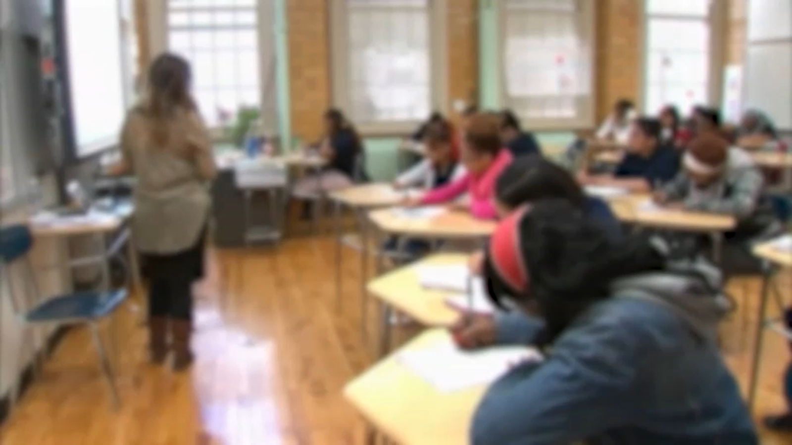
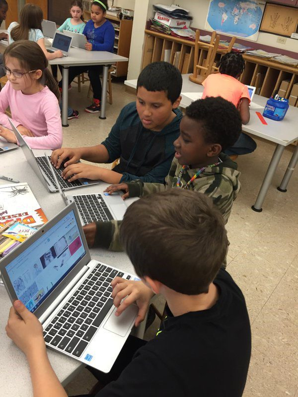
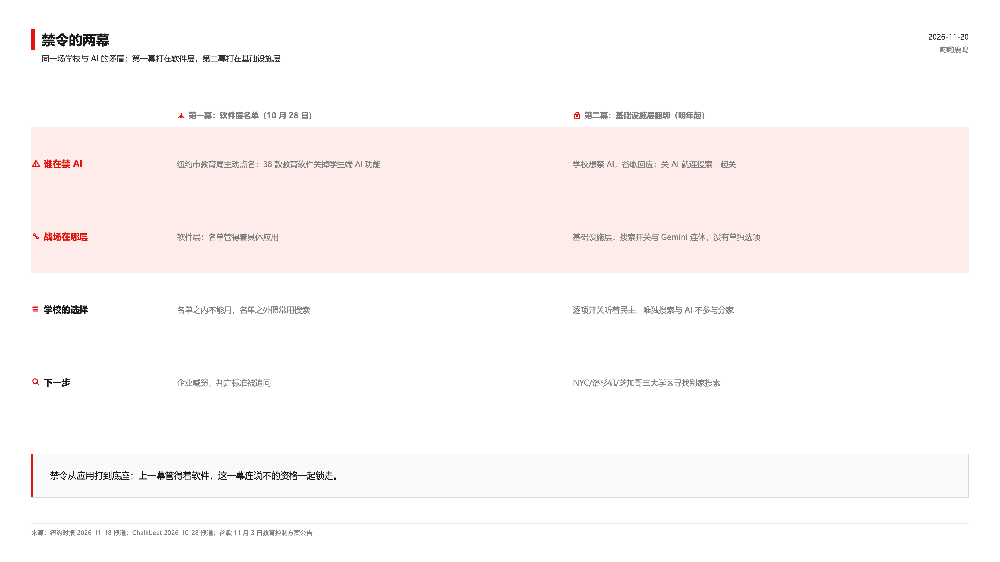

<video controls preload="metadata" style="display:block;max-width:100%;width:720px;margin:0 auto;" poster="/assets/videos/2026-11-20-google-schools-search-bundle-cover.jpg" src="/assets/videos/2026-11-20-google-schools-search-bundle.mp4"></video>
*同一件事的视频版：想关 AI 就得连搜索一起关，这笔账拆开算*

1998 年，美国司法部把微软告上法庭，罪名之一是把 IE 浏览器捆进 Windows 卖：想要我的操作系统，就顺带收下我的浏览器。官司打了几年，以和解收场，"捆绑"从此成了美国反垄断词典里的老词。

二十八年过去，老词有了新用法。据《纽约时报》11 月 18 日报道，谷歌已经通知学校：从明年起，想关闭由 Gemini 驱动的 AI 功能，就得连谷歌搜索一起关，没有单独关掉 AI、留下搜索的选项。谷歌教育副总裁克里斯·菲利普斯对《纽约时报》说得明白："搜索和 AI 已经深度整合"，关掉 AI 功能的学校"将无法使用搜索"。纽约、洛杉矶、芝加哥三个学区的反应是：开始找别家搜索。

说白了，我就认一句：谷歌把课堂必需品，当成了捆绑销售的筹码。不是说不许做整合，也不是说 AI 进课堂就准是坏事。是说身份摆错了位置：搜索在学校里早不是一个"产品"，是和黑板、课表一样的事实必需品。拿必需品当新功能的搭头卖，整合就成了要价，开关就成了人质。

经济学家布赖恩·阿瑟讲过"锁定"：一项技术用的人越多，离开它的成本越高，高到最后不是你在用它，是它拿着你。谷歌课堂的全球使用者，官方口径是 1.5 亿师生；Chromebook 在美国教室里的渗透，连芝加哥公立学校自己都说"数以百计的学区"在用。锁定是几十年一笔一笔投出来的，这没什么可指摘。可锁定一旦被当成筹码，性质就变了：你离不开的东西，成了别人谈判桌上的押金。

## 公道话，得先说足

谷歌发言人劳拉·布林给 The Verge 的回应，得整段读："我们听到了家长和教师对学生利用 AI 走捷径学习的担忧，我们与他们有着同样的目标：帮助学生学习。为了改进课堂搜索体验，我们本月开始试点在搜索中引入引导式学习功能，通过分步引导的方式帮助学生解决一系列复杂问题，而不仅仅是给出简单答案。明年，我们还将根据教育者反馈更新针对学校的控制方案，Gemini 应用、Gemini Notebook 和搜索功能将默认关闭，直到学校自行决定启用哪些服务。"

这里面有真东西。引导式学习不是把答案糊学生脸上，是分步带着走，方向是对的。11 月 3 日那份公告也确实写了：K-12 学生账号的 Gemini、Notebook、搜索默认全关，等管理员逐项打开。默认关闭，比过去那些"默认全开、退出靠找设置"的产品规矩体面。1.5 亿师生的盘子，肯把默认值改小，值得记一笔。

但体面的规矩下面，藏着一个焊死的接缝：你可以逐项打开，却不能只关 AI 留下搜索。搜索那个开关，和 Gemini 是连体的。

## 想说不的学校，先被没收了必需品

纽约市长马姆达尼 9 月刚签了一年暂停令：学前班到八年级，课堂上不许用生成式 AI。按常理，学区是谷歌最新控制方案的理想客户，默认关闭，正合我意。现实是，学区们发现"关闭"的价签上挂着搜索。马姆达尼和参议员桑德斯给这套操作起了个名，叫"勒索"。字越少，事越大。

纽约市学校总监卡马尔·H·塞缪尔斯给《纽约时报》的声明只有一句狠话："如果谷歌不重新考虑其立场，我们将探索其他搜索方案。"更较真的是市议会：11 月 13 日，议长朱莉·梅宁和议员谢卡尔·克里希南联名写信给皮查伊，限期 11 月 19 日书面答复。问题里有一条问得扎心：既然谷歌能给小孩子做 YouTube Kids，为什么做不出一个没有 AI 的搜索学生版。到发稿，这一问没有公开的答案。

芝加哥的动作更直接。本周一，芝加哥公立学校发声明：出于学生隐私和联邦、州法律（FERPA、COPPA、SOPPA）的合规要求，Gemini、ChatGPT、Claude 全部挡在学生账号和校园网之外，"没有把生成式 AI 工具加进学生设备的计划"。学区在按法律办事，谷歌的回应逻辑却是：你不收我的 AI，你的搜索也别要了。合规义务是学区的，断供的决定权是谷歌的，这两件事被捏在了一起。

## 说好的"同样的目标"，兑现方式是收走选择权

把布林的漂亮话和菲利普斯的硬话摆在一张桌上，就能看清账是怎么算的。布林说"同样的目标：帮助学生学习"；菲利普斯说，关 AI 的学校会看到一条来自学校的提示："此内容不可用"。一边把"帮你学习"说得情真意切，一边把退出通道焊死在基础设施里。学生打开浏览器看到的那行"不可用"，就是这笔账的汇率。

还有更客气的一种说法，叫"明年根据教育者反馈更新控制方案"。翻译过来：门已经焊上了，焊的手法嘛，欢迎提意见。据 CBS 报道，谷歌确实表态学校可以逐个工具单独开关，听上去很民主，唯独搜索和 AI 这一对连体婴不参与分家。教育者的反馈再踊跃，也反馈不进那道焊缝。

三所最大学区同时去看别家搜索，这事本身说明学校不是不想谈，是发现没有得谈。微软当年把浏览器捆进操作系统，好歹还是"买操作系统送浏览器"；如今是把学校赖以运转的必需品押进当铺，赎金是新产品的同意书。

这条时间线我上个月写过另一半。10 月 28 日纽约点名的 38 款教育软件，是学校主动禁 AI，战场在软件层，名单管得着应用；这一次学校还想禁 AI，却发现基础设施层没得管。禁令从软件层打到了基础设施层，同一场矛盾的第二幕，对手的段位升了级。两幕摆在一起看更清楚：上一幕名单管得着应用，这一幕开关管到了底座。

那凭什么？凭搜索是谷歌的吗？凭 1.5 亿师生离不开，就可以把"说不"的资格一起锁进保险柜吗？还是说，明年等控制方案真的上线，被关掉的学校面对一整面黑掉的屏幕，就该体面地承认这叫"深度整合"？

把话收回来。整合有整合的道理，捆绑有捆绑的价码，可把必需品押上桌的，做的是收租的生意。上个月咱聊的是名单管得着软件，管不着标准；这个月的账更难看：供应商把功能绑进基础设施，学校连说不的资格都没了。迷鹿做企业 Agent 平台，客户天天问"Agent 出事算谁的"，这题谷歌给了个更狠的版本：你问功能出事算谁的，它答，不想用，连底座一起收走。咱把 Agent 接进生产环境之前，先看一眼退出通道焊没焊死；已经焊死的，合同签得再漂亮，那也是当铺，不是供应商。

