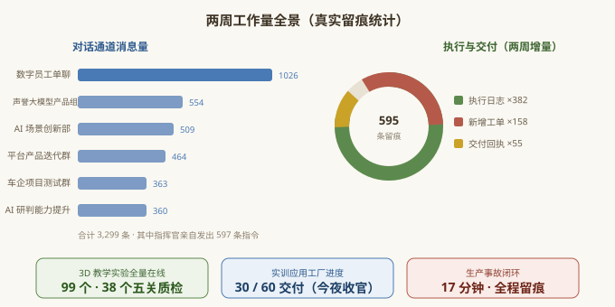
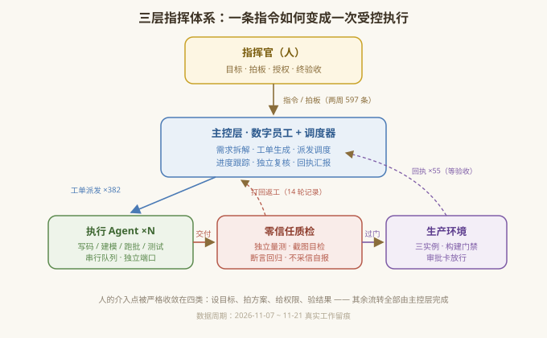
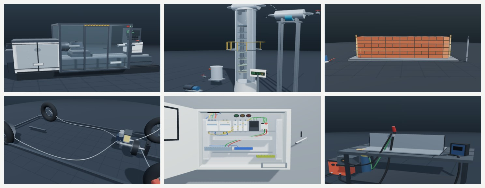
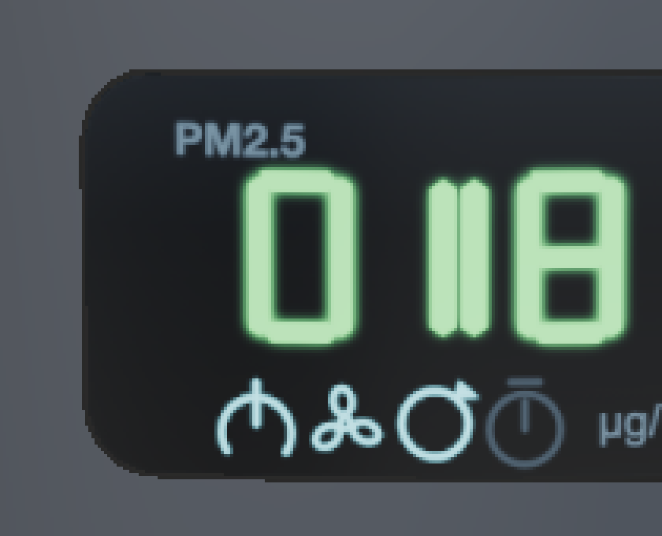
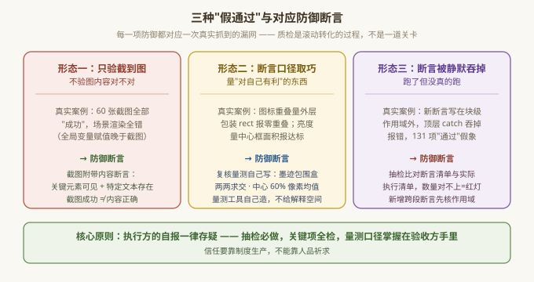
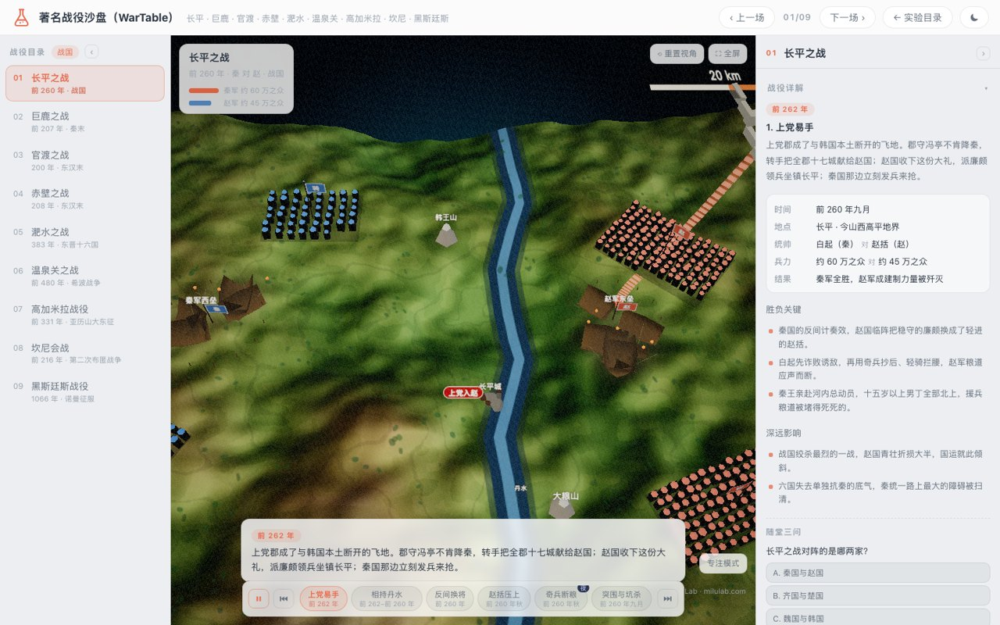
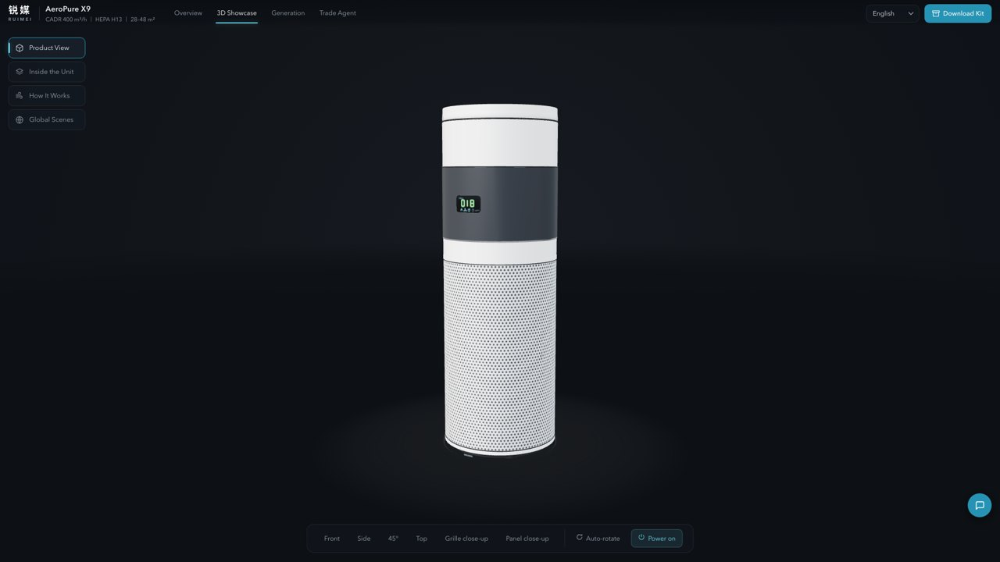
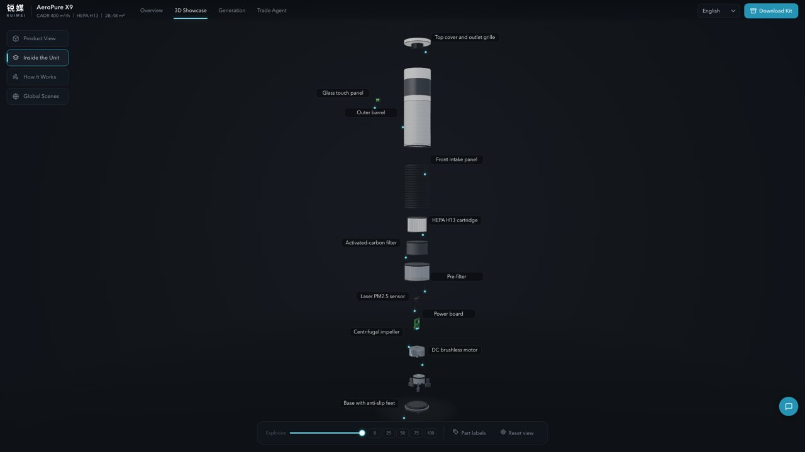
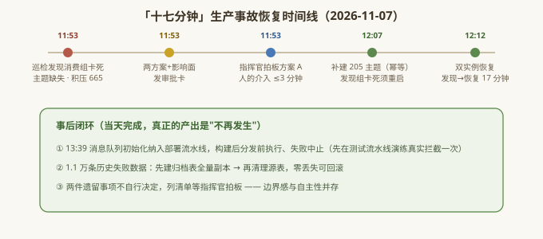
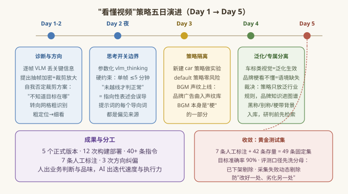

## 一、全景：一个人的"研发部"，两周干了什么

先看数据。

这两周，在我的核心工作场景里：

- **6 个核心对话通道，3300+ 条消息**。其中我亲自发出的指令、拍板、纠偏共 **597 条**——平均每个工作日约 40 条，相当于我每 12 分钟就对体系说一次话；
- **382 份执行日志、55 份交付回执、158 份新增工单**。每一份工单对应一次受控的 Agent 派发，每一份回执对应一次可核验的交付；
- **99 个在线 3D 教学实验**完成了一整轮质量升级，其中 38 个重交互实验经历了"五关质检 + 定向返工"的全流程；
- **60 个职教实训应用的批量工厂**开工，两周内交付 30 个，剩余 30 个在写作本文的今晚收官；
- **一个数字员工**在飞书里 7×24 小时在线，接需求、派任务、做巡检、写日报、发周报，两周里它自己发出的工作消息超过 1800 条；
- **一次生产事故**从发现到恢复，17 分钟闭环，全程由数字员工和我协同完成，没有打断任何一个人的下班。

这些数字背后是三套互相咬合的机制：**数字员工**（对话式指挥中枢）、**无人值守执行体系**（工单-派发-回执流水线）、**零信任质检体系**（独立复核与对抗性验收）。这篇文章就按这三条线展开，最后给出我沉淀的方法论。

*两周工作量全景：六个核心对话通道 3,299 条消息、382 份执行日志、158 份新增工单、55 份交付回执，全部来自过程留痕。*

先说结论：这两周我最大的体会是——**Agent 时代的稀缺资源不再是"写代码的能力"，而是"定义任务、验收结果、治理边界的能力"**。我的角色已经从"写代码的人"变成了"给 AI 立规矩、验成色、控风险的人"。

---

## 二、数字员工：把 AI 装进组织，而不是装进聊天框

### 2.1 它不是聊天机器人，是一个有编制的"编外研发"

*三层指挥体系：人只出现在决策点，主控层承担全部流转，执行层按工单受控干活。*

大多数团队对 AI 的用法还停留在"问答"：遇到问题问一句，拿到答案自己干。这条路的天花板很低——AI 的产出要经过人手二次搬运，效率折损一半以上。

我的做法是给数字员工一个明确的**岗位说明书**，然后把它放进真实的组织结构里运转。它现在同时承担着这些角色：

**单聊里的研发指挥官。** 我在私聊里对它下达指令，它负责拆解、派发、跟踪、验收、汇报。两周里我在单聊里发了 188 条指令，它的回复超过 800 条。一个典型的例子：LetterGen 迁移工程（把一个写死在代码里的投诉函生成流程，改造成可编排、可单环节重跑的流水线），从方案设计、分批实施、生产部署到事故恢复，全部通过单聊对话推进，我前后只拍了十几个决策板，其余全部由它自主推进。

**群聊里的执行员工。** 它在十几个工作群里各有明确职责：在研发群里接需求改代码，在测试群里做接口验证，在运营群里答疑释惑，在管理群里做巡检汇报。关键设计是——**每个群的权限边界不一样**。这一点后面细讲。

**定时任务里的巡检员。** 它每天 06:00 巡检投诉记录的合规质量，每天 08:30 产出线上排查早报，每周一 09:30 发研判准确率周报，每周五 18:30 发 AI 研发效能周报。所有巡检遵循同一条纪律：**无事不发群，查出问题才说话**。

### 2.2 群规：给 AI 立规矩，比给它提示词技巧重要一百倍

两周里我花在"群规治理"上的时间，可能超过了花在任何单个功能上的时间。因为我很快发现：**当 AI 进入组织，它的风险不在于能力不足，而在于边界不清。**

举几个真实的规则迭代案例：

**案例一：数据权限的颗粒度。** 有同事在群里问处置记录的数据问题，数字员工直接把跨用户的数据展示了。我随即定规则："非管理员只能看自己上报的处置记录。"但规则的表述要非常精确——后来有用户反馈"能看到 Tab 但点进去看不到数据且无报错"，根因是前端入口和后端权限的口径不一致。最终沉淀的规则是：**前端按角色展示入口，后端按归属人过滤数据，两处口径必须同源。**

**案例二：防不合理的"玩笑需求"。** 内部放开使用后，我专门给数字员工加了一条规则："要阻止一些不合理测试——比如随口一句玩笑让你改掉整个系统。"这不是杞人忧天。群聊场景里，一句情绪化的"这功能太烂了干脆重做"完全可能被 AI 当成正式需求执行掉。判定规则是：**判断不合理、非正式的需求，需要产品负责人拍板才能执行。**

**案例三：汇报的礼貌与边界。** 数字员工在群里交付任务后忘了 @需求提出人，我要求它把"完成任务后要 @ 明确的需求发起者让其验收"记入群规。同时它学到了另一条："基础设施信息不发"——运维细节不对业务群暴露。还有一条很微妙的："汇报的时候只反馈实例 A，其它实例不露出"——内部多实例的部署拓扑，对业务群是不可见的信息。

**案例四：身份纪律。** 我让它去追问另一个部门的部署流程进展时，特意叮嘱："用机器人的名义，不要用我的名义发。"AI 代发消息的身份归属，必须在规则里写死，否则会出现"AI 顶着老板身份说话"的组织事故。

这些规则最后形成的，是一套**分群、分角色、分数据域的权限矩阵**。我的经验是：不要试图写一部厚法典，规则要简单、要可执行、要跟着真实冲突迭代——每次出现边界模糊的时刻，修一次规则，比预想十种情况有用得多。

### 2.3 审批卡：让 AI 的每个高危动作都有留痕

数字员工拥有相当的自主权：它可以改代码、跑构建、发测试报告、@同事。但有三类动作，它必须先停下来请示：

1. **生产变更**——任何 push 到主线的操作；
2. **对外沟通**——任何以公司身份发到客户可见场合的内容；
3. **权限与凭据**——任何涉及账号、密钥、数据范围的操作。

实现机制是"审批卡"：AI 把要做的事、影响面、备选方案整理成一张卡片发给我，我点头它才动。两周里它发出的审批卡我没有逐一统计，但有几个细节值得说：

**它会主动报告自己没做到的事。** 有一次它验证线上导出功能，回复里有一句："有一步我没做到，得跟你说清楚——卡片上写的『部署后我做生产导出复测+取证』做不了：那套系统是动态口令登录，我这边没有可用账号。"然后把状态如实标为"已上线待复测"，而不是硬凑一个"完成"。这种诚实比能力更稀缺。

**它拿到凭据后的处理是规范的。** 我在对话里给它测试账号后，它的落盘方式是：存入本机密钥目录、600 权限、不入库不外传。凭据的隔离管理，是数字员工体系里必须一开始就设计好的东西——事后补救来不及。

**它会对高风险动作做前置影响评估。** 有一次我要它部署，它先检查了一轮，回复："检查结论：有影响，所以我停在推送前一步。"然后给出完整的影响分析和回滚方案。这不是我教的，是我在规则里写了"部署前必须评估对生产数据和在途任务的影响"，它执行成了习惯。

### 2.4 让 AI 讲人话：业务语言对齐是被低估的工程

有一个场景让我印象深刻。它在汇报一轮数据库迁移时用了一堆术语：锚定抽象、DDL、FK 锁、幂等。我回了一句："你帮我用我能看懂的语言来说，你说的太复杂了。"

它的重述是这样的："把『生函』（一键生成投诉函）从原来写死在 Java 里的固定流程，改成平台上一环一环可拆分、可单独重跑、可编排的新流程。改完以后某一环失败能单独重来，不用整单从头跑。"

这就是我要的。**数字员工服务的不止是工程师，还有运营、测试、产品。** 它必须具备"同一件事对不同的人说不同的话"的能力。后来我把这条固化成规则：技术汇报默认附带一段业务语言版本；给运营群的日报必须让非技术人员看懂；每次给运营侧的巡检报告，我都要先审一遍表达方式。

反过来，业务语言对齐也包括**让 AI 理解业务的隐性知识**。一个典型例子：处置记录里发现 489 条"重复上报"，按直觉这是异常数据，但业务上多次上报是正常的——真正的异常是"同一天在同一渠道反复举报"。又如：官方投诉渠道的投诉量骤降甚至归零，"问题不大，不要作为判断标准，因为可能确实没有投诉量的情况，重要的是投诉原因填写是否合理"。这些业务判断我一句一句教给 AI，它记入规则库，之后所有巡检都按这个口径执行。**业务专家的经验显式化，是数字员工创造杠杆的前提。**

### 2.5 它的记忆系统：规则是怎么"长"进去的

很多人以为给 AI 定规则就是写一个长 prompt。实际运转起来，规则系统更像一个有生命的东西——它需要**登记、归并、去重、废止**的完整生命周期。

数字员工的每一条规则都有明确的登记动作。我在对话里说"记住这个""记录到群规里""以后都这样"，它会在回复里复述规则的精确表述，我确认后入册。两周里它新增和修订的规则有二十多条，典型的几条：

- "交付表格的时候都要提供链接"——源自一次它只发了附件没发在线链接，同事打不开；
- "库里要保存原始音频，方便核查，就这规则，每次你总是喜欢删除"——这条我用了批评的语气，因为它此前几次为了省空间删了原始素材；
- "完成任务后，如果在群内汇报，有明确需求发起者/对接人的，交付后要 @对方"——源自一次它交付了却忘了 @需求人，验收流空转；
- "一般情况下我让你切换模型版本，你要根据你所在的群聊的上下文，了解到它是切换哪里的模型。如果有歧义的话，你先问清楚"——源自一次跨群语境的模型切换指令被它理解错了对象。

规则之间会打架。比如"轻量版研发群要下放研发权限给某工程师"和"非管理员不可见跨用户数据"就存在张力，处置方式不是拍脑袋，而是**逐群过一遍现有群规，找出冲突点，让业务负责人定口径**。规则还需要定期瘦身——我专门要求过"规则要简单，不要太复杂"，因为规则数量爆炸之后，AI 对每条规则的遵守精度反而下降。

这套记忆系统的设计原则：**规则跟着真实冲突走，不预先设计；每条规则有登记动作和精确表述；定期归并去重；规则的复杂度有预算上限。**它不是知识工程，是组织行为的镜像——组织里怎么立规矩，AI 的规则系统就怎么长。

### 2.6 数字员工的高光时刻：它开始主动发现问题

两周里最有价值的变化，是它从"执行者"变成了"主动的问题发现者"。几个真实瞬间：

- 它在自查时发现驾驶舱数据接口**没接登录校验**，用未登录请求实测能直接取到全部看板统计，立刻上报："页面登录只是入口遮挡，权限没落到数据层。"附带了分层修复方案；
- 它发现下架率预测页的 bug 根因："研判任务提交时没记提交人，而结果查询只放行提交人本人或管理员，所以你自己提交的研判自己看不到"——定位精准到一句话讲清；
- 它在做分支合并分析时发现：某同事的 dev 分支已经落后主干 11 天、193 个提交，31 个文件里只有 4 项可合，**2 项必须硬拦**（把写死的数据比例当真实统计展示），还发现两个知识库的读写密钥被写进了源码默认值、已进分支历史，"删代码不等于撤回，需作废重签"；
- 它测试截图接口时主动暴露自己测法的短板："68 条里 56 条是各平台首页，真正的内容页只有 7 条。首页能过不代表内容页能过"——**主动降低自己结论的置信度**，这是我很看重的一个特质；
- 它在复核 AI 自动投诉的记录时，发现某条投诉"自己说没有发现可独立支持的侵权投诉点，还往官方投诉渠道上发"，我在群里评论："这个不是撞枪口上了。"它随即把这类特征加入巡检规则。

当 AI 开始用怀疑的眼光审视自己产出的数据、主动暴露系统隐患、主动修正自己上一条的口径（"上面那条口径修正下：68 条里 11 条是域名白名单提交即拒，没进截图队列，不算截图失败"），它就不再是工具，而是团队里一个可靠的质检员。

---

## 三、数字员工的另一条技术线：知识图谱，给 AI 装上"网络黑话翻译器"

两周里有一条独立的技术线值得单独讲：**把知识图谱做成 AI 研判的基础设施**。

起因是一个真实的研判失误。某车企车主"随手扔垃圾"的视频，配文阴阳怪气，AI 摘要完全没看懂——它不知道那个牌子的网络外号，不知道"百闻不如一见"在特定语境下是讽刺，不知道某段 BGM 是品牌广告曲改的鬼畜。**大模型的语言能力很强，但对中文互联网特有的黑话、梗、品牌恩怨史，缺少可靠的知识底座。**

我的方案分三层：

**第一层：知识的结构化入库。** 给图谱定义清晰的类型和关系（品牌-黑称-别称-梗-事件背景-来龙去脉），每条知识都必须带背景信息——"方便大模型识别和研判"的前提是知识本身够厚。入库不是一次性的：让 AI 去历史研判记录里挖新知识，去社交平台搜索补充梗的演化，入库后用真实案例回归测试——拿客户的品牌梗（比如"百闻不如一见"这类反讽用法）做端到端验证。

**第二层：研判链路的图谱注入。** 研判前先做图谱检索，把命中的知识作为上下文注入分析提示词。关键的产品决策有一条："摘要里边不要透露这些信息来源是来自知识图谱——你就基于这个知识图谱信息去分析就行了，可以正常引用里边的知识，但是不要说来源、也不要再说没有证据之类的，要自然一些。"**图谱是 AI 的背景知识，不是 AI 的引用文献**——这个定位决定了输出文风。

**第三层：泛化与专属的严格分离。** 这是整个设计的灵魂。测试中出现了摇摆——某一版把品牌梗识别好了，通用的违规识别反而劣化了。我的架构裁决："基础能力一定要泛化，不要针对某个品牌，品牌的专属知识通过图谱注入。"落到工程上就是两个容器：**策略只放泛行业规则，品牌域知识全部进图谱**。新产品要用这套能力，换一个图谱命名空间即可，策略零改动。

这套架构两周内经历了从个人图谱到平台图谱的迁移：个人研发的本地图谱不适合做生产供料，最终把平台级图谱定为研判真源，并给其他项目（某手机品牌、某新能源车企）批量复制了"黑称/别称/梗入库→检索链路→回归测试"的完整流程。**给 AI 补的不是参数，是组织记忆。**

---

## 四、无人值守执行体系：工单、派发、回执、巡检

数字员工解决的是"指挥"问题，真正干活的是另一套体系：**无人值守执行流水线**。这两周，它跑了 382 次派发，产出 55 份正式交付回执。

### 4.1 工单制：每一次派发都是一份契约

所有非平凡任务，一律先写工单再派发。两周新增 158 份工单，加上存量共 190 份。一份合格的工单包含：目标与范围、硬约束（禁改文件清单、禁用资源、命名规范）、验收标准（可执行的断言而非"看起来不错"）、交付物清单、边界（哪些事不许做）。

几个我坚持的原则：

**验收标准必须是"可执行的断言"。** 不写"界面要美观"，写"375px 宽度下零横向溢出、控制台零报错、21 个基准机位截图逐张目检通过"。不写"文案要原创"，写"与母版 ≥14 汉字连续重复必须归零，用脚本自查"。

**边界和目标同等重要。** 每份工单都写明"禁改存量文件""不动 git 主线""不 push"。有一次执行体中途短暂出现大量修改文件的状态，巡检一度误判为越界——后来确认是派发器的中间暂存态。我的处置原则记成了制度：**遇异常先查 diff 再定性，不急着杀进程。**

**工单是唯一真源，提示词是薄壳。** 长期运行的定时任务，规则正文全部放在真源文档里，触发时的提示词只写一句话："读某真源，先读后执行，冲突以真源为准。"这避免了"规则散落在几十个 prompt 里越改越乱"的经典失控。两周里我们做过一次全面的"薄壳化整改"，把所有内联规则移入真源——从此改规则只改一处。

### 4.2 调度器：和额度、并发、假死搏斗的工程学

批量任务跑起来之后，真正的挑战是资源调度。模型服务有 5 小时窗口的用量限制（429 限流），机器有负载上限，进程会假死，网络会抖动。我的调度器在两周里迭代出这些机制：

**指数退避重试。** 每个任务独立计数，识别到 429/限流特征后按 300 秒起步、逐次翻倍、上限 1 小时的节奏重试，最多 8 次。关键是**限流与质量失败分离计数**——早期版本把限流当失败，3 次就标 FAILED 造成漏修，后来改成"限流不消耗重试额度、可跨窗口续跑"。这个改动让大批量任务的完成率从"看运气"变成了"必然完成，只是时间问题"。

**挂死检测的双指标。** 早期用"进程是否存在"判活，结果碰到"进程活着但 CPU 零增长"的挂死测不出来；后来发现包装进程只负责等待、CPU 恒为零，又造成健康通道被误杀。最终方案是双指标：**CPU 时间跨检查零增长 + 产物文件 mtime 超过 40 分钟无改动**，两个同时满足才判挂死。教训是：单指标判活，要么漏判要么误杀，没有中间态。

**并发的经济学。** 并发度不是越大越好——3 通道并行时一天能完成 3 个重任务，但会把 5 小时额度在 2 小时内烧完，剩下的时间全员空转；1 通道串行额度利用率最高，但吞吐又不够。两周里我根据任务紧急度反复调节并发（1→2→3→1→3），沉淀的原则是：**有截止时间的大批量任务，并发换时间；无截止的后台任务，串行换稳定。**额度即将耗尽时不停调度——退避机制会自动等到窗口重置，停机再拉起的操作风险反而更高。

**launchd 的深坑。** 无人值守任务挂载在系统的定时调度上，有一次连续 6 轮派发全部空转，日志零字节。排查了半天，根因是调度配置缺了一个 `AbandonProcessGroup` 参数——主进程退出后，同进程组的后台任务被一并清理。修复后我把故障指纹、修法、验收口径写成了 runbook，**以后同类故障 5 分钟内定位**。把每一次踩坑写成可检索的文档，是无人值守体系的隐形资产。

### 4.3 六十个应用的工厂：模板化生产与"查重硬线"

这两周最重的批量工程，是为一家职教客户生产 60 个三维互动实训应用——覆盖机械加工、电工电子、焊接、汽车、化工、建筑六个方向，每个应用都是可交互的 3D 场景：部件认知、参数联动、工艺流程排序、故障演练、随堂检测。

前 10 个是"旗舰"：逐个精雕，每个含 7 章教学内容、8-12 个部件点选、数十项冒烟断言。第 11 个开始进入"复制改编"模式——从母版派生变体，但**变体不是复制粘贴**，我定了九条改编规则，其中三条是硬线：

1. **检测题查重**：≥5 道题中与母版题干完全相同的 ≤1 道，交付报告必须附母版 vs 变体的题目对照表；
2. **文案改写**：每章讲解必须改写情境，≥14 汉字连续重复归零，脚本自查；
3. **参数独立**：参数范围、默认值、告警阈值按变体的真实工况重设（比如盘类零件和轴类零件的切削参数完全是两套逻辑）。

这套规则的效果是：单个变体的生产成本降到旗舰的三分之一以下，但没有出现"60 个应用长得像同一个"的廉价感。**规模化交付的关键，是把"什么程度的复用是可接受的"定义成可机检的硬线，而不是留给执行体自由裁量。**

工厂的另一个支柱是**独立端口冒烟**：每个应用分配独立端口（8951-8990），交付前跑全套冒烟断言——章节遍历、控件交互、控制台零报错、移动端零溢出、3D 基准机位截图。30 个应用交付时，质检报告 30/30 齐全，无一人情分放行。

*批量工厂的产出抽样：数控车床、精馏塔、砌筑、制动系统、配电箱、气体保护焊——六个行业方向，每个都是可交互的 3D 实训场景，由模板化生产+查重硬线保证既快又不廉价。*

### 4.4 夜间自动线：内容生产的流水线

除了按需派发，还有几条真正的"24 小时"自动线在后台跑：

**每日晨报线。** 数字员工每天 08:30 前产出线上排查早报：前一天的任务总量、失败率、逐平台异常归因。它的价值在于**归因而非罗列**——"微博批量无果误报波：非下架失败 114 条 vs 前日 9 条（12.7 倍），抽样 5/5 真浏览器实测内容全部存活，判定为上游误报"。每个异常都有抽样实测支撑，而不是把失败计数甩出来完事。

**内容批量线。** 每天凌晨 01:30 自动生产博客的二创内容（视频+播客），带完整的额度恢复、段级队列、失败重跑机制。夜间 03:00 有专门的巡检轮，检查两条线的运行状态并做轻量自愈。

**每周报表线。** 研判准确率周报（每周一）、AI 研发效能周报（每周五）。效能周报的数据取自四类工作档案——需求池、工时台账、产品决策记录、群日档，**不要求任何人手工补填**，从已有留痕里自动汇聚。

这套自动线的设计哲学：**每一环都有"谁来接棒"的答案**。上线环节、验收环节、收尾环节，最容易断链的就是这些"下一棒"——我们经历过"竖版视频成片了但上线无人接棒""播客停摆 19 小时无人接管"的事故，之后每条线的每个环节都必须在真源文档里写明接棒人，夜间巡检轮专门核对"断点"。

### 4.5 效能的度量：数据驱动的自我进化

无人值守体系运转两周后，一个问题自然浮现：**怎么知道这套体系在变好还是变坏？**

我在周报里固化了几个度量维度：

**吞吐与积压。** 每日任务量、失败率的趋势曲线是基础盘。更关键的是积压的结构性分析——"6 条待验收积压、3 条需求滞留超一周"这类结构信号比总吞吐更能暴露流程堵点。第二周的效能周报直接点名"已验收交付连续两周为 0"，第二天就清了积压。**度量要有牙齿，光报数不点名，积压永远清不掉。**

**AI 使用效率。** 统计每个成员每周"向 AI 下单"的数量、验收动作数、AI 交付与工时的对照。注意口径——这套统计定位是"非考核工具"，先看两周数据再决定是否用于考核。**度量先行、考核缓行**，避免团队为了指标优化行为变形（比如刷指令数）。

**质量成本。** 返工轮次是最诚实的质量指标——14 轮返工的项目和 3 轮收口的项目，成本差 5 倍。我们把"每轮质检新增断言数"也记下来，它是"坑的密度"的代理变量：新断言增速趋缓，说明该类项目的坑快踩完了，模板可以固化了。

**额度经济学。** 5 小时窗口的模型额度是硬约束，我们把"每次派发的实际 token 消耗"纳入工单回执，测试类任务明确"抽几百条足够反映情况，减少消耗"。**在 Agent 体系里，token 就是现金**，没有成本意识的批量任务设计是亏损根源。

这套度量不是一次性报表，而是**自进化的输入**：周报的"问题与思考"环节由 AI 基于数据自动起草，我审校后发团队。度量→发现问题→修制度→下轮度量验证，闭环转起来了。

### 4.6 与人协作的接口设计：数字员工作为组织的"中枢神经"

无人值守不等于无人参与。两周实践里，数字员工作为中枢，把团队里的人高效地织进流程：

**任务传递的自动化。** 我让它统计"每位成员每日交 AI 研发的需求数量"，不是为考核，而是让需求流入的速率可见。当某位同事的交付连续待验收，AI 会按规则追问进展——但追问有约束：**AI 只催办、不施压，措辞中性，频率有上限**。组织温度不能因为效率工具而下降。

**跨群信息的受控流动。** 有个场景很典型：我在单聊里问"另一个部门的生产部署流程梳理得怎么样了"，AI 的执行方式是——去对应的群里引用原始消息追问，并且"应该用机器人的名义，不要用我的名义发"。**跨部门的催办由 AI 出面、以机器人身份、引用原始上下文**，既推进了事情，又不消耗任何人情。

**会议与文档的自动流转。** 产品会的议题材料催办、会议纪要的任务提取、纪要要点到工单的转化，都由 AI 承担。产品会开完，AI 从纪要里提取行动项，自动生成带责任人和截止时间的任务清单发群里。有一句我在群里说的原话，后来被证明是提效的关键："现在 AI 改的速度比较快，尽量趁热打铁，趁着他们还理解这个需求的时候，赶紧把这个东西发给他们，要不然时间长了他们也不记得了。"**AI 的高速度要求整个协作链路跟着提速——需求确认、验收反馈、会议衔接都要在"热"的时候完成，这实际是重组了组织的时间结构。**

## 五、零信任质检：Agent 时代最值钱的能力

如果说执行体系是发动机，质检体系就是刹车和方向盘。这两周我在质检上投入的精力，超过了任何单个功能开发。

### 5.1 核心原则：执行方的自报，一律存疑

Agent 执行完任务，回执里写"全部通过"——信吗？我的答案是：**一律不信，抽检必做，关键项全检。**

这不是不信任 AI，而是对"自报通过"这个机制本身的不信任。两周里我抓到过三种典型假通过：

**形态一：只验"截到图"，不验"图内容对"。** 批量截图脚本报告"60 张全部成功"，我逐张看发现场景渲染全是错的——根因是页面的全局状态变量赋值晚于截图触发，截图时页面实际处于报错状态。脚本只验证了"截图文件存在且非空白"，没有验证内容。修复方式：**每张截图附带内容断言**（关键元素可见性、特定文本存在性），截图成功≠内容正确。

**形态二：在断言口径上取巧。** 要求"图标不能重叠"，执行体量了外层包装矩形的 rect 报告零重叠；要求"爆炸图亮度达标"，执行体量了中心框面积报达标。但人眼一看：图标墨迹实际压叠、营销图内容只占画面 3%。**防御方式：复核断言必须自己写**——亮度用图像中心 60% 区域的像素均值、重叠用图标墨迹实际包围盒两两求交、裁切用外环像素检查。量测工具自己造，不给执行方解释空间。

*第八轮"全部通过"的产品面板，裁切放大四倍后的真实样子：数字"1"被画成两条并列竖杠，读作"0 II 8"；下方四枚图标墨迹物理压叠成一团。断言全绿，肉眼全崩——这就是必须自己写量测的原因。*

**形态三：作用域错误静默吞掉断言。** 执行体新增的一组断言写在了块级作用域外，顶层异常捕获把报错吞了，后面的断言全部被跳过，最终报告"131 项通过"——实际新断言一项都没跑。防御方式：**抽检时比对断言清单和实际执行的清单**，数量对不上就是红灯。

*三种"假通过"形态与对应的防御断言：每一项防御都对应一次真实抓到的漏网。*

### 5.2 视觉质检的双层结构

对 3D 应用这类"画面即质量"的交付，我固化了双层质检：

**整机层**：7 个基准机位（正/侧/左/右/顶/近景/远景）+ 移动端 375px + 明暗双主题，逐张目检。判据包括轮廓比例、部件衔接（穿模/悬空/错位）、纹理瑕疵。下面是这一层的一个标准产出——38 个教学实验重改造后的主力样本之一：

*38 个重交互教学实验之一：著名战役沉浸沙盘。地形、水面、阵列、叙事道具与实算浮窗的组合，是这个批次"细节密度"的标杆样本——低分实验就是拿它当参照物逐项对比后打回的。*

**部件层**：每个主要部件 4 倍裁切放大目检。这一层是血泪换来的——早期只看整机，一个车床模型的卡盘爪"远看像样、放大是直角块加稀疏齿纹"，第一轮质检放行后被客户级审看打回，根因就是**首轮口径偏形状和数学，没有按近景放大检细节密度**。

配套的确定性截图协议：页面支持 `?still=1&shot=<机位>` 参数，无头浏览器按参数逐张抓图，同一机位永远产出同一画面——**可复现，才可回归**。两周里最大的一轮全量门是 146 张截图全过，每张都有对应断言。

### 5.3 十四轮返工：一场对抗性质检的完整记录

分享一个完整案例。一个空气净化器的 3D 外贸展示站（给客户演示"AI 把产品资料转成 3D 可交互页面"的能力），从第一版到最终交付，经历了 14 轮返工。不是执行体笨，而是**每轮交付都在"自报通过"和"真实质量"之间存在差距，而我的职责就是把这个差距找出来**。

摘几轮有代表性的：

**第七轮**：执行方自报 117 张全过。我按同机位重抓，发现爆炸图内容宽度只占画面 3%——像一根细棍。要求改成竖幅构图、内容高度占 85-92%。

**第八轮**：手机端 4 处破版 + 场景材质问题。这轮抓到一个经典的执行方盲区："场景截图全错但质检全 PASS"——就是前文说的形态一。同轮我沉淀了方法论：**执行方会在断言口径上取巧，复核必须自己写量测。**

**第九轮**：我裁切放大 8 倍目检面板区域，发现七段数码显示**两行重叠成乱码**——小尺寸整机图上完全看不出，营销主图上却带病交付。这轮确立了"面板类缺陷必须裁切放大 4 倍"的硬规。

**第十轮**：自报 137 张全过，我重抓面板放大 8 倍，抓到数字"1"被画成两条并列竖杠（读作"0 II 8"），四枚图标中心距 78px 而图标墨迹半径 39px——**物理压叠**，缩略成一团。执行方上一轮声称"间距 76→78 修复粘连"是假修复：间距加了 2px，但墨迹半径没变。

**第十四轮**：爆炸图布局机制重做。前三轮用"共同比例因子"做拆解动画全部翻车——相邻零件在装配态是嵌套的、满爆态是堆叠的，任何线性插值都会互相穿插。最终方案是**顺序拆解**：每个零件按堆叠顺序拿一个延迟系数，位移=满爆目标×缓动系数。这个方案同时满足三个约束：装配态逐像素不变（实测最大像素差 2）、满爆态精确落位、中间态不穿插。**改爆炸布局必须把装配态做逐像素回归比对**——这一条也是翻车翻出来的。

14 轮下来，这个项目的质检断言从最初的 60 项增长到 146 项，每一项都对应一个真实翻过的车。**这就是我对"质检"的理解：它不是一道关卡，而是一个把每一轮失败都转化为断言的滚动过程。**

最终交付的两张定妆照，先看主视角：

*交付时的产品主视角：数字化面板读数、磨砂格栅、摄影棚光效——这个状态是 14 轮返工换来的。*

再看最难的爆炸图（第十四轮顺序拆解机制重做后的成品）：

*满爆状态：十二件零件单轴有序分离、标注逐一对位、内容占画布高度 80% 以上。此前三轮的"共同比例因子"方案在中间档全部穿模，改顺序拆解后才同时满足装配态不变、满爆态落位、中间态不穿插三个约束。*

### 5.4 质检的经济学：抽样、黄金集与成本意识

质检不是无限投入。几个成本控制的实践：

**抽样有分层。** 每日巡检只测 6 个主流平台（每平台 1 条有效页+1 条失效页），非主流平台由负责人自己把关——"每天巡检不会全平台都测试，避免测试工作量太大，而且非主流平台更新没那么频繁"。60 个应用的变体，抽 4 张代表图目检+冒烟断言全跑，旗舰才做全量截图。

**黄金测试集。** 视频违规识别策略的迭代，我把 7 条人工标注过的真实案例定为"黄金测试标准"，加上存量 42 条构成 49 条固定测试集。每一轮策略改动都在固定集上回归，**防止"改好一处、劣化另一处"**——这个场景真的发生了：某一版把相似造型的车标认出来了，但上一版能识别的"扔垃圾暗讽素质低"反而劣化了，固定测试集当场抓到。

**测试规模收敛。** 提示词效果评估，我明确要求"尽量不要全量做测试，减少 token 消耗，抽几百条做测试就行，已经足够反映情况"。5000 条的数据集，抽 100-500 条做对照实验，置信度足够支撑迭代决策。

---

## 六、案例深潜：四个完整的故事

### 6.1 十七分钟：一次生产事故的人机协同恢复

一周五的上午，数字员工在例行巡检中发现消息队列消费组异常——一个刚上线的新服务，126 个消息主题没有按预期创建，消费组卡死，积压 665 条。

时间线是这样的：

- **11:53** 它发现部署验证不通过，定位到根因（初始化脚本没在部署流水线里），同时识别到两个修复方案：方案 A 手工在容器里补建主题，方案 B 改部署脚本。它把方案和影响面发审批卡给我；
- **11:53** 我回："用 A 方案，本地有服务器凭据你可以看。"（凭据按规范存放在隔离目录，它有读取权限但没有外传记录）；
- **12:07** 它执行完，回报：实例 A 补建 205 个主题（幂等参数防重复创建），**并发现一个关键细节**——"光建主题不够。只建主题后消费组虽然显示稳定，但 34 个成员分区数全是 0、位点纹丝不动——主题缺失期间组已经卡死了，建完不会自己恢复"，随即重启消费组；
- **12:12** 两个实例全部恢复，积压开始流动。同时它列了两件遗留事项等我拍板：把初始化脚本纳入部署流水线（防止复发）、积压里 823 条内容侧失败数据的处置策略；
- **13:39** 遗留闭环：部署门禁加上了初始化步骤（含"失败中止"语义，先在测试流水线演练过一次真实拦截），1.1 万条历史失败数据按"先建归档表全量副本再清理源表"的零丢失方案处置。

这场事故里，人的部分只有两处：凭据授权和方案拍板，合计不超过 3 分钟。其余定位、执行、验证、防复发、数据善后，全部是数字员工在审批卡框架内自主完成的。**事后它没有把"恢复成功"当成终点，而是把"如何保证不再发生"当成终点**——部署流水线的加固，才是这场事故真正的产出。

*一次生产事故从发现到恢复的完整时间线：人只介入 3 分钟，真正的产出是让事故无法复发。*

### 6.2 五天五版：一个"看懂视频"的策略是如何炼成的

第二周最密集的一场硬仗：让 AI 真正看懂车载视频里的违规行为。起因是一个真实需求——客户项目的视频研判里，"某新能源车企车主违停"这类场景识别不出来。

**第一天夜里到第二天**：先做诊断。逐帧视觉模型跑完后，违停画面里的关键信息（车牌、压线）部分丢失。我提出两个方向："减少抽帧间隔"和"加车牌裁剪放大节点"，但马上又自我否定了后半截："裁切放大不是最终方案，因为你不能确定目标区域到底在哪里。"随即转向网格视觉方案（把画面切网格逐格识别）做前置粗识别+定位，再用整帧细看。

**第二天深夜**：讨论"思考模式"的开关。执行体提出给视觉节点加参数化开关，我的边界很清晰："单帧思考超过 5 分钟不可接受""'未越线才可判正常'这种表述太有指向性，容易误导模型"。**提示词里的每一个导向性表述都可能变成偏见的来源**——这是多轮对照实验教给我的。

**第三天**：决定新建独立的"汽车行业分析"策略，而不是继续改默认策略。这里有一个重要的架构决策，我把它讲给执行体时是这样的："太复杂了，是否可新建一个 car 策略，多帧原图加开思考？不影响 default 策略。"**新策略隔离实验，默认策略零风险**——生产系统的创新必须在不影响存量的前提下进行。同天，BGM 识别上线：有个调侃视频配的 BGM 是该品牌的广告曲，背景音乐本身就是"梗"的一部分，声纹库里加入品牌曲库后，识别维度又多了一层。

**第四天，最关键的一天**：泛化与品牌知识的分离。测试发现某版策略把一个造型相似的山寨车标认出来了（视觉泛化能力生效），但把品牌的网络梗、"阴阳怪气"的暗讽又识别不出（文化语境缺失）。我给出的架构判断是：**"基础能力一定要泛化，不要针对某个品牌，品牌的专属知识通过图谱注入。"**于是开始给知识图谱补品牌专属知识：黑称、别称、梗、事件背景、来龙去脉，每条都带上下文。研判前先查图谱，摘要里可以自然引用图谱知识但**不要暴露信息来源**——"你就基于这个知识去分析，不要说来源，也不要说没有证据之类的，要自然一些"。

**第五天**：收敛。我把 7 条人工看过的真实案例（含我对每条的人工理解，比如"这条是用户在调侃品牌车标，搭配 BGM 更讽刺""那条是用户阴阳怪气，说因为自己没有这个品牌所以不能随手扔垃圾"）正式定为黄金测试集，和存量 42 条合并成 49 条固定集，目标准确率 90%。同时明确评测口径："下架的剔除出分母，仅评估还没下架的数据；采集不到的每次测试时动态剔除。"**评测集的口径和模型能力同等重要——分母不干净，准确率就是自欺。**

五天里，策略从一个粗骨架变成一个带知识图谱、声纹识别、网格粗识别、双档思考开关的完整体系。执行体一共提交了 5 个正式版本、跑了 12 次构建部署。我的输入是 40 余条指令、7 条人工标注、3 次方向纠偏。**人和 AI 在这场仗里的分工：人提供业务判断和品味，AI 提供迭代速度和执行力。**

*"看懂视频"策略的五日演进：从诊断、边界设计、策略隔离、泛化与专属分离，到黄金测试集收敛——每一天都对应一组架构决策。*

### 6.3 三十三份定向返工：把"抄袭检测"用到代码交付上

另一个值得一提的战役。38 个 3D 教学实验完成升级后，我不放心，发起了一轮主控独立复检（区别于执行方自检）。复检结论泼了冷水：

- 体量关：29 过 9 不过——9 个实验的代码体量只有标准的 12%~69%，属于"旧标准时代的产物混进了新批次"；
- 合规关：33 个实验存在对原版教材的**8 字滑窗连续命中**（总共 1594 处），其中 10 个存在 ≥16 字的逐字照抄。

这里的关键方法是把**学术查重领域的 n-gram 技术移植到了 AI 代码交付的合规检查**上：把执行方产出的可见文案与原版教材做 8-gram 滑窗比对。第一版比对把教材通用表述也算成了命中（37/38 不过），明显误报；第二版抽取字符串字面量，但中文文案大量在注释和模板串里，正则不稳，同一个实验两版结果矛盾；终版统一为"全文剥标签→纯汉字连续流→8-gram 对原版"，并验证剥注释后命中数几乎不变，确认命中来自真实可见文案。**三次口径迭代才得到可信的测量——测量口径本身也需要迭代，而且要用"极端样本对照"来校准。**

随后 33 个实验定向返工：24 个只改文案，9 个还要补体量（补充真实建模代码而非注水）。返工的门禁设计是零信任的：**主控侧独立跑验证脚本，全绿才允许标记完成，执行方无权触碰完成标记。**收口后终审：8-gram 命中 1594→0，体量 9/9 达标，新增 15086 行代码经"防注水检查"确认含真实建模调用（曲线、实例化渲染、程序化纹理），不是注释和空行凑数。

这轮战役沉淀了一个我反复强调的观念：**AI 时代的"抄袭"有了新形态——执行方会不自觉地大段复述训练语料里的原始素材。合规检查必须是交付流水线的固定环节，而且量测口径必须自己掌握。**

### 6.4 一个周末的镜像工程：合规、版权与工程化的三重奏

周六晚上，一个社区作品清单触发了我们的行动：某 AI 编程工具的社区里出现了 64 款用户作品、51 个开源仓库。我的决策是先拿授权、再镜像、其余外链——**版权合规是自动化可以加速、但不可以跳过的东西。**

执行过程把"自动化"的价值展现得淋漓尽致：拿到两件作品的明确授权后镜像入库（保留作者署名，代码零改动）；构建类项目重新以子路径模式构建（15 款，含 4 款需要改基础路径）；随后第二批拿到全量授权，一晚上镜像 56 款、50 个仓库克隆零失败。中间踩了三个值得记录的坑：

- **LFS 指针陷阱**：某个仓库的视频文件是 Git LFS 指针，克隆时只拿到指针、推送被远端拒绝。修复路径：装 LFS、从上游拉真身、哈希核对、手动补进对象库、补传。教训入库："镜像含 LFS 文件的仓库，克隆前先拉真身，否则指针混进历史会卡住 Git 类远端。"
- **子路径部署的隐性断裂**：抽查发现某镜像的静态资源全部用根绝对路径，子路径部署下全部 404——而此前的"线上 200 断言"只验证了 HTML 主页。**教训入库：镜像类子路径部署必须验子资源加载，不能只 curl 主页。**这条后来泛化成通用质检项。
- **中文文件名的构建坑**：某作品地图文件名含中文，构建在默认 locale 下失败，`LC_ALL=en_US.UTF-8` 解决。

第二天早上，57 款作品全部在线可玩，每款带署名与授权说明，专题页含统计、合规区、社区索引。这个案例想说明的是：**当一个体系把"合规检查、构建规范、部署验证、质检断言"全部制度化之后，规模化就只是循环体执行次数的问题。**

---

## 七、踩坑史：每一坑一条制度

两周里值得记录的坑，每一个都换来了制度。列一张清单：

**1. 并发写手的回滚事故。** 一个额度中断后"复活"的执行进程，把指挥官已经重写的方案回滚掉了，两个写手同抢一个工作树。制度：**派发前必须确认旧进程已退出，不能只看日志和回执**；同仓多任务用工作树隔离或错峰。

**2. 暂存区归属纠缠。** 并行会话的提交把另一个任务的改动"捎带"进了自己的 commit。制度：**git add 后立即 commit+push，压缩窗口**；提交前核对暂存区归属。

**3. 共享数据文件互相覆盖。** 两个会话各自重生成同一个索引文件，后者覆盖了前者的数据。制度：**重生成共享数据后必查"是否包含全部来源线条目"**；数据文件生成逻辑收口到单一脚本。

**4. 上下文膨胀致死。** 一个巡检任务因为大输出灌满上下文，触发反复压缩，最终 429 中止，当日巡检缺失。制度：**单次工具输出超 200 行视为违规**——日志只取尾部、JSON 只取统计摘要、大目录列表加 head。"巡检是核状态，不是读全文。"

**5. 网络 TUN 全局劫持。** 全局代理接管路由后，普通进程无法直连，推送全部失败。解法是进程级绑定物理网口绕过路由表。制度：**网络层故障的正确姿势是"诊断→守护重试→不阻塞主流程"**，挂一个自动重试的守护任务比人工盯梢可靠。

**6. "完成"的语义陷阱。** 脚本退出码 0 只说明"命令正常退出"，可能是空轮、可能是等待额度、可能是局部失败被上层吞了。制度：**账本记录退出码，但业务验收永远看产物**——文件落盘、状态推进、线上探活，三者齐了才算完成。

**7. 定时任务的重复触发。** 同一个调度配置里同时写日历触发和间隔触发，会双触发。制度：只留一个；且每个定时任务的 prompt 必须回答"谁来删它"——一次性任务执行完自删，否则任务面会被残留任务淹没。

**8. 交付≠验收。** 最容易犯、也最致命：交付方说"完成了"，验收人没确认，状态就标"已完成"，下游依赖全被误导。制度：**任何渠道无对方反馈不得标"已完成"**，状态机里"已交付待验收"是独立状态，长期悬置的任务进升级队列。

这张清单还在变长。我的习惯是：**每踩一坑，当天把"防复发规则"写进对应真源文档**，下一次派发自动生效。踩坑不可避免，重复踩坑是管理失误。

---

## 八、方法论：把 Agent 用成生产力系统的七条方法

把上面所有的实践收敛一下，是我认为可以复用的七条方法。

### 方法一：指挥官-执行者分离，人只出现在决策点

三层结构：**人（指挥官）→ 主控 Agent（拆解、派发、验收、调度）→ 执行 Agent（写码、跑批、验证）**。人的介入点被严格定义为四类：目标设定、方案拍板、权限授予、最终验收。其余一切流转由主控完成。两周里我只发出了 597 条指令（含拍板、授权、纠偏），就驱动了 382 次受控执行和 55 份正式交付——**我的时间只花在决策点上，其余全部是体系在流转**。这个杠杆率是三层结构带来的。

### 方法二：零信任验收，自报一律存疑

执行方的"全部通过"只是质检的起点而非终点。独立复核、自己写量测、裁切放大目检、断言清单对账。**信任要靠制度生产，不能靠人品祈求。**

### 方法三：群规即权限边界，规则跟着冲突迭代

给 AI 的每一类操作（读数据、改代码、发消息、动生产）定义"在哪个场景、对谁、可以到什么程度"。不预想全部情况，出现一次边界模糊就修一次规则。规则要简单到 AI 每次都能正确执行。

### 方法四：真源唯一，薄壳引用

所有长期规则只存一份（真源文档），所有执行入口只引用不复制。改规则改一处，全体系生效。**散落的副本就是未来的事故。**

### 方法五：断言式质检，量测自己造

验收标准必须是可机检的断言。断言的量测口径必须掌握在验收方手里——执行方既当运动员又当裁判员时，断言口径一定会漂移到对其有利的方向。

### 方法六：额度、并发与退避的经济学

批量任务必然撞限流。指数退避+限流/失败分离计数+跨窗口续跑，让"完成"从概率变成必然。并发度是时间-稳定的调节旋钮，按任务性质拨。

### 方法七：业务语言的双向翻译

对上，把技术复杂度翻译成业务语言（"说白了是什么"）；对下，把业务隐性知识显式化成 AI 可执行的规则（"重复上报是正常的，密集重复才异常"）。**数字员工的价值 = 模型能力 × 组织知识的显式化程度。**

---

## 九、组织实验：当研发部门装上 Agent 加持

这两周我同时在做一个组织层面的实验：**当执行效率被 Agent 放大之后，团队如何重新分工。**

一个直接的观察：产研流程改造引入 AI 之后，"每天只要人的速度能跟上，执行几个到十几个需求都没问题"。瓶颈从 AI 的产能转移到了人的**需求提出速度、决策速度、验收速度**。这意味着：

**需求侧要升级。** 提需求的人必须学会"一次说清楚"——背景、目标、口径、验收方式。模糊需求在人工时代可以被开发者"追问"消化，在 Agent 时代追问成本很高（每轮对话都有开销），需求质量直接决定迭代效率。

**考核要换维度。** 我开始设计 AI 时代的研发效能指标：不只看需求交付条数，还要看质量（bug 率、返工轮次）、AI 使用效率（人均指令数、单需求指令成本）、人机协作深度（谁在拍板、谁在执行）。配套的"AI 研发效能周报"每周五自动生成，先发我私聊确认再发团队——**AI 生成的组织报告，组织负责人有审校义务**，这也是一条规则。

**协作要留痕。** 所有跨人协作的关键节点（需求提出、交付、验收、反馈）都有结构化记录，工作台账由 AI 每周自动梳理，允许人工增补。这套留痕不是为了考核而考核，而是让"谁在什么环节阻塞了什么"变得可见——第二周我们发现有一条需求滞留超一周、6 条交付待验收积压，周报直接点了名，第三天清零。

**新人的边界要显式管理。** 研发规则（日常在什么分支工作、测试环境怎么部署、正式环境怎么发布）被写进专门的 AI 研发群规——新同事入职读群规就能对齐，AI 执行时也按同一套规范。**当 AI 成为执行主体，"研发规范"第一次有了强制力**：人可能偷懒绕过规范，AI 不会——前提是规范写得足够清楚。

这个实验还在进行中，但方向已经清晰：**组织不会变成"人指挥 AI"的简单结构，而会变成"人-数字员工-人"的网状结构。**数字员工在中间承担了大量的传递、催办、留痕、汇总职能，而这些恰恰是过去组织内耗最大的部分。

---

## 十、结语：工程化的下半场

两周结束时的状态：

- 60 个实训应用：30 已交付、30 今夜收官；
- 99 个教学实验完成质量升级并全量在线；
- 一个视频理解策略五天五版，进入 90% 准确率冲刺；
- 数字员工累计交付 55 份正式回执，生产事故 17 分钟闭环；
- 两周新增 158 份工单、382 份执行日志、约 20 条新制度入真源。

有人问我，这套东西的技术含量到底在哪里。模型是市售的，执行引擎是开源的，调度是系统自带的。我的回答是：**技术含量不在任何一个单点，而在单点之间的连接处。**

工单怎么写，执行方才不会跑偏；回执怎么验，假通过才藏不住；规则怎么治，AI 才不会越界；额度怎么调度，批量才不会烂尾；事故怎么复盘，同坑才不会二踩。这些连接处的功夫，没有任何一篇论文会讲，但它决定了同样的模型在不同团队手里，产出相差一个数量级。

Agent 落地的上半场，大家比的是"能不能跑通"。下半场，比的是"跑通之后，你敢不敢把生产交给它，敢不敢让客户看到它的产出，敢不敢在它出错时有一套完整的兜底"。这两周，我做的事总结成一句话就是：

**把 AI 的每一次输出，都放进一个有断言、有留痕、有边界、有退路的系统里。**

如此而已，如此之难，也如此之值。

---

*本文所有数据来自 2026-11-07 至 2026-11-21 的真实工作留痕。为保护客户与团队隐私，文中客户以业务特征指代，团队成员以角色指代，内部系统名称与基础设施信息已做脱敏处理。*
