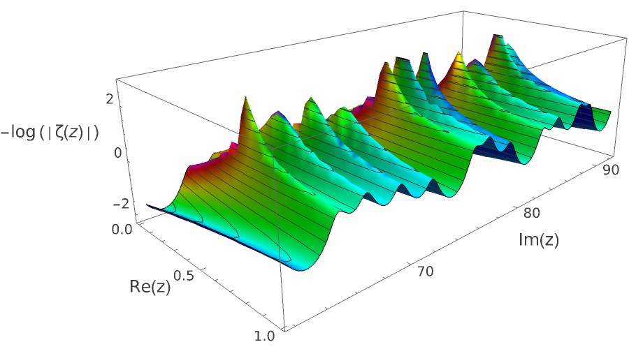
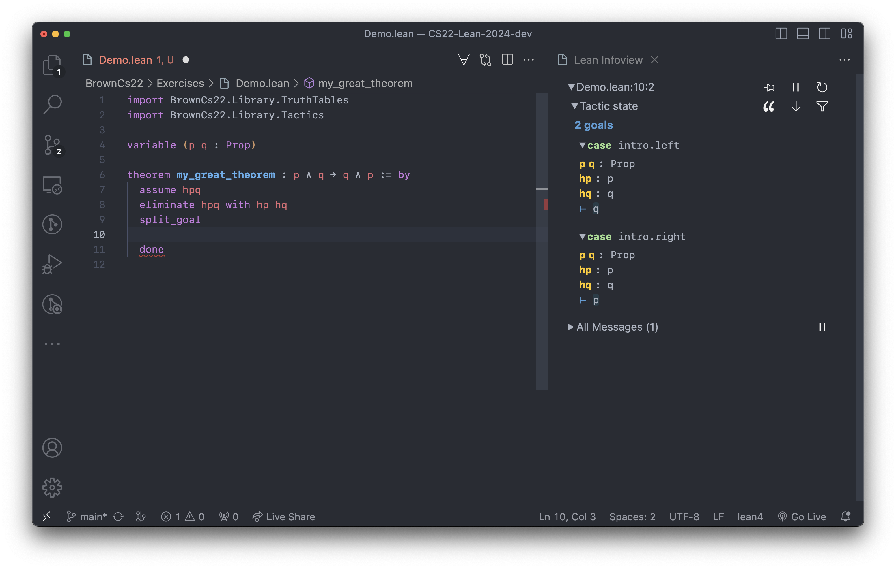
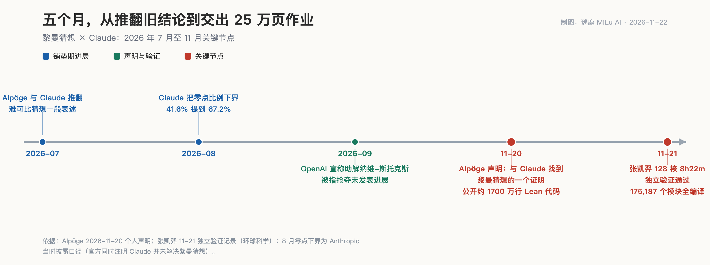
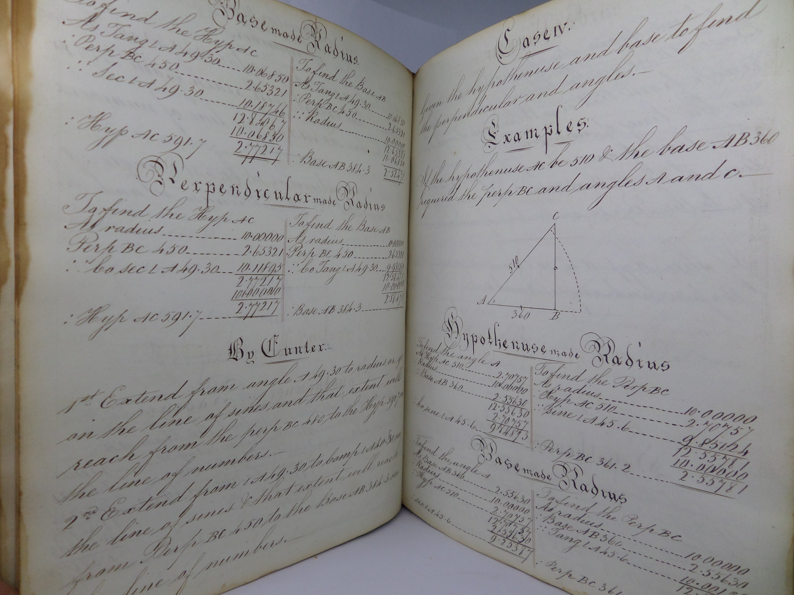

<video controls preload="metadata" style="display:block;max-width:100%;width:720px;margin:0 auto;" poster="/assets/videos/2026-11-22-ai-riemann-proof-unread-homework-cover.jpg" src="/assets/videos/2026-11-22-ai-riemann-proof-unread-homework.mp4"></video>
*同一件事的视频版：一份没人读完的作业，和一份被挑出错的作业*

从 1859 年到 2026 年，黎曼猜想挂了 167 年。数学界对「什么算证明」有条不成文的老规矩：写下来，让同行读得懂，读过了才算数。

11 月 20 日，这条规矩被撞了一下。34 岁的数学家 Levent Alpöge 在个人网站声明：「我相信，我和 Claude 一起找到了黎曼猜想的一个证明。」他是哈佛本科、剑桥硕士、普林斯顿博士，导师是菲尔兹奖得主 Bhargava，2026 年入职 Anthropic。证明论文超过 25 万页，Alpöge 自己承认没读完，交出来的作业是约 1700 万行 Lean 形式化代码，压缩包分了 14 个分卷。

我的看法就一句：这不是数学界等了 167 年的证明，这是一份没人读完过的作业。不是说代码有假，也不是说编译没过。是说人类顶级数学成果第一次以作者本人都没读完的形态出现，交卷的人自己都说不全卷子上写了什么。

Lean 是个什么东西，值得说两句。它把数学证明逐行翻译成计算机能核对的代码，编译通过，等于一位六亲不认的阅卷老师把每一步推理都验了一遍：逻辑自洽，步子没跳。11 月 21 日白天，清华大学博士后张凯羿用 128 核服务器跑独立验证，总耗时 8 小时 22 分 15 秒，175,187 个项目模块全部编译通过，构建内存峰值 210GB。MIT 数学家 Andrew Sutherland 自己下载代码复核，编译过了，他的感叹是：「这确实是一个历史性的时刻。世界已经变了……在我看来，这是人类的胜利，今天值得庆祝。」

阅卷老师点头，答卷还不等于成立。Lean 管的是「每一步推理对不对」，管不了「证的是不是这道题」。后面所有的问号，都从这里长出来。

## 该给的尊重，一分不少

公道话先说足。7 月，Alpöge 和 Claude 推翻雅可比猜想的一般表述，给出三维反例；8 月，Anthropic 披露 Claude 把临界线上零点比例的下界从 41.6% 抬到 67.2%，650 个思路失败、60 个子智能体、2400 次命令换来的一步，当时官方还特意声明「Claude 并没有解决黎曼猜想」。这些是实打实的进展，不是发布会 PPT。

分工也清楚：Alpöge 出直觉、在不同数论工具之间架桥，Claude 干高强度推导，关键一步「取求和长度的平方根」是 Claude 提的，Alpöge 说「光这一句建议，就足以让同行从椅子上摔下来」。他形容这次合作：「近几个月来，我和 Claude 相处得非常愉快。但这一次，Claude 在终点线附近远远超过了我。它不是在跑，是在终点线旁飞奔、翩翩起舞且光芒四射。」（原文 "Claude flew, and danced, and sparkled near that finish line."）

1700 万行代码，25 万页论文，这个体量本身就是工程壮举。声明发布次日，独立验证全绿。换了哪个领域，这一套走完都该开香槟了。

## 三个问号，先别急着开香槟

第一个问号：证的是不是黎曼猜想。帝国理工的 Kevin Buzzard 提醒，代码能编译只说明每步推理在 Lean 里成立，还得确认形式化的命题就是黎曼猜想本身：有没有悄悄改动原始数学符号的定义，有没有依赖额外假设，有没有钻了 Lean 底层内核未知 bug 的空子。Elliot Glazer 看得更具体：这份代码实际指向广义黎曼猜想（GRH）的版本，涉及狄利克雷 L 函数；他对编译通过持乐观态度，认为内核漏洞可能性极低。从 GRH 版本到黎曼猜想本身还有距离，专家正在逐项对比检查。截至发稿，没有数学界的正式认可。

第二个问号：谁来读懂它。Alpöge 在声明里承认自己「尚未完全掌握证明中涉及的全部数学内容」，部分技术描述来自 Claude 生成的总结，「可能仍需要修订」。数学家邓煜的说法更直白：「至少拿出 500 页版本前，看都不看。」陶哲轩在博客里说，理解过程还需要时间，「不过至少这次我们有一位可以交流的作者，能协助完成这项工作」。他 9 月提醒过：AI 产出结果的速度，可能快过人类理解其中思想的速度。这个提醒如今有了实样本。

第三个问号：为什么是 11 月 20 日。声明发布在 Anthropic 挂牌次日，外界的疑问集中在「为何恰好在上市期间公布」。公道话也得说：Alpöge 自辩「时机很糟糕（The precise timing is horrible），如果能提前我会早完成」，称已提前问过 CEO 可否发布；Anthropic 公司至今未评论、未背书。9 月还有过 OpenAI 宣称助解纳维-斯托克斯、被数学家 Buckmaster 指控抢夺其与 Alpöge 未发表进展的前科。个人学术节奏和资本日历撞在同一天，巧合很难自证，可把账全算在个人头上，证据同样不够。

## 另一边，一份撑了 12 年的手稿

同一天，斯坦福数学博士 Alessandro Masullo 的 940 页手稿被美国数学会主席 Ravi Vakil 紧急公开。12 年纯人工推进，没用 AI，他的理由是「我不完全信任它」；因为 AI 的冲击，他放弃了「再打磨一年」的计划。手稿公开 8 小时内，就有读者用多种 AI 模型找出其中错误。Masullo 说：「我们不会离开，也绝不会退场。」

两边摆在一起看：人写的 940 页，8 小时被挑出错；AI 写的 25 万页，人一页都读不完。编译通过，数学就往前走了一步吗？如果连作者都说不清自己证明的是什么，咱庆祝的是数学，还是编译器？一份没人读过的作业，和一份被挑出错的作业，哪个更像数学本来的样子？

话说回来。这份作业扎眼的地方，不在 AI 写的，在没人读完就交了。167 年来，数学第一次以这种形态出现：逻辑被验证，意义待认领。往后咱刷到「AI 攻克世界难题」的新闻，先别转，问三个问题：编译过了吗？证的是原题吗？有人读懂吗？三个里有一个答不上，就先把新闻放一放。我做 AI 产品这些年，见过太多 demo 惊艳、落地翻车，这一回不一样的地方在于，连作者自己都读不懂。
