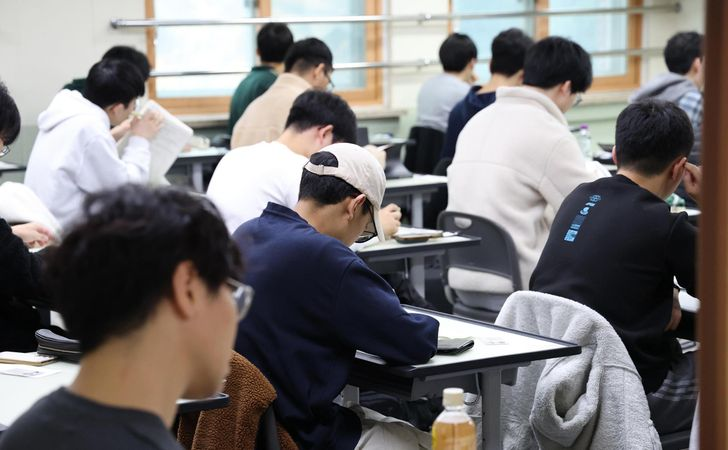
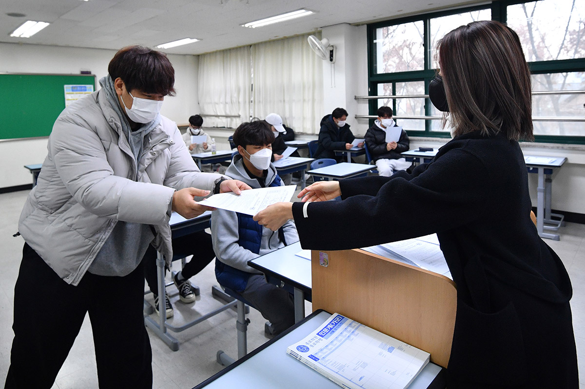
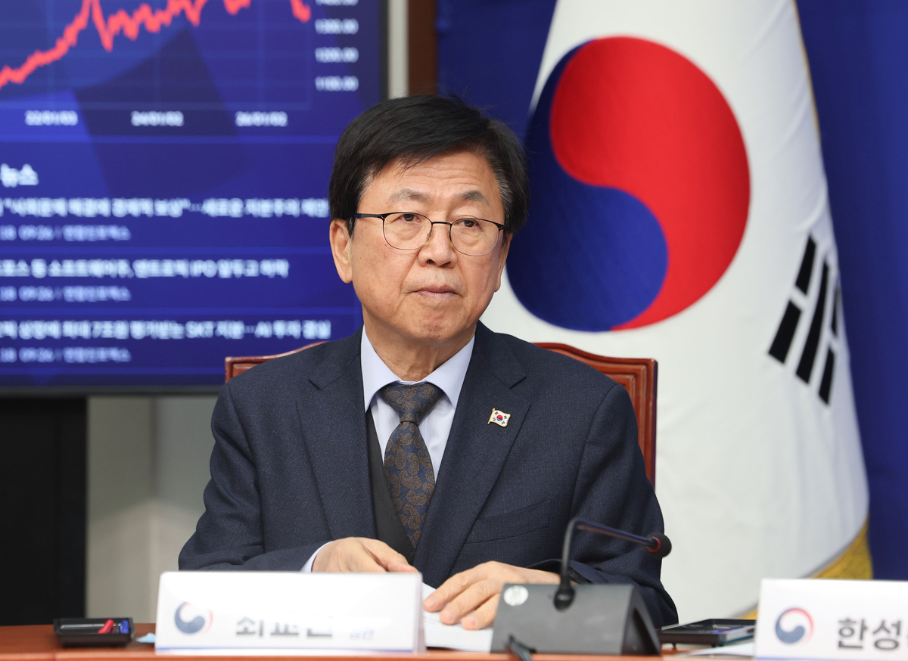
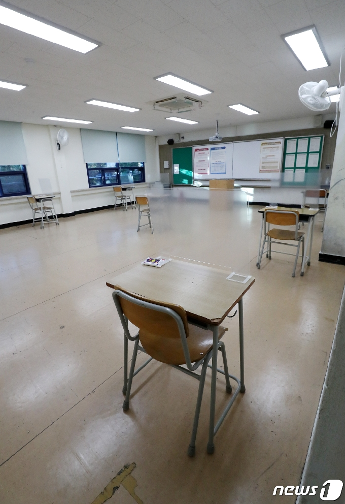

<video controls preload="metadata" style="display:block;max-width:100%;width:720px;margin:0 auto;" poster="/assets/videos/2026-11-23-korea-csat-ai-cheating-cover.jpg" src="/assets/videos/2026-11-23-korea-csat-ai-cheating.mp4"></video>
*同一件事的视频版：五十五万考生全员成了嫌疑人的七十二小时*

老话讲，正人先正己。

管考试公平这件事，不是说抓到几个作弊的就算尽责了，是说你对公平本身有没有分寸。韩国教育部这几天，把这份分寸丢在了考前 72 小时里。

11 月 15 日，韩国税务师考试曝出榜首作弊：一个考出近满分的人，自己站出来认了，用的是微型摄像头、智能手机，外加生成式 AI。距离高考，只剩 4 天。而教育部门手里那套防作弊预案，防的还是智能眼镜。

AI 都已经能替人答题了，预案还停在眼镜藏耳机的年代。接下来 72 小时的手忙脚乱，基本可以预料。

韦伯把从政者的伦理分过两种：信念伦理管「我信什么」，责任伦理管「我的决定会砸出什么后果，我接不接」。考试公平这件事，后果全砸在 55 万考生头上。坐在主管位置上的人，接不住，就别坐。这不是苛求，是这个位置的底线——公平是考试唯一的产品，产品毁了，主管部门难辞其咎。

这套预案，原本只防智能眼镜。理由不难猜：眼镜是上一代作弊工具，写进过文件，年年照抄就完事。防具已经落伍，防的思路更落伍——文件里写了什么防什么，没写的当不存在。可作弊的人不按文件来。微型摄像头小到能缝进衣服，生成式 AI 能在几秒内组织出满分答案，这两样都不在任何一份旧预案里。对手换了武器，守桥的还是长矛兵。

## 动作不算慢

先把该说的说了。这 4 天，动作真不算慢。

11 月 17 日，考前 2 天，追加 8400 人手：1800 多名智能设备检查员，6600 多名走廊监考；同时要求考生的衣服纽扣贴上标识贴纸。11 月 18 日，考前关闭考场区域的公共 Wi-Fi。11 月 19 日开考，约 55 万考生，考足 9 个小时。考完第二天就通报：查处 111 起涉电子设备违规。悬赏也挂出来了——举报奖金 1 亿韩元，约合 49 到 50 万元人民币，主动认罪、举报同伙还能从轻拿奖。

反应速度有，人手有，钱也肯出。追责这台机器，是在动的。好话，说到这里为止。

对照着看会更清楚：隔壁税务师考试那个案子，考完无人察觉，是榜首自己站出来认的。若不是他自己开口，这局公平已经丢了，丢得悄无声息。高考这边至少把 111 起违规摆上了台面，悬赏也真金白银地挂了出来——追责在动，这没得否认。

## 说到底，防的是谁

可是把这一串动作摆在一起看，方向歪了。

考前 72 小时，规矩翻了三轮：纽扣贴贴纸，防的是纽扣里藏摄像头；修正带、橡皮、自动铅笔芯临时禁带，全考场只许用黑色铅笔；监考人员考前一天才通过视频会议紧急培训，次日上岗。55 万考生，人均嫌疑人。没作弊的孩子，胸前贴着纸，兜里交出橡皮，手机在考场外跟着全国灾难警报一起响——考试当天，最高级别的灾难警报短信发了 3 次，用途是排查谁没上交手机。

灾难警报，拿来当搜身器使。

韩国教员团体总联合会的原话是：「临时抽调人员、考前一天进行培训、次日便投入监考，根本不足以使其具备识别高技术 AI 作弊行为的专业能力。」培训了一天的人被推上去搜身，真正的作弊者呢？事后通报的 111 起违规，近半数是靠那 3 次灾难短信才定位出来的。事前，一个没拦住。

再往上看，坐在最上面的人是什么状态。考前 3 天，国会上有议员问教育部长崔教振：有没有百分百的信心抓出 AI 作弊？这位 72 岁的部长当着国会回答：「I don't think I could, because of my age.」——因为我的年纪，我抓不住。

考前承认抓不住，考后交出的成绩单是 111 起违规、近半数靠灾难短信兜底。11 月 22 日，崔教振辞职，李在明大约 1 小时就接受了辞呈。辞职声明里写：「临近考试之际，考试规定发生多项变化，给包括考生在内的广大国民带来不便。作为主管部门负责人，我无法回避外界对考试准备不足的指责和批评。如今考试已经结束，我深感责任重大。」

「带来不便」。纽扣上的贴纸是「不便」，被收走的橡皮是「不便」，在考场里跟灾难警报一起响起的手机也是「不便」。李在明的定性比这重得多，11 月 20 日他在青瓦台开会，把高考作弊定成「与公职人员腐败同等严重的犯罪行为」，是「对数十万其他考生多年努力成果的盗窃」，呼吁高考制度全面改革。一边把作弊定成盗窃罪级，一边让 55 万没偷东西的人排队挨搜，这道算术，怎么算都对不上。

还有一件事，没法轻轻放下：据韩联社报道，法学院入学考试 LEET 的一名满分考生因涉作弊指控，11 月 19 日被发现死亡。警方仍在调查。

## 贴纸撕了，公平没回来

管公平的部门，考前 72 小时改了三轮规矩，改的全是规矩下的人，自己那份预案，4 天里没改过一天——凭啥呢？监考的人前一天还在视频会议里学怎么识别 AI 作弊，第二天就得对着考生搜纽扣——他们凭什么担这个责？部长自己都说因为年纪抓不住，那这 4 天手忙脚乱的大阵仗，防的到底是 AI，还是人？

不是 AI 打赢了考试，是管考试的人先乱了自己。

韦伯那句话还摆在那儿：接不住后果，就别坐在那个位置上。辞呈 1 小时批完，程序走得一点不拖。可程序再快，公平没跟着回来——贴纸撕掉了，橡皮还回去了，在那 9 个小时里被当成嫌疑人搜过一遍的孩子，没人跟他们说一句「查的不是你」。

咱把自家孩子代进去想想：孩子备考一整年，考前 3 天通知不许带橡皮，衣服上要贴纸，考试当天手机跟着全国灾难警报一起响，警报级别和台风地震一个档。你第一反应是什么？怕孩子作弊，还是怕孩子被吓着？

这事还没完。Anthropic 技术成员 Tao Lin 11 月 15 日接受采访时预测，到 2027 年底，AI 会在编程、电影制作等几乎所有领域比肩或超越顶尖人类专家。明年这个时候，考场门口要拦的东西，就不是贴纸和没收橡皮能拦住的了。到那天，管公平的人，打算拿什么接？
