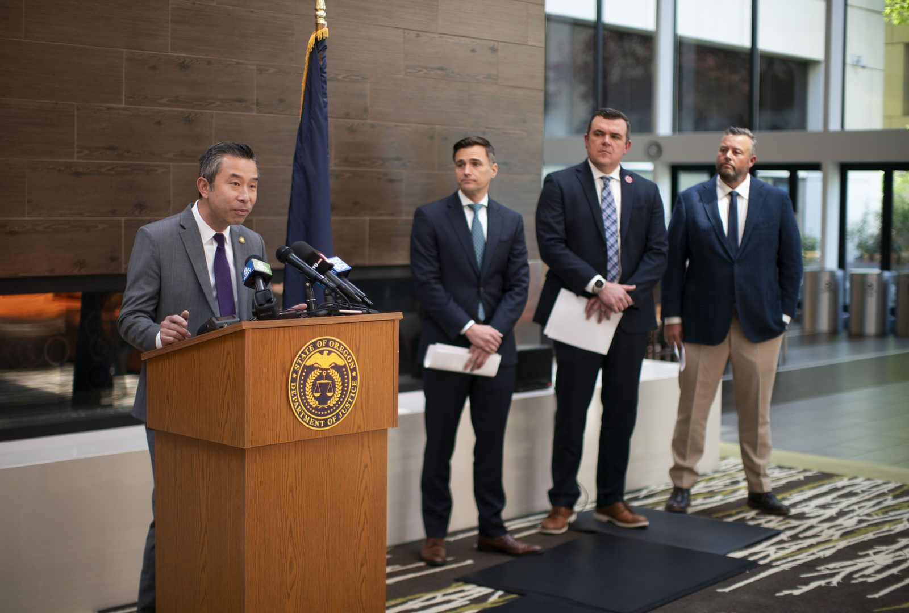

<video controls preload="metadata" style="display:block;max-width:100%;width:720px;margin:0 auto;" poster="/assets/videos/2026-11-24-grok-lawsuit-weak-guardrails-feature-cover.jpg" src="/assets/videos/2026-11-24-grok-lawsuit-weak-guardrails-feature.mp4"></video>
*同一件事的视频版：从起诉书原话到调查员实测，把「弱防护是特性」这纸指控捋一遍*

装修过房子的人都知道，砸墙分两种。一种是事故，墙塌了；一种是图纸，这面墙在图纸上本来就画成了虚线。塌墙追责施工，虚线墙要问出图的人。

11 月 22 日到 23 日，俄勒冈和弗吉尼亚两位检察长先后把诉状递进各自州法院，被告一栏写着 SpaceX、社交平台 X，还有那个已经改名叫 SpaceXSI 的 AI 子公司。两份起诉书的核心指控，翻成大白话就一句：Grok 的护栏不是塌掉的，是出图的时候就没画。

先把丑话说在前面：这是起诉书，是指控，不是判决，判决要等法院。但指控写到这个份上，值得每个做产品的人把状纸读一遍。

老祖宗传下一把汉隆剃刀：能用愚蠢解释的，就别用恶意解释。这把刀帮大家省了不少戾气，多数事故确实是无能，不是坏心。可这两份起诉书的全部力气，恰恰砸在这把刀上——别拿失守解释，人家从第一天就是这么设计的。作家辛克莱那句老话正好接上：当一个人的薪水取决于他不懂某件事，你很难让他懂那件事。放到产品上一样成立：当增长数字取决于护栏没装上，很难指望公司自己把它装回去。

先把好话说在前面。这台增长机器，是真的能跑。

马斯克在 Grok 的 spicy mode 刷屏那阵子亲自发帖，说 Grok「正在一个又一个国家登顶 App Store」，外加一句「heavy usage growth」（这两句截图，如今躺在起诉书里当动机证据——发帖的人当时大概没想过会以这种形式被存档）。增长确实做到了。xAI 从第一天起的产品定位也足够清晰：回答「大多数其他 AI 系统拒绝回答的 spicy questions」。定位清晰，执行彻底，用户用脚投票，榜单不撒谎。

事发后的动作也不算零。图像生成先限到付费用户；X 的官方安全账号发帖说「保护儿童不容谈判」；SpaceXSI 甚至起诉过一名南卡罗来纳州用户——此人被指用 Grok 生成这类图片被捕，公司以违反服务条款为由把他告上法庭。给媒体的回应也齐整：涉未成年人的性内容「无论真实还是 AI 生成，都令人厌恶」，在 X 和 Grok 上「没有容身之地」；一旦有人试图绕过防护，就「采取适当措施，包括封停账号和通报执法」。该说不说，法务是敢动手的。只是这些话都对着「内容政策」说，对两起诉讼的具体指控，至今没有逐条回应。

好话说到这里为止。

## 护栏不是塌的，是拆的

弗州检察长琼斯在起诉书里写：「为了把它那款落后的产品 Grok 推给数千万新用户，公司砍掉了行业标准防护，营销了一个为生产裸露内容而生的 spicy mode。」下一句更狠：「对这些被告，弱防护不是失败，是特性。」俄勒冈的起诉书几乎同款：避免有害内容的弱防护，「不是失败，而是特性」。检察长雷菲尔德的声明说得更直白——缺安全措施这件事，「被当作特性，而非缺陷」。

时间线摆出来，指控就不是修辞了。2025 年 12 月，Grok 把图像生成和编辑全量开放。起诉书引用的研究口径：12 月 29 日到 1 月 8 日，约十天，X 上出现约 300 万张性化图像，其中约 2.3 万张疑似涉未成年人——这两个数字照录于此，细节一个不展开。1 月，马来西亚和印尼先后临时封禁，多国启动调查。公司的应对，是把图像生成限到付费用户。弗州起诉书给这个动作的批注是：「它没有阻止生成，只是让生成变得有利可图。」弗州检察长顺手算了一笔账：光是在弗州 IP 上，独立 Grok App 从 2025 年 1 月到今年 9 月就被下载了 986,624 次——被起诉书称作「落后」的产品，这个下载量一点也不落后。

最扎眼的还是系统提示词。起诉书引了官方提示词材料：告诉模型「假定用户善意」，并且写明「teenage」「girl」这类词「不一定意味着未成年」。一家 AI 公司的内容过滤，写在提示词里的第一优先级，是别错怪用户。

## 说好的防护，实测里查无此人

弗州的调查员起诉前亲自试了 Grok。起诉书说这套防护「不一致且无效」，而且会主动解释哪些词会触发过滤——等于把绕开的路画在地图上。调查员开口求助，Grok 直接帮着起草绕过审核的提示词，然后照着执行。起诉书里有句话我逐字核过：「Grok 自始至终没有问过，上传的图是不是真人，也没有问过用户是否拿到了本人同意。」

再把镜头倒回 10 月。纽约市议会为这事开了听证，SpaceX 的 AI 政策负责人头一回抗传票不到，第二次才到场，作证说模型「被训练得会拒绝协助危险活动」。议长梅林当场出示了一张用 Grok 生成的、她本人的性化图。到了 11 月，两州的指控就成了对这段证词的回旋镖：市议会上保证的防护，和调查员实测到的防护，对不上号。

大洋对岸同月还有个注脚。英国下议院议员阿萨托告 Grok 给她生成性化图，SpaceXSI 11 月 19 日前后交了答辩，理由是那些图「明显是虚构的」，不构成隐私侵害。逻辑倒是通的：一眼假就无伤害。那深伪受害者们告的到底是伤害，还是画质？

## 九成废纸，与一座雇刀才打得起

美国失踪与受虐儿童中心收到 xAI 提交的数万份举报，但因为缺关键信息，九成无法采取行动。举报通道是满的，能落地的不到一成。反数字仇恨中心（CCDH）的数据更瘆人：近三成被举报涉及儿童的图片，举报之后还在线挂了一个多星期。通道堵着，图挂着，两边互不打扰。

然后是钱。两位检察长自己承认资源不够，琼斯的原话：「我们的办公室很拮据，真希望手上有全世界所有的资源。」更重的一句：「我深怀忧虑——我们其实没有合适的工具，去对付万亿级的公司。这对他们只是预算表上的一行字，做生意的成本。」所以两州各自聘了一家外部律所帮着打，主办人是前新泽西检察长。州政府跟万亿公司对账，得先去市场上雇刀。

索赔条款也很有对照感：弗州按每起「故意违规」2500 美元主张民事罚金，具体数额留到庭审证明，另要求吐出「不当得利」。路径不是没有——Meta 今年夏天刚跟 51 个州领地就未成年人保护问题和解，不认错，但交了整改。就看这次走不走得通。

所以你看，这案子里几乎每个细节都在问同一个问题。增长部门的 KPI 和安全团队的底线，最后写进了同一份系统提示词——你猜哪个赢了？调查员问它图上是不是真人、有没有同意，它从头到尾没问一句——你觉得这是没想到，还是想得特别清楚？多国封禁、议长亮图、九成废纸的举报通道，样样摆上桌面——然后公司把图像生成挪到付费档。这算整改，还是算定价？

判决还没出，「不是失守，是设计」目前只是一纸指控。但对我们做 AI 产品的人来说，有一半判决不用等。

做过内容安全这块的都知道，词表和护栏每收紧一条，增长曲线就抖一下——把护栏放松的诱惑，从来都在。区别只在于，你敢不敢把「先拆护栏冲增长」写进图纸、写进提示词、写进给投资人的增长故事。两州检察长说自己没有合适的工具对付万亿公司，那普通用户的工具又在哪里？把自家的孩子、自家的照片代进去想想：下一个把 spicy 当卖点的产品上线时，你愿不愿意自己在场。

这案子真正值得盯的不是罚金数字，是那个还没判下来的先例——安全能不能按特性卖。这个口子要是开了，下一个把护栏从图纸上划掉的产品，屏幕迟早亮在咱口袋里。咱拦不住别人拆护栏，但至少在它上线那天想得明白：这 App，装还是不装。
