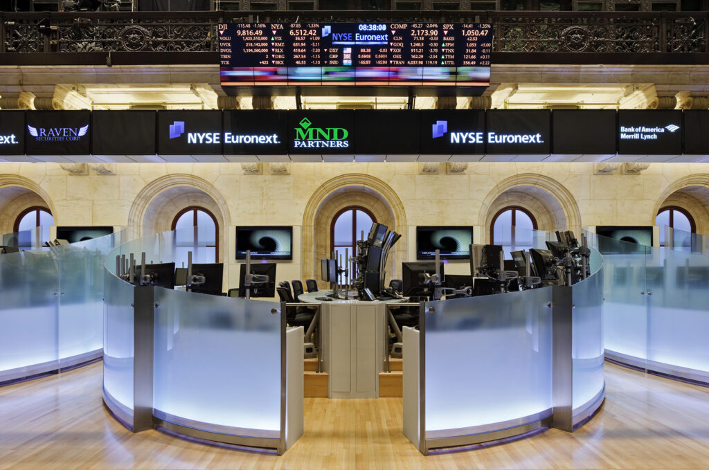
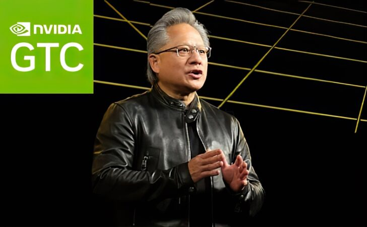
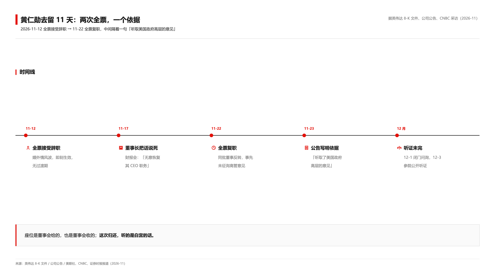
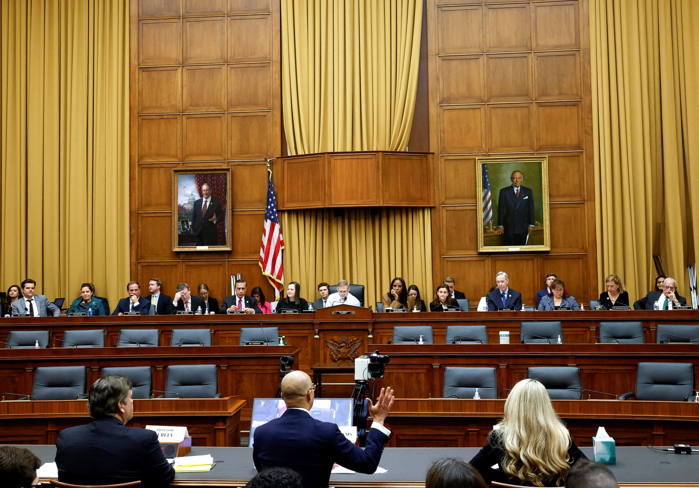

老话讲，请神容易送神难。英伟达董事会把这话反着演了一遍：送神用了调查，请神只用了六天。

2026 年 11 月 12 日，董事会全票接受黄仁勋辞去总裁、CEO 和董事职务，即刻生效。11 月 17 日，董事长哈维·琼斯在财报电话会上把话说死：董事会一致接受辞呈，无意恢复其 CEO 职务。11 月 22 日晚上，还是这十个董事，再次全票，把总裁、CEO 和董事的职务原样还给他，即刻生效，事先没征询高管意见，临时 CEO 克雷斯事先不知情。11 月 23 日公告里写着复职的依据：「在作出该决定的过程中，董事会听取了美国政府高层的意见。基于相关意见，董事会确信，黄仁勋复职不会带来国家安全风险。」

所以这事说的不是黄仁勋能不能回来。是说回来这件事由谁拍板、依据是什么、谁来担责。

## 董事会替谁看门

公司治理里有个基本概念，受托责任（fiduciary duty）：董事会是股东选出来的看门人，替几百万个不认识的人守着公司，判断要独立，后果要自己担。纽约证交所和纳斯达克的上市规则都白纸黑字要求董事会里独立董事过半数，防的就是看门人跟被看的人穿一条裤子。

约翰斯·霍普金斯商学院讲师凯瑟琳·戴研究金融危机和公司治理多年，她的评语是：「股东应该要求换一个新董事会。」她把那六天的反转称为「向压力低头，把一个损害了公司声誉的人请回来，是疯狂的」（To bow to pressure to bring someone back who has hurt the reputation of the company is crazy）。

读商学院的人背这条规则，上市公司按这条规则挂牌。英伟达市值三万多亿美元，独立董事过半数，治理结构齐全。而这家公司的董事会，把「听取了美国政府高层的意见」写进了任免 CEO 依据。

## 该说不说，这次抬得真诚

黄仁勋 1993 年创立英伟达，33 年把它从一家显卡公司做成三万多亿美元的算力巨头，AI 芯片市占率一度九成。这话不是恭维，是资产负债表。

他辞得也体面。婚外情风波曝出来，他没有恋栈，宣布辞职即刻生效，公开声明里说自己「未能达到公司对每个人的期望标准」，「完全承担自己犯下的错误，并承诺全力配合董事会的独立调查」。员工发起「与黄仁勋站在一起」联署，几天收了超过 19 万个签名。据美联社报道，辞职后八个交易日，英伟达股价从 174 美元跌到 126 美元附近，市值蒸发约 1.2 万亿美元。复职后的全员大会上，他承认违反了公司行为准则，说每天接受一个半小时心理治疗，承诺第二次会做得更好。

单看这个人，单看这份担当，值得一句敬语。问题不出在他身上。

## 可这回来，不是董事会想明白了

第一个裂缝，对谁负责。11 月 17 日还说「无意恢复」的董事长，11 月 23 日亲手签发公告说「黄仁勋是领导英伟达的合适人选」。六天，同一个人，同一批董事，两边都全票。变的不是事实——调查一件都没结束——变的是来传话的人。特朗普事后接受 CNBC 近一小时采访，把账算得明明白白：「我和他们谈过，我说服了他们，这事是我谈成的。」副总统万斯出面斡旋，司法部长布兰奇提供评估，白宫通讯主任对媒体补了一句：「我们要保护我们的天才。」

第二个裂缝，决策依据。上市公司任免 CEO，依据该是调查结论、事实认定、程序正义。英伟达公告里的依据是「听取了美国政府高层的意见」——哪家机构、哪些官员、基于什么材料，公告一个字没写。参议员沃伦要的就是这个：政府到底给了什么「意见」，由哪些高层官员给出。到现在没人答。特拉华大学政治学教授金德曼的评价更直接：总统「实质上告诉董事会该做什么」，独立董事会这回事「就没影了」，「这真是权贵资本主义的标志」。

第三个裂缝，谁在获益。复职当天英伟达股价收于 165.05 美元，单日回补近一万亿美元市值。据英国金融时报估算，特朗普名下持有最多 37 万股英伟达，仅复职当日账面获利就在 130 万至 1500 万美元之间。而特朗普在采访里说漏的那句更妙：「当公司股价下跌 40% 甚至 50% 时，他们就会发现，这份工作好像也没那么好干了。」加州总检察长邦塔的传票已经送到——查芯片是否流向中国、查是否误导投资者——理论上，这些调查本来该是董事会说「不」的依据。现在调查还在，座位先还了。穆迪一周前把英伟达的评级展望调整为「稳定」，理由里写的就是治理层面的担忧，那间屋子。

最刺人的是版本对撞。特朗普说「我说服了他们」，黄仁勋在员工大会上说这种说法「完全虚假」，称董事会「全面评估了整件事」。两个当事人，两个版本，必有一假。哪一个是假的，董事会没有说，公告里也不写。反正 12 月 1 日黄仁勋要去众议院情报、外交和中国特选委闭门问询，12 月 3 日参议院银行委员会公开听证，沃伦带着五名参议员的联名问题等着问：总统为什么以这种非同寻常的方式干预，是否无视了严肃的反情报顾虑，这种干预是为了谁的利益。到那时总得有一个版本是真的。

一边是「全票接受辞职、无意恢复」的独立董事会，一边是「听取美国政府高层意见」后「全票复职」的同一家董事会。一边是「保护我们的天才」，一边是没人说得清的国安保证。一边是没走完的调查，一边是即刻生效的官复原职。

凭什么呢？凭 33 年的功劳，功劳可以抵调查吗？凭股价涨回来了，股价是治理能力的证据吗？凭总统说了「没有国安风险」，总统是调查机关还是担保人？

说到底，董事会这两次全票，投的都不是黄仁勋。第一次投的是「我们不能有污点」，第二次投的是「我们不能没他」。缺的那一票，从头到尾是「这事该按程序办」。

这事不难看清：座位是董事会给的，也是董事会收的，这次归还，签的是董事会的名字，听的是白宫的话，担责的没人。

咱手里那点英伟达，多半还是在养老金和指数基金里躺着。咱管不了华盛顿谁打电话给谁，但下次你司开股东大会，投票选董事的时候，可以想想这一出：哪天你的董事会也「听取上级意见」了，你的名字可不在那份公告里。
