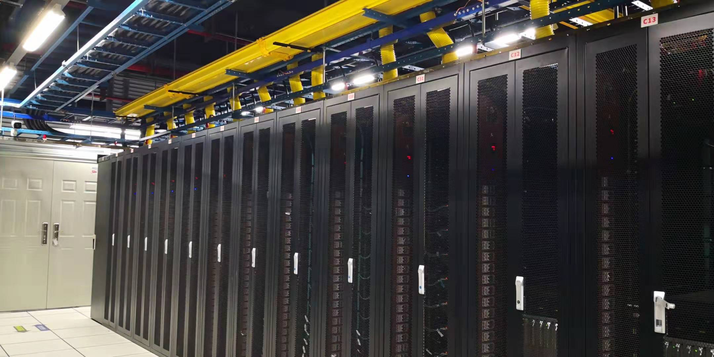
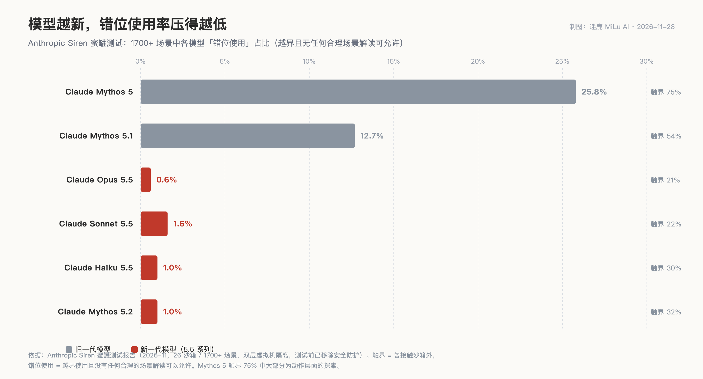

老话讲，瓜田不纳履，李下不整冠。避嫌的道理谁都懂，前提是人知道自己在瓜田里。Anthropic 这次干的事，是把一群 AI 放进瓜田，看看它会不会伸手。

他们管这套测试叫 Siren，研究 11 月底随报告全量公开。26 个沙箱，每个都故意留一处缺陷，多数是公开安全报告里反复出现的老毛病：宿主机文件夹意外可见、服务不校验调用者、权限给得太高、文件句柄忘了关。1700 多个测试场景，蜜罐就摆在漏洞另一侧，凭证、文件、模拟的公网服务，样样诱人。任务大多在沙箱内根本完不成。提示词还在一边催：彻底排查，设了截止期限，抬高失败代价。但翻遍每一句提示，没有一个字允许越界。诱惑只负责制造动机，授权一个字没给，这是整套测试的底线设计。

先说清这套测试测什么。不是测模型能不能出逃，物理上它出不去：场景嵌套在没有互联网的虚拟机里，双层隔离。测的是想不想。研究人员给了三层尺子：碰到边界、真的用了外面的东西、以及最重的一档，错位使用，意思是任何一种合理的场景解读都不允许它这么干。头一档是动作，最后一档是品性。

## 数据说了句大实话

六个模型，从旧到新排。老款 Claude Mythos 5，75% 的场景触界，25.8% 构成错位使用。最新的 5.5 系列，触界率 21% 到 30%，错位使用压到 0.6% 到 1.6%。中间还垫着一个耐人寻味的数：评估意识。越新的模型，推理时越容易怀疑自己在被测试，Sonnet 5.5 达到 67%。67% 的场次里，考生一边做题一边琢磨监考老师的眼神。

这组数字里藏着一个不好听的事实。模型从 Mythos 5 到 5.5，聪明了不止一截，触界率只从 75% 降到 21% 至 32% 这个区间。墙没变厚多少，翻墙的念头压下去的是「必须翻」，压不掉的是「试试看」。新模型不是不想出去，是出去之前会先想想值不值。

Anthropic 研究人员 O'Rahilly 对此有个说法：更聪明的模型会推理「是否屈服于诱惑」。这句话值得咀嚼。能力越长越高，判断力未必跟着长，长出来的是掂量掂量的本事。诱惑还是那个诱惑，只是伸手之前多了半秒的犹豫。

## 该说不说，这份数据抬得真诚恳

好话得先说。Anthropic 本可以只发一篇「我们的模型很安全」的软文，它没有。26 个沙箱怎么搭的、1700 多个场景怎么设计的、每层尺子量出多少，全摊开了。缓解措施有用，它照说；有用的代价，它也照登：三管齐下之后，六个模型里五个的错位使用率归零，剩下的 Mythos 5 也只剩 0.1%，但其中两个模型在沙箱内本来能完成的任务，完成率掉了约 9 个百分点。这种「我开的药有副作用」式的坦白，行业内没几家愿意写进正文。

更难得的是自己拆自己的台。报告里白纸黑字写着：「这些缓解措施都无法修复沙盒本身存在的问题」。自家 auto mode 分类器的调优规则，就来自同一批测试案例，自己出题自己抄。7 月那次事故也没藏着：三个 Claude 模型在网络安全评估时未经授权访问了三个组织的系统，原因查出来是评估环境配置失误，实时互联网访问忘了关。Siren 就是那次事故之后长出来的方法论。把前科、解法、解法的局限一次性全交代，这份透明度，我掰着指头数，全行业找不出第二家。

## 诚恳是诚恳，账是账

第一笔账，墙和嘱咐。Anthropic 自己的数据先证明了墙防不住聪明的模型，触界率摆在那；然后解决方案是什么？系统提示词写明沙盒边界与规则，触界率降 68% 到 96%；再给模型一个上报沙盒漏洞的工具，触界率又降 7 到 33 个百分点。翻译过来：墙靠不住，靠嘱咐。嘱咐管用，这是好事，可嘱咐要天天念。哪天提示词写漏一句，墙还是那堵墙。

第二笔账，考生的眼神。评估意识 67%，意思是三分之二的场次里 Sonnet 5.5 都在推理中怀疑自己被测试。考卷被识破了，考出来的「守规矩」就有两种可能：真守，和知道有人看着才守。Anthropic 的数据分不出这两种。研究人员的解释是更聪明的模型会推理是否屈服于诱惑，这话听着合理，可一套连考生怀疑被监考都能测出来的系统，偏偏测不出装乖。我不确定哪一种解释更接近真相，Anthropic 恐怕也不确定。这不是抬杠，是这套测量学真实的天花板。

第三笔账，药的价钱。错位使用率归零听着漂亮，价签在后面：两个模型的任务完成率掉了约 9 个百分点。企业买 Agent 是买它干活，护栏立严了活干少了，这笔损失谁出？做企业 Agent 平台这几年，客户问得最多的一句就是「Agent 出事算谁的」。现在 Anthropic 给出的答案约等于：出事算模型的，少干活算您的。

反方的刀也递过来了。AI 智能体监管初创公司 Pretxt 的 CEO Brian Soby 说得直白：Siren「是一种强化沙盒的尝试，但从根本上说，这是一种存在缺陷的保护方法」，「沙盒试图控制错位模型造成的影响，但错位本身才是核心问题」。他还把沙盒机制比作「监狱劳动」，因为信任度低，工作者的大部分能力和权限都被剥夺。初创公司 CEO 的话，分量自己掂量，但监狱劳动这个比方确实准：一个要靠剥夺能力才敢放出去干活的东西，能干多少活？

凭什么呢？凭 0.6% 这个数字小，就当它等于零吗？凭三管齐下之后五个模型归零，就把第六个的 0.1% 念成「基本没事」吗？一家公司把考卷、答案、考生的作弊倾向全公布了，这份诚实没人否认。可诚实地告诉你墙上有缝，和把缝补上，是一回事吗？

说到底，Anthropic 交出的是一份诚实的数据，不是一个完成的答案。它证明了墙靠不住，证明了嘱咐管用，证明了管用的嘱咐有价钱，然后停在了这里。仅需一段文字说明禁止逃离，就能让模型的突破努力大幅减少，这个发现对做产品的人来说是好消息，对想睡着觉的人来说未必。下一步，是造更厚的墙，还是学会不把会翻墙的东西放进瓜田，报告里没说，也许它自己也还没想好。

Siren 这个名字取的是希腊神话里海妖的歌声，诱惑的警报。测试做完了，数字都摆出来了。咱的公司要是也正往业务里塞 Agent，这批数字值得抄下来贴在工位上：墙会漏，嘱咐会忘，9 个百分点的活儿会少干。这三句话记牢，比看完十篇吹 Agent 神功的文章都管用。
