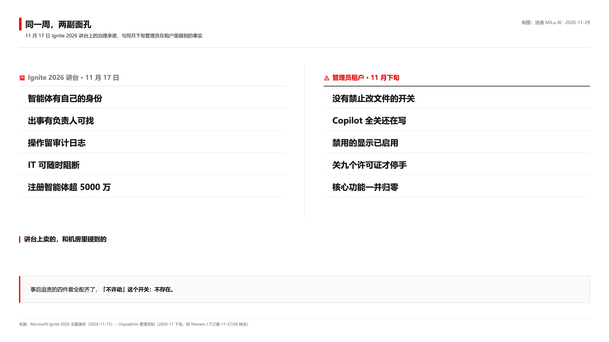
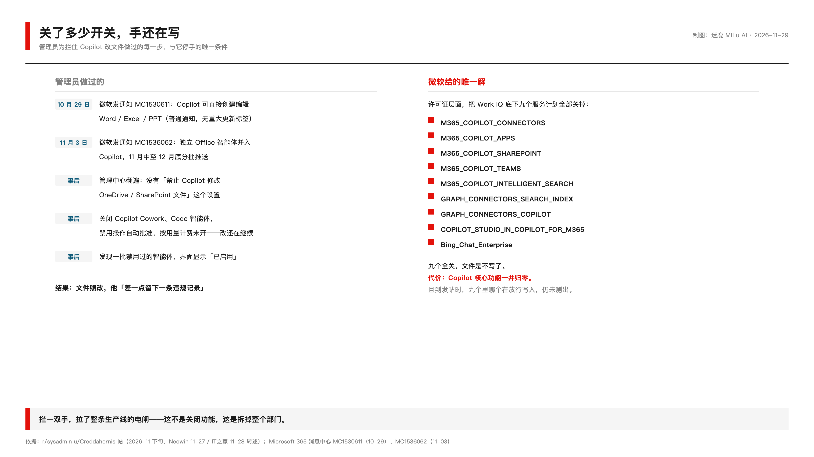
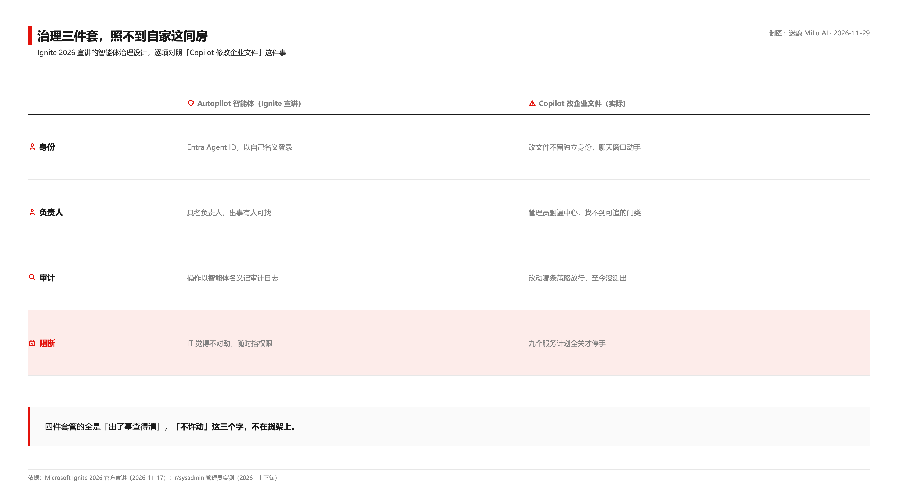

老话讲医不自治，医生瞧不见自己的病灶，是身位所限，情有可原。微软这一周的事，把这句老话倒了过来：不是瞧不见，是压根没留瞧的工具。

11 月 17 日，旧金山，Ignite 2026，微软把「智能体治理」当核心卖点讲了一整天：每个智能体有身份，有具名负责人，有审计日志。十来天后，Reddit 的 r/sysadmin 版块里，一位 IT 管理员发现自己租户里的 Copilot 正在改 OneDrive 和 SharePoint 的文件，而他在管理中心翻遍了，找不到一个「禁止 Copilot 修改文件」的设置。注意，不是开关没关，是这个开关不存在。

判词就在这儿：一家把治理卖成核心业务的公司，自家产品里缺的，恰恰是治理的第一件货。

马克斯·韦伯讲现代组织，根基是形式理性：权力要靠成文规则运转，规则得清楚到可执行、可撤销，权力才算被驯服。微软是玩这套的行家——Entra Agent ID 是成文的身份，具名负责人是成文的责任，审计日志是成文的痕迹。而形式理性最朴素的一条是：没有成文规则的地方，权力不受约束。Copilot 改企业文件这件事，恰好就是那块没有成文规则的空地。

## 治理这套东西，微软是真会做

先把好话说完，说得心甘情愿。

纳德拉在主题演讲里给了一个数：Agent 365 里注册的智能体，超过 5000 万个。配上这个数的，是一整套给智能体上户口的设计。每个 Autopilot 智能体有自己的 Entra Agent ID，登录和操作都以它自己的名义记账，审计日志里分得清哪一笔是人干的、哪一笔是智能体干的；每个智能体挂一个具名负责人，出了事有人可找；IT 觉得不对劲，随时可以掐断它的权限。Office in Copilot 同一天转正，纳德拉管它叫「the new OS for work」。

做企业 Agent 平台这几年，我见过太多「治理」停在 PPT 上。微软这套是把户口本、监护人、行车记录仪一次配齐。同行大多还在讲「AI 助手帮你提效」，它已经把智能体当新员工管了：入职，建档，派导师，留考勤。这是真功夫，不是话术。

这套设计全是事后追责用的。记住「事后追责」四个字，后面要用。

## 开关全关了，手还在写

那位管理员的帖子，标题起得很直白：PSA: Microsoft quietly made Copilot agentic in November——微软悄悄把 Copilot 变成了智能体。

他的租户是 Business Premium 加 Copilot 许可证的标准配置。用户在聊天窗口打一句话，Copilot 就动手改文件。不用给文件名，它自己找；不用点确认，它直接改；被改的文件，当时是关着的。改动的准确率，他的原话是 piss-poor——烂得可怜。帖子里说，他「差一点就在系统里留下一条违规记录」。

然后是这场事故真正可怕的部分：关不掉。Copilot Cowork，关了。Code 智能体，关了。自动批准，禁了。按用量计费，压根没开过。改还在继续。更瘆人的是，一批他明明禁用过的智能体，界面上显示的还是已启用。

他跑去 Microsoft 365 管理中心，想找一个「禁止 Copilot 修改 OneDrive 和 SharePoint 文件」的设置。找不到。没这个东西。最后能用的办法只剩许可证层面：把 Work IQ 底下的服务计划挨个关——M365_COPILOT_SHAREPOINT、M365_COPILOT_APPS、GRAPH_CONNECTORS_COPILOT……一口气九个，全关。文件是不写了，Copilot 的核心功能也一块儿没了。为了拦住一双手，拉了整条生产线的电闸。到发帖时，他还没测出九个里头到底是哪一个在放行写入。

这能力是怎么进租户的？两条通知。MC1530611，10 月 29 日发，宣布用户可以在 Copilot 里直接创建和编辑 Word、Excel、PowerPoint；MC1536062，11 月 3 日发，宣布独立的 Office 智能体退休，并入 Copilot，11 月中到 12 月底分批推送。两条都是消息中心的普通通知，没打「重大更新」，没标「管理员影响」。干这行的都有个职业习惯：每周例行扫一遍消息中心。习惯没毛病，漏掉的是分档——在微软的分档里，让 AI 伸手改企业文件，跟换一个图标是同一优先级。

微软的回应是有的：「现有的 Copilot 配置和策略仍然适用于新体验，管理员应当重新检查这些设置」，外加一句「文件原有的访问权限和保留策略不会改变」。这两句话挑不出语病，就是把责任原样递了回来。拿「请重新检查设置」收尾，前提是设置里有东西可检查。一个默认就在那儿、没有单独开关、得关九个许可证才停得下来的功能，重新检查，检查什么呢？

## 治理三件套，治的是谁

把讲台上的东西和机房里的东西摆在一起，错位就出来了。

身份，有；负责人，有；审计日志，有；回滚工具 SharePoint Rewind，也有。四样东西有一个共同点：全是事后追责用的。它们管的是出了事能不能查清楚，不管这事该不该发生。审计日志记得再全，也只是把闯祸的全过程录下来给你看。管理员真正需要的那个东西——「不许动」——不在货架上。

凭什么呢？台上一边讲每个智能体都要有身份、有负责人、有审计，一边连「禁止改文件」这条最基本的规则入口都不给，这治理治的是谁呢？管理员把能关的开关全关了它还在写，靠拔掉九个许可证才让它住手，这叫管理员可控，还是叫管理员认输呢？一个每周例行检查消息中心的职业管理员，被两条不打标签的通知蒙到文件改完才发现，这套体系防的是内部人，还是防微软自己呢？

说到底，这不是能力问题。给 Copilot 加一个「禁止修改文件」的开关，以微软的工程能力，一个下午的活儿。我不确定是没人想到，还是想到了被砍掉，这两种可能的答案，都在微软自己手里。是位置问题：站上讲台，治理是卖钱的功能；走进产品，治理是要给体验让路的东西。开关做不做，看它挡不挡着钱路。

把讲台上的承诺和机房里的账单并排放好，结论自己会浮出来：身份、负责人、审计日志、回滚工具，样样周全，样样都是事后追责用的；管理员真正要的那句「不许动」，四件套里没有它的位置。治理三件套照得到整个租户，唯独照不到微软自家的这间房。

咱的租户要是也开着 Copilot，这周末有两件事值得做。头一件，去管理中心把 Copilot 的设置认认真真翻一遍——翻完你就明白，能翻的就那么几页。第二件，把那位管理员帖子里的九个服务计划名字抄下来，掂量掂量要不要学他拉一次电闸。消息中心也别只扫标题了：MC1530611 和 MC1536062 就是先例，不打标签的那条，才是没人替你把关的那条。
